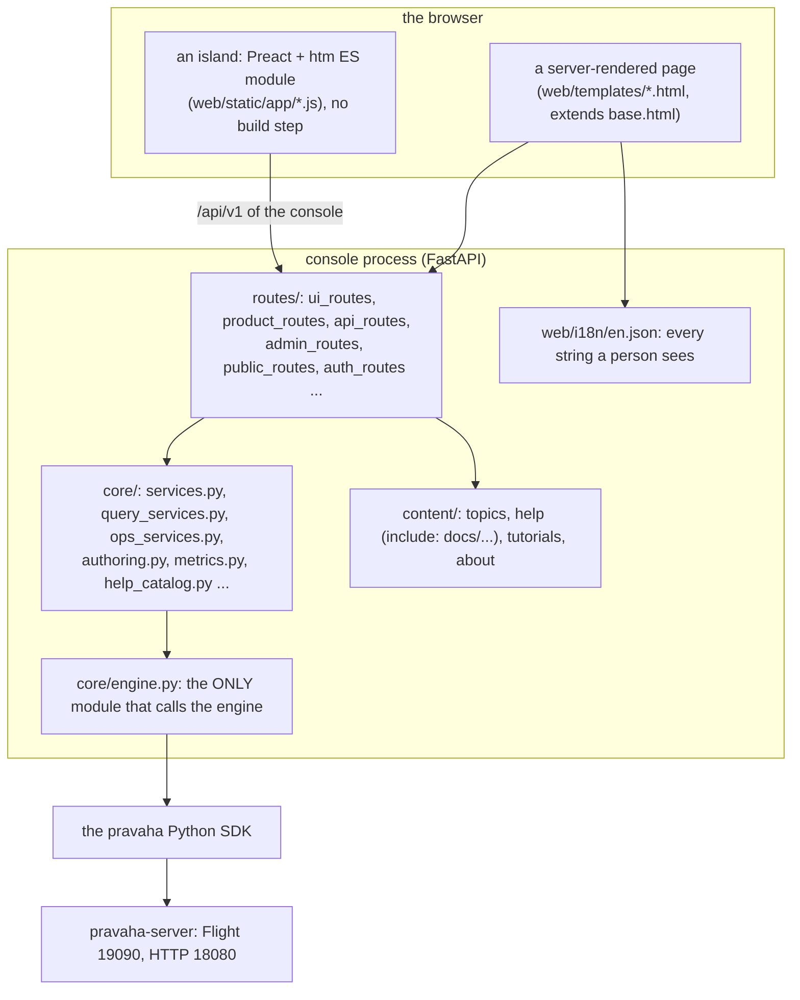
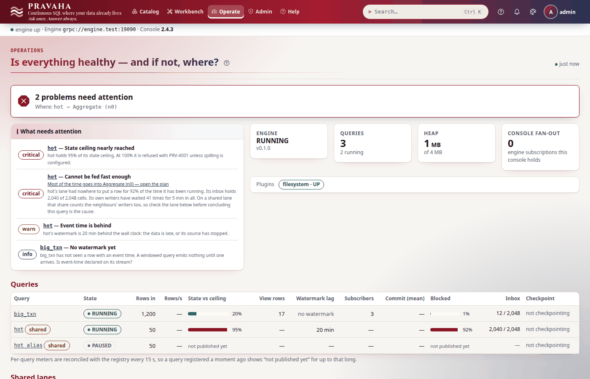

# Console developer guide

Copyright © 2026 Ashutosh Sinha \<ajsinha@gmail.com\>. All rights reserved.
**Proprietary and confidential** — see [`../../../LICENSE`](../../../LICENSE).

How to change the console: add or change a screen, add an engine call, add a help topic, and test all of
it. **The console's own [`README.md`](../../../pravaha-console/README.md) is the canonical description** of its
layout, its design rules (drishti's), its vendored libraries, its help system and its test tiers; this guide is
the task-by-task path through it and does not repeat it. Running it from PyCharm is
[`RUNNING_IN_INTELLIJ_AND_PYCHARM.md`](../setup/RUNNING_IN_INTELLIJ_AND_PYCHARM.md#the-console-in-pycharm); where it sits in the system
is [clients and console](../../design/architecture/clients-and-console.md#the-console). Conventions:
[`CONTRIBUTING.md`](CONTRIBUTING.md).



Each layer knows only the one below it: a template does not know the SDK exists, a service does not know a
browser does, an island knows only the console's own `/api/v1`.



*The operations screen as the browser tests see it: the real application and real Chrome, over
`tests/fake_engine.py`.*

---

## 1. Running it

```bash
cd pravaha-console
make install                 # .venv, the Python SDK and the console
make run                     # http://localhost:17070 (every interface), engine at grpc://localhost:19090 and http://localhost:18080
python run_pravaha_web.py --server.port=8099 --engine.url=grpc://staging:19090 --engine.http_url=http://staging:18080
```

Three ports: the console on **17070**, the engine's Flight on **19090**, its HTTP on **18080** — the console
uses both engine ports.

**Code that is not the console's: `external_lib/python/`.** At start the console puts
`<external_lib>/python` first on `sys.path` and logs the folder it added
([ADR-064](../../design/adr/064-configuration-folders-and-node-layout.md)), before anything imports an
optional extension -- so a deployment's own module there imports without being installed. The root is
`paths.external_lib`, then `PRAVAHA_EXTERNAL_LIB`, then `$PRAVAHA_HOME/external_lib`, then the checkout's
`external_lib/` beside `pravaha-console/` (`core/external_lib.py`). The `pravaha` CLI does the same at
its start, defaulting to `./external_lib`. Code there runs with the console's privileges; review it as
you would the console's own.

## 2. Adding an engine call

1. The engine and the SDK first: the console may only do what the public SDK does
   ([client developer guide](CLIENT_DEVELOPMENT.md#3-adding-a-call-step-by-step)).
2. `core/engine.py`: one method over the SDK — `with self._client() as client: client.x(...)` for Flight,
   `EngineApi` for HTTP. Nothing else in the console imports `pravaha`.
3. A service in `core/` with the rules a page needs (who may, what a refusal means, a `ServiceError` with
   the engine's code and an HTTP status), no HTTP and no HTML.
4. The same method on `tests/fake_engine.py`, so the product and browser tests can drive it.

The real example is the query lifecycle: `routes/api_routes.py` `POST /api/v1/queries/{name}/{action}` →
`core/query_services.py` `act(name, action)` → `core/engine.py` `lifecycle(action, name)` →
`client.pause(name)`, traced in full in the client guide.

## 3. Adding or changing a screen

| Step | Where | Rule |
|---|---|---|
| Route | the matching module in `routes/` | Gate it: reading anything registered requires a session; a mutating route requires the role; return through the page renderer in `routes/base.py` |
| Template | `web/templates/<screen>.html`, extending `base.html` | Every state a screen can be in is drawn — the eight states of design §23.12, whose macros are in `_states.html`, and which `test_browser_states.py` photographs screen by screen |
| Island (if interactive) | `web/static/app/<screen>.js`, registered in `base.html`'s import map | Preact + `htm`, no JSX, no bundler, no CDN: anything new is vendored under `web/static/vendor/` with its licence and a row in `THIRD-PARTY-NOTICES.md` |
| Strings | `web/i18n/en.json`, `t('key')` in templates and islands | `tests/i18n_scan.py` finds English that bypasses the catalogue |
| Help | `core/help_catalog.py` `SCREEN_HELP["<screen>"]`, and `helplink('<screen>')` beside the heading | At most `SCREEN_CARDS` (3) topics; every topic and `#section` must exist; every screen a template names must have help and vice versa (`test_help.py`) |
| About this page | `core/page_help.py` (`TEMPLATES`, `TILES`) and `page.<screen>.*` in `web/i18n/en.json` | Every page ends with one, drawn by `base.html` — see [below](#about-this-page); `test_page_help.py` walks every page route and fails on a page without one |
| Security headers | `routes/security_headers.py` | No inline script: the Content-Security-Policy refuses it, and the browser tests fail on any CSP violation |
| Screenshot baselines | `tests/browser_harness.py` `PAGES` | A new page joins the visual, accessibility and state tests by being listed here |

### About this page

Every page ends with **About this page**, MAYA's panel: a one-line summary of what the page is for, two
to four tiles (what you can do there, the idea that makes sense of it, the thing people trip on) and
**More in Help** — the screen's `SCREEN_HELP` topics. It is drawn once, by `base.html`
(`_page_help.html`), open by default and collapsible; closed once, it stays closed on that browser; the
**?** in the top bar jumps to it. A page does not ask for it: `Routes.page()` resolves the template it
renders to a screen. To give a new page its panel:

1. `core/page_help.py`: add the template to `TEMPLATES` (`"<template>.html": "<screen>"`) and the screen's
   tile icons to `TILES` — two to four Bootstrap Icons names, one per tile.
2. `web/i18n/en.json`, under `page`: `<screen>.what` (one line) and `<screen>.points.<n>.heading` / `.text`
   for each tile, numbered from 1. Short — the topics are the full account; link, don't repeat.
3. `core/help_catalog.py`: the screen's topics in `SCREEN_HELP`, which become **More in Help**.

`tests/test_page_help.py` walks every GET page route (a route with a parameter needs a real object in its
`SAMPLES`) and fails on a page without exactly one panel, a template with no screen, a screen with no
words or tiles, and words for a screen no page shows. Help's own pages are exempt (`EXEMPT`): each topic
already ends with its own footer, and a second would say the same thing twice.

### Themes

The console wears drishti's seven themes, under drishti's ids: **Terminal** (`terminal`, navy and amber), **Parchment** (`light`), **Blue** (`blue`), **Wall Street** (`wallstreet`, Bloomberg black and amber), **Green** (`green`), **Crimson** (`crimson`, Pravaha's brand and the default) and **Crimson dark** (`crimson-dark`).
`web/static/css/tokens.css` is the only place a colour is defined — a stylesheet, template or script
that states a hex colour fails `tests/test_contrast.py` (the brand SVGs and the theme menu's swatches,
which live in `tokens.css`, are the exceptions). Use a token: drishti's `--d-*` names (`--d-accent`,
`--d-ink`, `--d-muted`, `--d-link`, `--d-surface`, …) or the console's role aliases (`--pv-crimson` is
the accent, `--flow` and `--muted` in the product stylesheets). Gradients belong on the chrome only
(`gradients.css`): the page wash, the bar, panel headers, big titles, accent buttons — never a table,
a panel body or a number.

To add a theme:

1. Add a `:root[data-theme="<id>"]` block to `tokens.css` declaring **every** token the Crimson block
   declares (the test fails on a missing one), including the band stops `--d-nav-from/via/to`,
   `--pv-heading`, `--pv-retract` and the eight `--pv-series-*`.
2. Add `.swatch-<id>` beside the other swatches in `tokens.css`, and the id to `THEMES` in
   `static/js/theme.js` and `static/js/theme-init.js` (and `DARK` in both if its ground is dark), to
   the list in `_theme_menu.html`, and its name to `shell.themes` in `web/i18n/en.json`.
3. If its bar is a coloured band rather than glass, add it to the `:root:is(...)` selectors in
   `nav.css` and `gradients.css`; set its gradient strengths (`--g-*`) in `gradients.css`.
4. Add it to `THEMES` in `tests/test_contrast.py` and `tests/browser_harness.py`, run
   `test_contrast.py` until it passes, then take its baselines with `PRAVAHA_UPDATE_BASELINES=1` and
   look at them.

### Mobile

Every page must work on a phone. `tests/test_browser_mobile.py` loads every page in `PAGES` (plus the
menu-only screens in its `EXTRA_PAGES`, and the public pages signed out) at 360×740 and 390×844 and
fails on: a page that scrolls sideways, an element wider than the viewport outside a scroll box (named in
the message), a tap target under 40×40 CSS px, text under 12px (code 11px), a text field under 16px (iOS
zooms on focus), and a collapsed menu whose entries cannot all be reached by tap.

- **Tables** sit in `.table-responsive` and scroll inside it: on a phone the first column (the name) is
  sticky, a shadow at the right edge shows there is more, and a long SQL cell is one line with an ellipsis
  and its full text as `title` — never one word per line. Don't stack rows into cards.
- **Tap targets**: 40×40 for every visible `a`, `button`, `input`, `select`, `textarea`, `summary` and
  `[role=button]`; a checkbox or radio counts with its label. A link that is `display: inline` inside
  running text (its block has at least three letters that are not a control) is exempt, as WCAG 2.5.8
  exempts it. Anything else excused goes in the test's `TARGET_ALLOWED`, with the reason.
- **The rules** live in `web/static/app/mobile.css`, linked last from `base.html`, by pattern and under
  `@media (max-width: 767.98px)` (the collapsed bar's under 991.98px), so the wide layout does not move.
  A new screen built from the shared classes needs nothing; fix a failure there, not on the page.

## 4. Adding a help topic

Topics are task-sized pages in `content/topics/<slug>.md`; nothing lists them by name, so adding one is
adding a file. The front matter of `content/topics/lanes.md`, as it is:

```yaml
---
title: Lanes — sizing them, sharing them, and giving a query its own
slug: lanes
category: operating
order: 20
icon: cpu
summary: "What a registered query costs on its lane and the pravaha.lane.* settings that size it; how lanes are shared (auto from 64 queries), how one query keeps a lane of its own, and how an administrator rebalances by hand."
audience: Operators
keywords: [lane, inbox, arena, batch-size, wait-strategy, ...]
guide: operations#sizing-a-node-for-many-queries
related: [state-spill, observability, reading-a-plan, sharing, backfill-cutover]
---
```

`category` is one of the topic **sections** of `config/help.yaml`; `icon` a name the vendored Bootstrap
Icons font has; `guide` the long-form guide (a `content/help` slug, optionally `#anchor`) behind the
footer's *Full reference* link (a section names the default one); `kind` the badge on its card —
`guide` when left out, `tutorial` or `reference` otherwise.

### The catalogue: `config/help.yaml`

The help centre is drishti's design and is drawn from one catalogue, `pravaha-console/config/help.yaml`
(read by `core/help_catalog.py`, whose public API — `CATEGORIES`, `SCREEN_HELP`, `MOVED`, `HelpCatalog` —
the templates and tests use):

- **`categories:`** — Start, Use, Build, Operate, AI, in display order. Each has an `id`, a `name`, an
  `icon`, a `blurb`, its topic **`sections`** (`{id, guide}`: the values a topic's `category:` may take,
  in the order its cards appear, and each one's default *Full reference*) and the **`guides`** it offers
  as cards after its topics — `{guide: <slug>}` for a long-form guide, `{href: <path>}` for any other page,
  each with `title`, `icon`, `summary`, optional `keywords` and a `kind` (`tutorial`, `reference`, `guide`,
  `examples`). A **new category** is an entry here and at least one section a topic names; a **new guide**
  is a `content/help/<nn>-<slug>.md` with `include: docs/<path>.md` and, to give it a card, a line in
  a category's `guides:` (otherwise it is listed under Help · Guides only).
- **`moved:`** — a topic that was merged or renamed: `old-slug: new-slug` or `new-slug#section`.
  `/help/topics/<old>` answers **301** there; `test_help.py` holds that every target exists and that no
  help page still links to an old address. Rename a topic by moving its file *and* adding the line.
- **`contextual:`** — each screen's help, most relevant first, at most three: the "About this page"
  panel's *More in Help*, the `?` beside a heading, and — the first — where **F1** goes
  (`/help/context/<screen>`, `static/js/help-keys.js`; `?` opens the About panel, `theme.js`). A new page
  adds its screen here and in `core/page_help.py`.

**Examples.** The gallery at `/help/examples` is drishti's: each example is three files in
`content/examples/` — `<name>.sql` (statements; a `-- sql: read` line marks a read of a view),
`<name>.json` (`{"streams": {"<stream>": [rows]}}`, the columns of `streams.properties`; a `weight` of
`1`/`-1` for a changelog) and `<name>.md` (the note, its `# ` line the title). *Open as a copy in the
Workbench* is `/workbench?example=<name>` — the editor prefilled, nothing registered. `pravaha-it`'s
`HelpExamplesSqlTest` plans every statement (a `CREATE ALERT` must follow a view the file creates, on
columns it has) and `tests/test_help_catalogue.py` holds the data to the streams; an example that stops
planning fails the build. Rendered documents get drishti's help language from `core/content/renderer.py`:
a fenced block is a captioned figure with a *Copy* button (its caption the block's first comment line),
and `!!! tip | warning | note` is a box.

The rules `test_help.py` and `test_help_accuracy.py` enforce, so a topic cannot drift from the engine:

- every `PRV-nnnn` is a code the engine declares, and links to its page;
- every `pravaha.*` setting exists, and every default a settings table states is the node's;
- every `pravaha` / `pravaha-engine` command and flag is one the CLIs have; every REST call is in the lock;
  every `pravaha_*` metric is published; every YAML example parses and names only options its plugin reads;
- every ` ```sql ` block is marked (`<!-- sql: read -->`, `<!-- sql: refused PRV-2050 -->`,
  `<!-- sql: parameterised -->`, or a plain continuous query) and is **planned by the real engine** in
  `pravaha-it`'s `HelpExamplesSqlTest` against `content/examples/*.properties`.

**Topic or document?** A topic is the task at hand — the settings table, a complete worked example, the
pitfalls. Depth belongs in `docs/`, and the topic links to it the way every topic already does: its
`guide:` front matter (the *Full reference* link in its footer) and a *Where next* list of `/help/...`
links. A long document becomes readable in the console by a `content/help/<nn>-<slug>.md` with
`include: docs/<path>.md` ([ADR-051](../../design/adr/051-help-is-served-by-the-console-from-content-it-ships.md));
links between included documents are rewritten to console routes by `core/content/renderer.py`
(`ROUTES`), and a link to a document the console does not serve is shown as text rather than as a link that
would 404.

## 4a. The plain-English screens

The AI features are the engine's (`/api/v1/ai/*`, [AI.md](../../guides/AI.md)); the console's screens for
them follow drishti's designs and live in `routes/ai_routes.py` (pages and the console's JSON tasks),
`core/ai_features.py` (the calls, one refusal shape, drafts held server-side for their confirmation),
`web/templates/_ai.html` (the controls, as macros), `_ai_fragment.html` (every answer, drawn once on the
server), `static/app/ai.js` (shows the controls, posts a form to `/api/v1/ai/<task>`, puts the fragment in
place, draws the chart) and `static/css/ai.css`. Rules a new control keeps:

- **Drawn only when open.** Wrap it in `` — the engine's
  `GET /api/v1/ai/features` (asked once per request) says whether the layer is on and the policy opens the
  feature (`ask`, `draft`, `alert`, `explain`, `narrative`, `page`) to this person. Off is the default, and
  then nothing is drawn; a call that still arrives answers the `PRV-1080` fragment.
- **A box.** `data-ai-box` around a form with `data-ai-task="<task>"` (one of `routes.ai_routes.TASKS`) and
  an output `data-ai-out` (a live region); `data-ai-control hidden` on what needs scripting. Anything the
  model wrote is text in the fragment — never markup — and no key ever reaches a page.
- **Nothing without a confirm.** A draft's answer carries an id; the browser posts the id and
  `confirmed=yes`, never the SQL, and the console registers (`QueryService.register`) or creates (the
  statement through the Workbench's read path) what the engine judged.
- **Tested with no model.** `tests/fake_ai.py` plays the engine's features with regular expressions (the
  way the engine's `mock` provider plays the model); `test_ai_screens.py` drives them through the routes and
  `test_browser_ai.py` through Chrome (axe, 360 and 390 px). `tools/docs_screenshots.py`'s `ai` shots run
  a scratch node with the real `mock` provider.

**Admin → AI** (`/admin/ai`) shows the engine's layer (`GET /api/v1/admin/ai`) and the console's own
(`core.ai.console_ai_layer(...).status()`); *Test connection* posts to the console's
`/api/v1/admin/ai/test`, which asks the engine's (an administrator only). The command-line assistant's
model file (ADR-058) is still edited at Admin · AI models, linked from there.

## 5. Testing

| Tier | Command | What it needs |
|---|---|---|
| Product (fake engine) | `.venv/bin/python -m pytest tests/test_product.py tests/test_contrast.py -q` | nothing |
| Help | `.venv/bin/python -m pytest tests/test_help.py tests/test_help_accuracy.py -q` | the repository (it reads the Java sources, `api/openapi.lock.json`, `application.yaml`) |
| Against a real engine | `.venv/bin/python -m pytest tests/test_console.py -q` | `JAVA_HOME` and the engine's test classes: `./mvnw -o -pl pravaha-flight -am test-compile` |
| Browser | `tests/test_browser_*.py` | Chrome or Chromium (`PRAVAHA_CHROME`); off with `PRAVAHA_BROWSER_TESTS=0` or `make test-fast`. About eight minutes |
| Everything | `make test` / `make test-fast` | |

A screenshot that no longer matches fails with the actual image and a diff in `tests/visual/failures/`.
If the change is intended, look at the diff, then `make baselines` and commit the new images. Baselines
record the Chrome major version that took them; on another version the comparison is skipped and says
so. Run the browser suites when pages change, not on every edit.

### Regenerating the documentation's screenshots

Every image in `docs/assets/screenshots/` is made by `tools/docs_screenshots.py` from the list it
declares (`SHOTS`): the console screens with the same harness — `Console(BrowserEngine())`, real
Chrome through `tests/cdp.py`, the `DETERMINISM` script and the Crimson theme, at 1400×900 — so they show
the fake engine's data, not a live node's; the two IDE-guide shots against a scratch node (the server
jar on free ports, profiles `dev,users`, a `txn` stream) with a console over it signed in as `admin`,
its ports shown as the standard ones; and the plain-English screens (`console-ai-*`) against a scratch node
with its AI layer on and the `mock` provider, `txn` read from a CSV and `big_txn` registered through the
console, each shot taken after its action (a question asked, a draft drafted, Test connection pressed).

```bash
cd pravaha-console
.venv/bin/python tools/docs_screenshots.py --list                    # the declared shots
.venv/bin/python tools/docs_screenshots.py                           # all of them
.venv/bin/python tools/docs_screenshots.py --only console-query      # one; repeatable
```

It needs Chrome, and for the node shots `JAVA_HOME` and the built server jar. With Pillow on this
interpreter or on `python3`, each PNG is palette-quantised to about a fifth of Chrome's size. Look at
the images before committing them. `tests/test_doc_images.py` fails when a document shows an image
that is missing, when an image is in the directory that no document shows, and when a document shows
one the tool does not declare: to add a screenshot, declare it, run the tool, and reference it.
