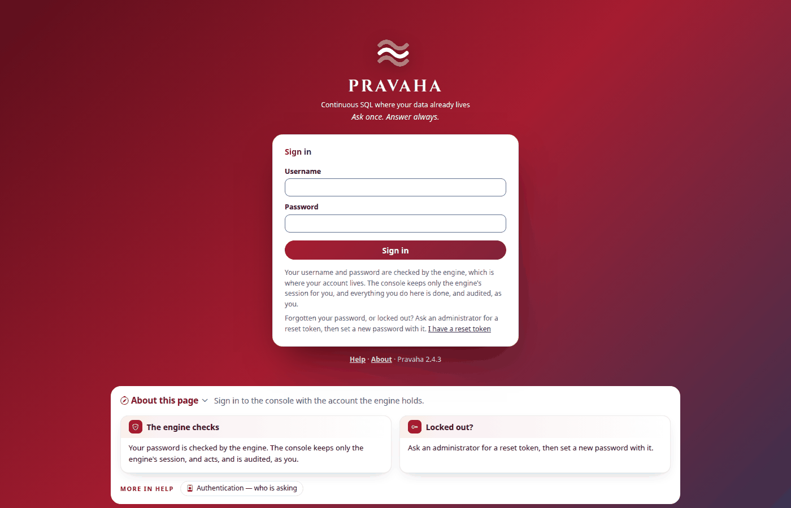
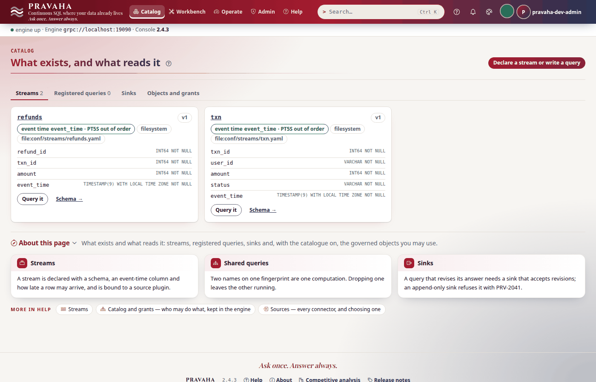
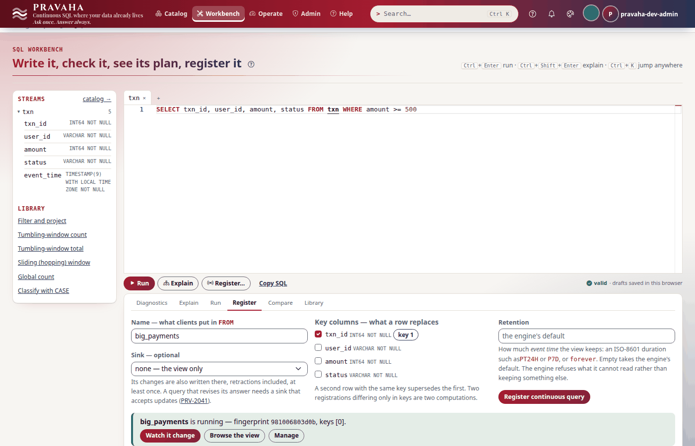
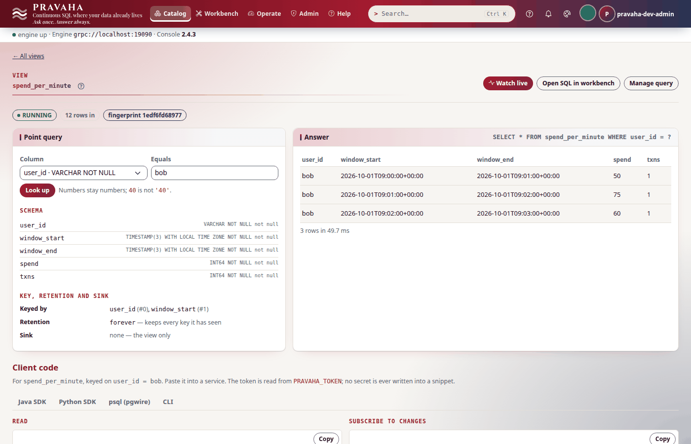
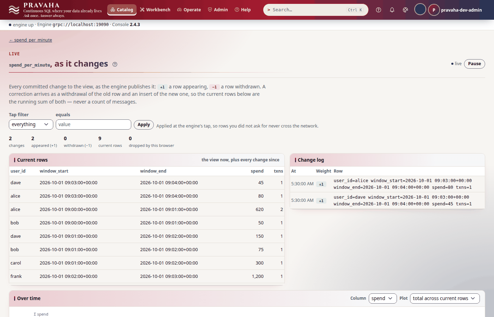

# Tutorial 1 · Your first 15 minutes

Copyright © 2026 Ashutosh Sinha \<ajsinha@gmail.com\>. All rights reserved.
**Proprietary and confidential** — see [`../../LICENSE`](../../LICENSE).

Pravaha keeps the answer to a question current while the data under it moves: you ask once, in SQL,
and the answer — a **view** — is maintained row by row from then on. In this tutorial you go from
nothing to that, end to end: `pravaha init` scaffolds a project, a node starts on it, you sign in to
the console, look at the stream the project declares, add a second stream while the node runs,
register two continuous queries (one in the Workbench, one from the command line), watch a view change live when a row arrives, check the whole
setup with `pravaha doctor`, and read the view from Python. Every output below was printed by a real
node of this version running exactly these steps.

**Time to complete:** about 15 minutes.

## Before you start

- **Java 21 or later** (`java -version`) and **Python 3.11 or later**, or **Docker** for the node.
- **The `pravaha` command**, which comes with the Python SDK: from a checkout,
  `pip install './sdk/python[flight]'` (the [CLI reference](../../pravaha-console/content/topics/cli-reference.md) has the other ways).
  `pravaha --version` should answer.
- **A node to run.** Either the server jar from a build (`./mvnw -q -DskipTests install` makes
  `pravaha-server/target/pravaha-server-<version>-app.jar`, launched by `bin/pravaha-server`) or the
  Docker images (`deploy/docker/build.sh` and `deploy/docker/console/build.sh`, see
  [RUNNING_IN_DOCKER.md](../operations/RUNNING_IN_DOCKER.md)).
- Nothing else: the project brings its own sample data. The free ports it needs are **18080** (the
  node's HTTP API), **19090** (Flight SQL, which the CLI and the SDKs speak) and **17070** (the console).

## What you will learn

- what `pravaha init` writes: a stream in a file of its own, the source that feeds it, and a query;
- how to start a node with sign-in on, and sign in as the development account `pravaha-dev-admin`;
- how to read a stream's **event time** and **out-of-orderness** — the two settings that decide when an answer is final;
- how the node picks up a stream file you add while it runs, and lets go of one you take out;
- how to register a continuous query in the **Workbench** and with `pravaha register`, and why some queries are refused;
- why a windowed view shows a minute only once the minute is over, and how to watch a view change in **Live** and with `pravaha subscribe`;
- how `pravaha doctor` checks a setup, and how a program reads the view with the Python SDK.

## Step 1 · Scaffold a project

`pravaha init` writes a starter project that runs as it stands. It asks no node and writes nothing
outside the directory you name:

<!-- capture: t01-init -->
```text
$ pravaha init shop
created a Pravaha starter project in shop/
  conf/application.yaml          the node's configuration: how often conf/streams is looked at
  conf/streams/txn.yaml          stream txn, one file named after it, fed by the CSV (source: filesystem)
  external_lib/java/README.md    where your own connector jars go (on the classpath at start)
  external_lib/python/README.md  where your own Python for the console and the CLI goes
  data/txn.csv                   12 sample transactions over four minutes of event time
  queries/spend_per_minute.sql   the first continuous query: per-user spend per one-minute window
  docker-compose.yml             pravaha/pravaha-server:<version> on 18080 and 19090; the console on 17070 (profile console)
  README.md                      what is here, and the next three commands
  .pravaha                       the connection this node wants, for `pravaha context add` (not read by pravaha)

choices made for you:
  - image tag <version>, this CLI's version, so the engine speaks what the CLI expects; PRAVAHA_TAG overrides it
  - the dev profile: an open node on 127.0.0.1 for one developer; PRAVAHA_PROFILES=dev,users for sign-in and the console
  - a windowed query with an event-time column, because an unwindowed GROUP BY has unbounded state and is refused (PRV-2050)
  - the source follows the file (follow: true), so appended lines arrive without a restart
  - the stream has a file of its own (conf/streams/txn.yaml): add files there for more streams, and the node declares them while it runs
  - your configuration is untouched: save the connection with the context command below

next:
  cd shop
  docker compose up -d
  pravaha register --name spend_per_minute --sql-file queries/spend_per_minute.sql --keys 0,1
  pravaha query --sql "SELECT * FROM spend_per_minute"
  pravaha context add shop --url grpc://localhost:19090 --http http://localhost:18080 --use   # optional: save the connection
```
<!-- /capture -->

The heart of it is `conf/streams/txn.yaml`. A node declares each stream in **a file named after it**
in its `conf/streams/` folder: what the stream is (its schema and its clock), and, under `source:`,
what feeds it — a plugin and its options:

```yaml
# shop/conf/streams/txn.yaml (comments shortened)
schema: "txn_id:INT64,user_id:STRING,amount:INT64,status:STRING,event_time:TIMESTAMP"
event-time: event_time      # the column that carries each row's own time
out-of-orderness: 5         # how late a row may arrive and still count; a number is seconds
source:                     # what feeds the stream: a plugin and its options
  plugin: filesystem
  options:
    path: data/incoming/txn.csv
    follow: true            # tail -f: appended lines arrive without a restart
```

`conf/application.yaml` holds the node's own settings; here only how often it looks at
`conf/streams/` for new files, `pravaha.config.watch-interval`, ten minutes unless set. Step 5 adds a
stream while the node runs, so make it ten seconds for this tutorial (in `shop/conf/application.yaml`):

```yaml
pravaha:
  config:
    watch-interval: 10s
```

The data is twelve payments over four minutes of **event time** — the time each payment happened,
not the time the node reads it:

```text
1,alice,500,COMPLETED,2026-10-01T09:00:05Z
2,bob,50,COMPLETED,2026-10-01T09:00:20Z
3,carol,900,PENDING,2026-10-01T09:00:41Z
...
11,dave,45,COMPLETED,2026-10-01T09:03:20Z
12,alice,80,COMPLETED,2026-10-01T09:03:50Z
```

`init` refuses a directory that is not empty (exit `2`) unless you add `--force`; `--dry-run` lists
the files and writes none.

You should see the nine files listed above in `shop/`, and nothing anywhere else.

## Step 2 · Start a node, with sign-in on

The console signs people in against the node's own accounts, so the node runs with two profiles:
`dev` (a node for one developer, on loopback) and `users` (accounts, sessions and API keys).

**With Docker**, from `shop/`, the node and the console together:

```bash
cd shop
PRAVAHA_PROFILES=dev,users docker compose --profile console up -d
export INCOMING=data STREAMS=conf/streams   # the folders the node reads txn.csv and stream files from
```

**Without Docker**, with the server jar: give the node a home of its own (`PRAVAHA_HOME`), put the
configuration folder and the CSV where the configuration says, and start it; then the console from a
checkout (`make install` once):

```bash
cd shop
mkdir -p node/data/incoming
cp -r conf node/ && cp data/txn.csv node/data/incoming/
PRAVAHA_HOME=$PWD/node <checkout>/bin/pravaha-server --spring.profiles.active=dev,users &
export INCOMING=node/data/incoming STREAMS=node/conf/streams
(cd <checkout>/pravaha-console && make run) &
```

The node keeps what it must not forget — the queries you register, their checkpoints — under its
home's `data/` (the image's volume `pravaha-data` with Docker), so a restart brings them back. A node
started with no home and no settings keeps them in `./data`; `pravaha.data.dir: none` keeps nothing.

Ask the node how it is:

<!-- capture: t01-status -->
```text
$ pravaha status
instance       pravaha-node-01
version        <version>
engine         RUNNING
uptime         N s
queries        0
streams        1
stopped feeds  0
flight         localhost:19090
```
<!-- /capture -->

`status` answers without a credential; almost nothing else will. The node's log says what it made of
the configuration, one line per decision. These four are the ones to read on a first start:

<!-- capture: t01-log -->
```text
$ grep -oE '(sources bound|stream txn|Flight SQL listening|identity: captive).*' node/logs/pravaha-server.log
stream txn: event-time=event_time, out-of-orderness=PT5S, allowed-lateness=PT0S
identity: captive users [pravaha-dev-admin] ensured from pravaha.identity.captive-users; they cannot be disabled, re-roled or re-passworded at runtime
sources bound: [txn <- filesystem[event.time, follow, path, schema]]
Flight SQL listening on localhost:19090 (pravaha.flight.host, pravaha.flight.port)
```
<!-- /capture -->

`stream txn: event-time=event_time` is the line that matters most: a stream with no event time can
never close a window (a windowed query over it is refused, `PRV-2002`). `sources bound` lists the
options the plugin was given — an option nested at the wrong level of the YAML is simply absent here.
(With Docker, `docker compose logs pravaha-server` shows the same lines.)

The node refuses to start, by name, on a JVM older than 21 and on the published development password
without `dev` (`PRV-7022`); a port already in use stops it with the port in the message.

You should see `engine RUNNING`, `streams 1` and `queries 0`.

## Step 3 · Sign in

Open <http://localhost:17070> and sign in as **`pravaha-dev-admin`**, password
**`pravaha-dev-admin123`**. That account is *captive*: the `users` profile ensures it at every start,
with the `admin` role, and it cannot be disabled or re-passworded at runtime. (Its password is a
literal in configuration, which only `dev` allows — never copy it to a deployment.)



The command line needs a credential too. `pravaha login` asks for the password without echoing it and
prints a session token; export it, and say that sending it over plaintext to this machine is
intended:

```bash
export PRAVAHA_TOKEN=$(pravaha login --user pravaha-dev-admin)
export PRAVAHA_INSECURE_TOKEN=true     # a node on loopback, without TLS
```

<!-- capture: t01-whoami -->
```text
$ pravaha whoami
user              pravaha-dev-admin
principal         pravaha-dev-admin
tenant            public
roles             admin
via               session
name              Pravaha dev admin
email             -
password expires  -
token from        env
```
<!-- /capture -->

Without `PRAVAHA_INSECURE_TOKEN` the CLI refuses to send the token over `http://` or `grpc://`
(`PRV-1031`); without a token the node answers `PRV-7001` (not authenticated). A session lasts 12 hours
at most and 30 minutes idle (`PRV-7016` once it has ended); `pravaha login --save` keeps it in a file
instead of the environment.

You should see `via session` and `roles admin`.

## Step 4 · Look at the stream

A continuous query is written over a **stream**. Ask what `txn` is:

<!-- capture: t01-streams -->
```text
$ pravaha streams describe txn
name          txn
version       1
event time    event_time
out of order  PT5S
lateness      PT0S
source        filesystem
origin        file:conf/streams/txn.yaml
not applied   -

ORDINAL  NAME        TYPE                                        NULLABLE
0        txn_id      INT64 NOT NULL                              no
1        user_id     VARCHAR NOT NULL                            no
2        amount      INT64 NOT NULL                              no
3        status      VARCHAR NOT NULL                            no
4        event_time  TIMESTAMP(9) WITH LOCAL TIME ZONE NOT NULL  no
```
<!-- /capture -->

In the console, **Catalog → txn** shows the same, with the templates you can start a query from:


**Out-of-orderness `PT5S`** says a row may arrive up to five seconds of event time after a later one
and still be counted. The engine turns it into a **watermark** — "nothing earlier than this is still
coming" — the newest event time it has read, less five seconds. **Lateness `PT0S`** says a row behind
the watermark is dropped rather than used to correct an answer already published;
[tutorial 2](02-windows-and-late-data.md) changes that.

You should see five columns, `event time event_time` and `out of order PT5S`.

## Step 5 · Add a stream while the node runs

You do not restart a node to give it a stream. Write a second file into its streams folder — refunds,
fed by a CSV of their own:

```bash
echo '1,2,50,2026-10-01T09:02:30Z' > "$INCOMING/refunds.csv"
cat > "$STREAMS/refunds.yaml" <<'YAML'
schema: "refund_id:INT64,txn_id:INT64,amount:INT64,event_time:TIMESTAMP"
event-time: event_time
out-of-orderness: 5
source:
  plugin: filesystem
  options:
    path: data/incoming/refunds.csv
    follow: true
YAML
```

The node looks at the folder every `watch-interval` — ten seconds here, ten minutes unless you set
it — so within ten seconds `refunds` is declared, its source bound. `pravaha declarations` says
what came from where, and whether each file is applied:

<!-- capture: t01-declarations -->
```text
$ pravaha declarations
connectors  conf/connectors
streams     conf/streams
lookups     conf/lookups
sinks       conf/sinks
watch       PT10S

KIND    NAME     ORIGIN                          STATE    CODE  DETAIL
stream  refunds  file:conf/streams/refunds.yaml  applied  -     -
stream  txn      file:conf/streams/txn.yaml      applied  -     -
```
<!-- /capture -->

`pravaha streams` lists both, with an `ORIGIN` column: `file:` and the file for one declared in the
folder, `config` for one written inline under `pravaha.streams` in `application.yaml` (which still
works), `api` for one declared over HTTP:

<!-- capture: t01-streams-list -->
```text
$ pravaha streams
NAME     VERSION  EVENT TIME  LATENESS  SOURCE      ORIGIN                          FIELDS
txn      1        event_time  PT5S      filesystem  file:conf/streams/txn.yaml      txn_id INT64 NOT NULL, user_id VARCHAR NOT NULL, amount INT64 NOT NULL, status VARCHAR NOT NULL, event_time TIMESTAMP(9) WITH LOCAL TIME ZONE NOT NULL
refunds  1        event_time  PT5S      filesystem  file:conf/streams/refunds.yaml  refund_id INT64 NOT NULL, txn_id INT64 NOT NULL, amount INT64 NOT NULL, event_time TIMESTAMP(9) WITH LOCAL TIME ZONE NOT NULL
```
<!-- /capture -->

The **Catalog** shows the same origin on each stream's card:



Take the file out and the stream goes at the next look:

<!-- capture: t01-remove -->
```text
$ rm "$STREAMS/refunds.yaml"
```
<!-- /capture -->

<!-- capture: t01-streams-after -->
```text
$ pravaha streams
NAME  VERSION  EVENT TIME  LATENESS  SOURCE      ORIGIN                      FIELDS
txn   1        event_time  PT5S      filesystem  file:conf/streams/txn.yaml  txn_id INT64 NOT NULL, user_id VARCHAR NOT NULL, amount INT64 NOT NULL, status VARCHAR NOT NULL, event_time TIMESTAMP(9) WITH LOCAL TIME ZONE NOT NULL
```
<!-- /capture -->

A stream that a registered query reads is the exception: its file's change or removal is **not
applied** while the query is registered — the query keeps the definition it was planned against, the
node logs `PRV-1065` naming the file and the queries, and `pravaha declarations` lists the file as
`not-applied` until the last of those queries is dropped. A file that cannot be read is reported
(`PRV-1064`, naming the file and the key) and never takes the node down; a literal password in one is
refused (`PRV-1063`: write `${ENV_NAME}`).

You should see `refunds` with `ORIGIN file:conf/streams/refunds.yaml`, then only `txn`.

## Step 6 · Register a query in the Workbench

Open **Workbench**, type a question and register it. The first one here keeps every payment of 500 or
more:

```sql
SELECT txn_id, user_id, amount, status FROM txn WHERE amount >= 500
```

The editor plans it as you type (**valid**, bottom right). Open **Register**, name it `big_payments`,
tick `txn_id` as the key — the column that says which row a later row replaces — and press **Register
continuous query**:



From that moment the node keeps `big_payments` current: every payment that arrives goes through the
filter once. Not every question is accepted. A total per user **for ever** is refused, because its
state would grow with every new user and never shrink:

<!-- capture: t01-validate-refused -->
```text
$ pravaha validate --sql 'SELECT user_id, SUM(amount) AS spend FROM txn GROUP BY user_id'
PRV-2050  GROUP BY user_id has no bound on its key space, so its state grows with the number of distinct keys and never shrinks. One row per key is fine at a thousand keys and fatal at a hundred million, and the failure arrives weeks after deployment.
  Bound it with a window -- GROUP BY TUMBLE(event_time, INTERVAL '1' MINUTE), user_id -- so state is released when each window closes.
Refusing now rather than exhausting memory later.
(exit 1)
```
<!-- /capture -->

The Workbench shows the same refusal under the editor, and **Register** stays disabled. Other
refusals you can meet here: `PRV-2001` (the SQL does not parse), `PRV-2002` (a name or column the
catalogue does not have), `PRV-2020` (a shape the engine does not run, such as `ORDER BY`).

You should see `big_payments is running` with a fingerprint and `keys [0]`.

## Step 7 · Register one from the command line, and read it

The project's query is a **windowed** aggregate: each user's completed spend per minute of event time.

```sql
-- shop/queries/spend_per_minute.sql
SELECT user_id, window_start, window_end, SUM(amount) AS spend, COUNT(*) AS txns
FROM TABLE(TUMBLE(TABLE txn, DESCRIPTOR(event_time), INTERVAL '1' MINUTE))
WHERE status = 'COMPLETED'
GROUP BY user_id, window_start, window_end
```

<!-- capture: t01-register -->
```text
$ pravaha register --name spend_per_minute --sql-file queries/spend_per_minute.sql --keys 0,1
registered spend_per_minute  state=RUNNING  fingerprint=1edf6fd68977
a query with the same fingerprint is the same computation, shared
```
<!-- /capture -->

`--keys 0,1` keys the view by `user_id` and `window_start`: one row per user per minute. The
**fingerprint** identifies the computation; register the same question under another name and you get
a second name on the same computation, not a second one. Both queries are running:

<!-- capture: t01-queries -->
```text
$ pravaha queries
NAME              STATE    FINGERPRINT   ROWS IN  SINK
big_payments      RUNNING  981006803d0b  12       -
spend_per_minute  RUNNING  1edf6fd68977  12       -
```
<!-- /capture -->

A view is read with ordinary SQL. The read looks the answer up; it does not scan `txn` again:

<!-- capture: t01-query -->
```text
$ pravaha query --sql 'SELECT * FROM spend_per_minute'
user_id  window_start               window_end                 spend  txns
alice    2026-10-01 09:00:00+00:00  2026-10-01 09:01:00+00:00  620    2
bob      2026-10-01 09:00:00+00:00  2026-10-01 09:01:00+00:00  50     1
dave     2026-10-01 09:01:00+00:00  2026-10-01 09:02:00+00:00  150    1
bob      2026-10-01 09:01:00+00:00  2026-10-01 09:02:00+00:00  75     1
carol    2026-10-01 09:01:00+00:00  2026-10-01 09:02:00+00:00  300    1
frank    2026-10-01 09:02:00+00:00  2026-10-01 09:03:00+00:00  1200   1
bob      2026-10-01 09:02:00+00:00  2026-10-01 09:03:00+00:00  60     1
7 rows
```
<!-- /capture -->

Twelve payments were read, and the minute from 09:03 is missing. That is the design, not a delay. The
newest payment is at 09:03:50, so the watermark is 09:03:45: past the end of 09:02 (published) and
short of the end of 09:03, which is still open. Publishing 09:03 now would publish a total the next
row could make wrong. (Carol's 900 is `PENDING` and alice's 30 `FAILED`, so the `WHERE` leaves them
out.) In the console, **Catalog → Views → spend_per_minute** reads the view by its key:



A read of a name that is not a view is `PRV-4023`; `ORDER BY` in a read is refused (`PRV-2020`)
because a view has no row order — sort in whatever reads it.

You should see seven rows and no row for 09:03.

## Step 8 · Watch the view change

Open **Watch live** on the view page, and in a terminal follow it with `pravaha subscribe`. Then
append one payment from 09:05 — it is what moves event time past the end of 09:03:

```bash
pravaha subscribe --view spend_per_minute --limit 2 &
```

<!-- capture: t01-append -->
```text
$ echo '13,bob,10,COMPLETED,2026-10-01T09:05:00Z' >> "$INCOMING/txn.csv"
```
<!-- /capture -->

<!-- capture: t01-subscribe -->
```text
$ pravaha subscribe --view spend_per_minute --limit 2
subscribing to spend_per_minute; changes print as they are committed, until 2 rows (at the end of that commit). Ctrl-C to stop.
WEIGHT	user_id	window_start	window_end	spend	txns
+1	dave	2026-10-01 09:03:00+00:00	2026-10-01 09:04:00+00:00	45	1
+1	alice	2026-10-01 09:03:00+00:00	2026-10-01 09:04:00+00:00	80	1
-- commit, 2 rows
```
<!-- /capture -->

The watermark moved to 09:04:55, the 09:03 minute closed, and its two rows arrived together as one
**commit** — the unit in which a view changes; you never see half of one. Each row carries a
**weight**: `+1` a row appeared, `-1` one was withdrawn. The Live page shows the same commit as it
happens, with the current rows beside the change log:



The 09:05 minute is now the open one. Read the newest minutes to check:

<!-- capture: t01-query-after -->
```text
$ pravaha query --sql "SELECT user_id, window_start, spend, txns FROM spend_per_minute WHERE window_start >= TIMESTAMP '2026-10-01 09:03:00'"
user_id  window_start               spend  txns
dave     2026-10-01 09:03:00+00:00  45     1
alice    2026-10-01 09:03:00+00:00  80     1
2 rows
```
<!-- /capture -->

`subscribe` refuses a view that does not exist (`PRV-4023`) and a filter on a column the view lacks
(`PRV-8002`); [tutorial 4](04-following-a-view.md) is all about following views.

You should see two `+1` rows for 09:03 in one commit, and the Live page counting `2 appeared`.

## Step 9 · Check the setup with doctor

`pravaha doctor` checks this machine and the node in one go — Python, the CLI, pyarrow, Java, the
token, HTTP, Flight, who you are — and says how to fix anything that is not green. It changes nothing
and never prints the token:

<!-- capture: t01-doctor -->
```text
$ pravaha doctor
GREEN    python        Python 3.x (python); needs >=3.9
GREEN    cli           pravaha <version> (sdk/python/pravaha)
GREEN    pyarrow       pyarrow <version>, with Flight
GREEN    java          JAVA_HOME=$JAVA_HOME: Java 21
GREEN    token file    ~/.config/pravaha/token: none saved (pravaha login --save writes it); token from PRAVAHA_TOKEN
GREEN    context       none in use: flags, environment and defaults decide
GREEN    http          http://localhost:18080 answered in N ms: health UP
GREEN    version       cli <version>, node <version>
GREEN    flight        grpc://localhost:19090 answered in N ms: 2 continuous queries you may see
GREEN    auth          pravaha-dev-admin (tenant public), via session, roles admin
YELLOW   token expiry  expires <time> (in N h)
                       fix: pravaha login --user <name> --save   before it does
doctor: 0 red, 1 yellow
```
<!-- /capture -->

It exits `1` on any `RED`, so it makes a pre-flight step in a script. The one `YELLOW` is honest: a
session token expires, and an API key (Admin → Keys, or `pravaha key create`) is what a long-running
program should use instead.

You should see `doctor: 0 red`.

## Step 10 · Read it from Python

The SDK speaks Flight SQL for reads and subscriptions and HTTP for the catalogue. The same token
works:

<!-- file: data/t01/read_view.py -->
```python
import os

from pravaha import ClientOptions, connect

client = connect(options=ClientOptions.create(
    os.environ.get("PRAVAHA_URL", "grpc://localhost:19090"),             # Flight SQL: reads and subscriptions
    token=os.environ["PRAVAHA_TOKEN"],
    http_url=os.environ.get("PRAVAHA_HTTP", "http://localhost:18080"),   # HTTP: the catalogue, plans, status
    allow_insecure_token=True,                                             # a node on this machine, over plaintext
))

query = client.describe_query("spend_per_minute")
print(query["name"], query["state"], "rows in:", query["rowsIn"])

# A read of the view looks up the answer the query already holds: it does not scan txn. A view has
# no row order (ORDER BY is refused, PRV-2020), so the reader sorts.
rows = client.query("SELECT user_id, window_start, spend, txns FROM spend_per_minute WHERE user_id = ?", ["bob"])
for row in sorted(rows.to_list(), key=lambda r: r["window_start"]):
    print(row["user_id"], row["window_start"].isoformat(), row["spend"], row["txns"])
```

The whole file is [data/t01/read_view.py](data/t01/read_view.py):

<!-- capture: t01-python -->
```text
$ python read_view.py
spend_per_minute RUNNING rows in: 13
bob 2026-10-01T09:00:00+00:00 50 1
bob 2026-10-01T09:01:00+00:00 75 1
bob 2026-10-01T09:02:00+00:00 60 1
```
<!-- /capture -->

Bind values with `?` rather than formatting them into the SQL: a bound value can never be read as
SQL, and the node plans the statement once however many users you ask about. Bob's 10 at 09:05 is not
there yet: its minute is still open.

You should see `rows in: 13` and bob's three closed minutes.

## Next steps

- [Tutorial 2 · Windows, event time and late data](02-windows-and-late-data.md): hopping windows, a
  late reading that corrects a published window, and what lateness costs.
- [Tutorial 4 · Following a view](04-following-a-view.md): subscriptions from Python, Java and a BI
  tool over the PostgreSQL protocol.
- The reference: [CONTINUOUS_QUERIES.md](../guides/CONTINUOUS_QUERIES.md) (the SQL, and every
  refusal), the [CLI reference](../../pravaha-console/content/topics/cli-reference.md), [PYTHON_API_GUIDE.md](../guides/PYTHON_API_GUIDE.md).

## If something goes wrong

| Symptom | What it means | What to do |
|---|---|---|
| `pravaha init` exits `2` | the directory is not empty | name a new directory, or add `--force` to write over files of the same name |
| `PRV-1031 refusing to send a token over plaintext HTTP` | the CLI will not send a token over `http://` unless told to | `export PRAVAHA_INSECURE_TOKEN=true` for a node on this machine; use TLS anywhere else |
| `PRV-7001` on every command | no token, or one the node does not know | `export PRAVAHA_TOKEN=$(pravaha login --user pravaha-dev-admin)` |
| `PRV-7016` on any command | the session has ended (12 hours, or 30 minutes idle) | sign in again, or use an API key |
| The node stops at start with `PRV-7022` | the captive account's literal password needs the `dev` profile | start with `--spring.profiles.active=dev,users` (only on your own machine) |
| A new stream file is not there | the node has not looked yet, or the file was refused | wait one `watch-interval` (ten minutes unless set); `pravaha declarations` and the node's log name a refused file and why (`PRV-1061` its name, `PRV-1064` its content) |
| `PRV-2050` at register | an aggregate with no window keeps state for ever | add a window, as in Step 7 |
| `PRV-2002` at register | a name the catalogue does not have, or a window over a stream with no `event-time` | check `pravaha streams describe`; declare `event-time` on the stream |
| `RUNNING`, rows in climbing, the view empty | no window has closed: the watermark has not passed one's end | append a later row, as in Step 8; check `stream txn: event-time=...` in the log |
| The view never changes after an append | the source does not follow the file, or you appended to another copy | `follow: true` under `options:`; `$INCOMING` is the folder the node reads |
| `doctor` reports `http` `RED` | nothing answers on 18080 | start the node (Step 2); `--http` if it is elsewhere |
