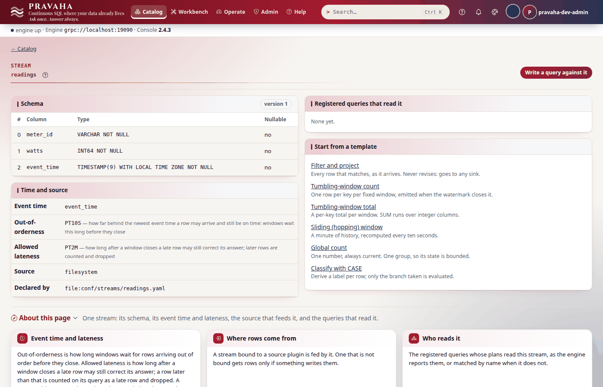
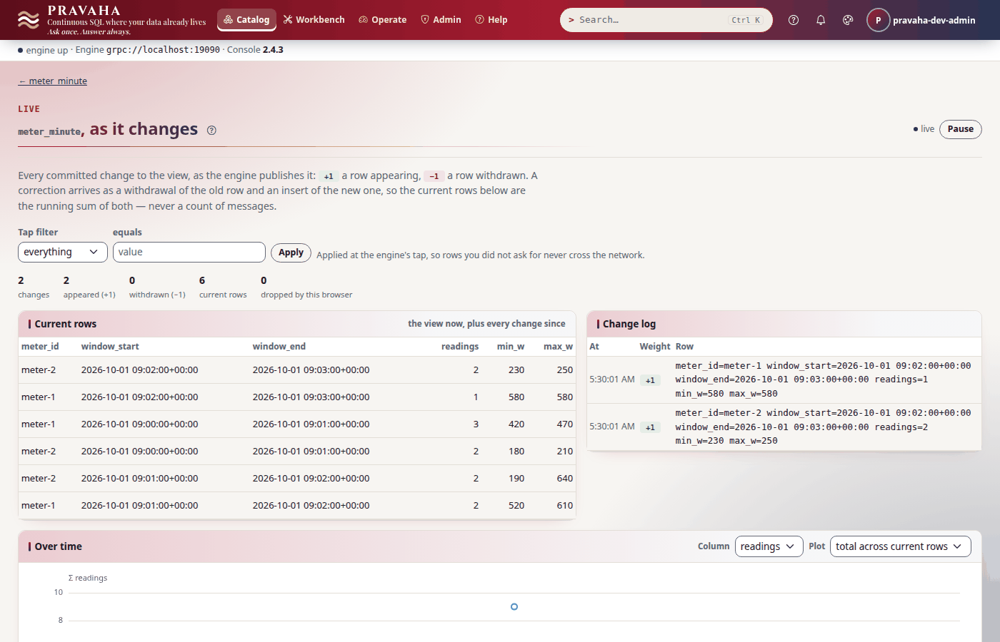
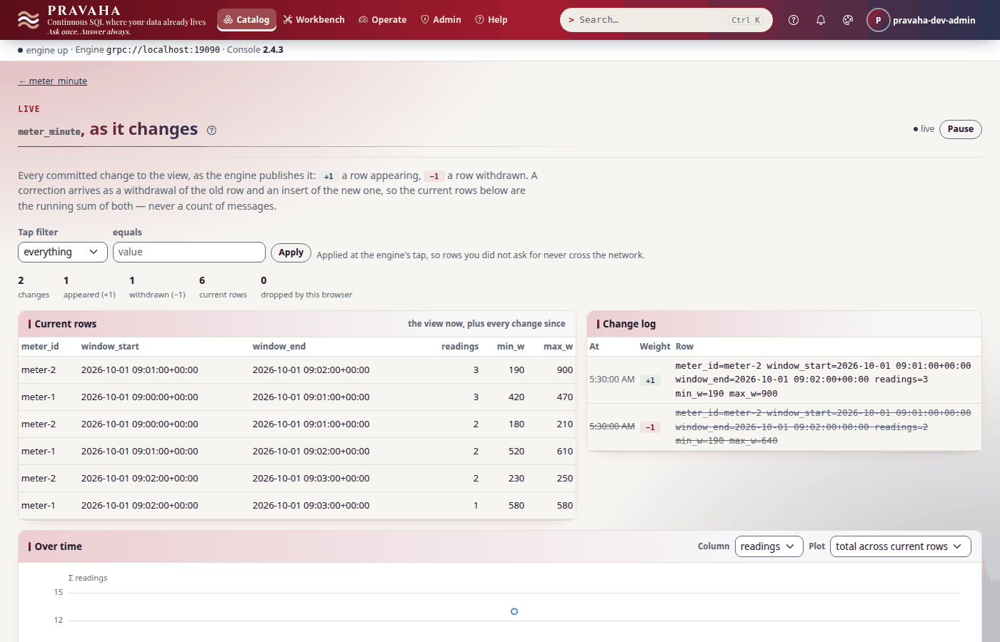
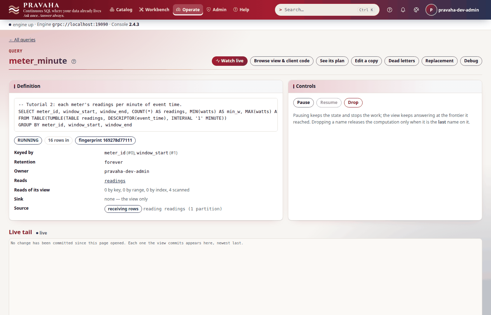

# Tutorial 2 · Windows, event time and late data

Copyright © 2026 Ashutosh Sinha \<ajsinha@gmail.com\>. All rights reserved.
**Proprietary and confidential** — see [`../../LICENSE`](../../LICENSE).

A continuous query over a stream that never ends has to decide when a number is final. Pravaha
decides in **event time** — the time a reading was taken, not the time it arrived — with a
**watermark** that says "nothing earlier than this is still coming", and it lets a straggler that
arrives after a window was published **correct** it, within a bound you set. In this tutorial two
smart meters report their power draw: you cut the readings into tumbling and hopping windows, watch
one reading close a window, send a reading late enough to reopen a published window (and see the
old answer withdrawn at `−1` and the corrected one inserted at `+1`, in Live and in `subscribe`),
send one too late to count, and find out what lateness costs. Every output below was printed by a
real node running these steps.

**Time to complete:** about 30 minutes.

## Before you start

- [Tutorial 1](01-first-15-minutes.md) done: you can start a node with `--spring.profiles.active=dev,users`,
  sign in, and export `PRAVAHA_TOKEN` and `PRAVAHA_INSECURE_TOKEN=true`.
- The tutorial's files, in [data/t02/](data/t02/): the stream, `streams/readings.yaml`, and the sink,
  `sinks/meter_log.yaml` — a file each, named after it, which the node reads from its `conf/streams/`
  and `conf/sinks/` folders — `readings.csv` (twelve readings over two and a half minutes) and two
  queries, `meter_minute.sql` and `meter_rolling.sql`.
- A node home of its own for this tutorial, with the configuration and the data in place:

```bash
export PRAVAHA_HOME=$HOME/pravaha-t02
mkdir -p $PRAVAHA_HOME/conf $PRAVAHA_HOME/data/incoming
cp -r docs/tutorials/data/t02/streams docs/tutorials/data/t02/sinks $PRAVAHA_HOME/conf/
cp docs/tutorials/data/t02/readings.csv $PRAVAHA_HOME/data/incoming/
bin/pravaha-server --spring.profiles.active=dev,users &
cd docs/tutorials/data/t02            # the commands below read the .sql files from here
export PRAVAHA_TOKEN=$(pravaha login --user pravaha-dev-admin) PRAVAHA_INSECURE_TOKEN=true
```

## What you will learn

- the two settings of a stream's time — **out-of-orderness** (how long a window waits) and **allowed lateness** (how long it can still be corrected) — and how the node reports them;
- how the watermark is derived, where to read it, and why a window's row appears only when the watermark passes its end;
- **TUMBLE** and **HOP** windows, how hopping windows are aligned, and that **SESSION** windows have no SQL yet;
- what a late reading does: a **correction**, `−1` of the old row and `+1` of the new, in one commit;
- what happens to a reading too late to correct anything;
- what allowed lateness costs in state, and why a query that can be corrected cannot write to an append-only sink.

## Step 1 · Read the stream's clock

The stream is declared with both settings:

```yaml
# conf/streams/readings.yaml (the stream; its source: block follows)
schema: "meter_id:STRING,watts:INT64,event_time:TIMESTAMP"
event-time: event_time
out-of-orderness: 10s     # how long a window waits for stragglers before it is published
allowed-lateness: 2m      # how long after that a straggler may still correct what was published
```

<!-- capture: t02-describe -->
```text
$ pravaha streams describe readings
name          readings
version       1
event time    event_time
out of order  PT10S
lateness      PT2M
source        filesystem
origin        file:conf/streams/readings.yaml
not applied   -

ORDINAL  NAME        TYPE                                        NULLABLE
0        meter_id    VARCHAR NOT NULL                            no
1        watts       INT64 NOT NULL                              no
2        event_time  TIMESTAMP(9) WITH LOCAL TIME ZONE NOT NULL  no
```
<!-- /capture -->

The node states what is in force, one line per stream, when it starts — the first place to look when
a windowed view stays empty:

<!-- capture: t02-log -->
```text
$ grep -oE 'stream readings:.*' "$PRAVAHA_HOME/logs/pravaha-server.log"
stream readings: event-time=event_time, out-of-orderness=PT10S, allowed-lateness=PT2M
```
<!-- /capture -->



The two settings divide every reading's fate in three:

```text
           ◄── counted when its window closes ──►◄── corrects a published window ──►◄── dropped ──►
event time ─────────────────────────────────────┬──────────────────────────────────┬──────────────
                                            watermark                 watermark − allowed lateness
                                  (newest event time − 10 s)                      (− 2 min more)
```

A unitless number is seconds (`out-of-orderness: 10` is ten seconds). A stream with no `event-time`
cannot close a window, and a windowed query over it is refused at registration (`PRV-2002`); allowed
lateness without an event time, or negative, is refused at startup with `PRV-2002` too.

You should see `out of order PT10S` and `lateness PT2M`.

## Step 2 · A tumbling window, and the watermark

A **tumbling** window cuts event time into fixed, non-overlapping slices; every reading falls in
exactly one. Each meter's readings per minute:

```sql
-- data/t02/meter_minute.sql
SELECT meter_id, window_start, window_end, COUNT(*) AS readings, MIN(watts) AS min_w, MAX(watts) AS max_w
FROM TABLE(TUMBLE(TABLE readings, DESCRIPTOR(event_time), INTERVAL '1' MINUTE))
GROUP BY meter_id, window_start, window_end
```

<!-- capture: t02-register-minute -->
```text
$ pravaha register --name meter_minute --sql-file meter_minute.sql --keys 0,1
registered meter_minute  state=RUNNING  fingerprint=169278d77111
a query with the same fingerprint is the same computation, shared
```
<!-- /capture -->

<!-- capture: t02-query-minute -->
```text
$ pravaha query --sql 'SELECT meter_id, window_start, readings, min_w, max_w FROM meter_minute'
meter_id  window_start               readings  min_w  max_w
meter-1   2026-10-01 09:00:00+00:00  3         420    470
meter-2   2026-10-01 09:00:00+00:00  2         180    210
meter-2   2026-10-01 09:01:00+00:00  2         190    640
meter-1   2026-10-01 09:01:00+00:00  2         520    610
4 rows
```
<!-- /capture -->

Twelve readings, up to 09:02:25, and only the minutes from 09:00 and 09:01. The query's plan says
why — its watermark:

<!-- capture: t02-plan -->
```text
GET /api/v1/queries/meter_minute/plan
200
{
  "watermark": "2026-10-01T09:02:15Z"
}
```
<!-- /capture -->

The newest reading is at 09:02:25; less ten seconds of out-of-orderness, the watermark is 09:02:15.
The 09:01 minute ends at 09:02:00, which the watermark has passed, so it is published; the 09:02
minute ends at 09:03:00, which it has not, so it is still open and nothing of it is shown. Windows are
half-open (`[09:00, 09:01)`) and aligned to the epoch in UTC.

The descriptor must name the stream's declared event time; another `TIMESTAMP` column is refused
(`PRV-2002`), because the watermark only knows that one. Aggregates accumulate in 64-bit integers:
`SUM` or `MIN` over a `DOUBLE` column is refused with `PRV-2020` — which is why `watts` is an `INT64`.

You should see four rows, two minutes for each meter, and a watermark of 09:02:15.

## Step 3 · A hopping window, and the session window that is not there yet

A **hopping** window has a fixed width and slides by a smaller step, so windows overlap and each
reading belongs to *width ÷ slide* of them. The highest draw over the last minute, every thirty
seconds:

```sql
-- data/t02/meter_rolling.sql
SELECT meter_id, window_start, window_end, COUNT(*) AS readings, MAX(watts) AS max_w
FROM TABLE(HOP(TABLE readings, DESCRIPTOR(event_time), INTERVAL '30' SECOND, INTERVAL '1' MINUTE))
GROUP BY meter_id, window_start, window_end
```

`HOP` takes the **slide first**, then the width.

<!-- capture: t02-register-rolling -->
```text
$ pravaha register --name meter_rolling --sql-file meter_rolling.sql --keys 0,1
registered meter_rolling  state=RUNNING  fingerprint=712180b090a5
a query with the same fingerprint is the same computation, shared
```
<!-- /capture -->

<!-- capture: t02-query-rolling -->
```text
$ pravaha query --sql "SELECT window_start, window_end, readings, max_w FROM meter_rolling WHERE meter_id = 'meter-1'"
window_start               window_end                 readings  max_w
2026-10-01 08:59:30+00:00  2026-10-01 09:00:30+00:00  2         450
2026-10-01 09:00:00+00:00  2026-10-01 09:01:00+00:00  3         470
2026-10-01 09:00:30+00:00  2026-10-01 09:01:30+00:00  2         520
2026-10-01 09:01:00+00:00  2026-10-01 09:02:00+00:00  2         610
4 rows
```
<!-- /capture -->

Windows start on multiples of the slide, so the first reading, at 09:00:05, is in
`[08:59:30, 09:00:30)` and in `[09:00:00, 09:01:00)`: two windows, as *60 s ÷ 30 s* says. The same
watermark rule applies — the newest closed window ends at 09:02:00. A hop so fine that one reading
would land in more than 100,000 windows is refused (`PRV-3026`).

**Session windows** — a window per burst of activity, closed by a gap — exist in the runtime but have
no SQL yet, and the engine says so rather than guessing:

<!-- capture: t02-session-refused -->
```text
$ pravaha validate --sql "SELECT meter_id, window_start, window_end, COUNT(*) AS readings FROM TABLE(SESSION(TABLE readings, DESCRIPTOR(event_time), INTERVAL '30' SECOND)) GROUP BY meter_id, window_start, window_end"
PRV-2020  SESSION windows exist in the runtime but are not wired to SQL yet: their state is a per-key interval set rather than a slice grid, so they need the keyed state store. Use TUMBLE or HOP. See docs/guides/CONTINUOUS_QUERIES.md for what this engine executes and what it refuses.
(exit 1)
```
<!-- /capture -->

You should see four overlapping windows for `meter-1`, and `PRV-2020` for `SESSION`.

## Step 4 · A reading that closes a window

Open **Catalog → Views → meter_minute → Watch live**, follow the view in a terminal, and append a
reading from 09:03:10. Nothing about the 09:02 minute changes — what changes is the clock:

```bash
pravaha subscribe --view meter_minute --limit 2 &
```

<!-- capture: t02-append-close -->
```text
$ echo 'meter-1,560,2026-10-01T09:03:10Z' >> "$PRAVAHA_HOME/data/incoming/readings.csv"
```
<!-- /capture -->

<!-- capture: t02-subscribe-close -->
```text
$ pravaha subscribe --view meter_minute --limit 2
subscribing to meter_minute; changes print as they are committed, until 2 rows (at the end of that commit). Ctrl-C to stop.
WEIGHT	meter_id	window_start	window_end	readings	min_w	max_w
+1	meter-2	2026-10-01 09:02:00+00:00	2026-10-01 09:03:00+00:00	2	230	250
+1	meter-1	2026-10-01 09:02:00+00:00	2026-10-01 09:03:00+00:00	1	580	580
-- commit, 2 rows
```
<!-- /capture -->

The watermark moved to 09:03:00 (09:03:10 less ten seconds), which is the end of the 09:02 minute, so
both meters' rows for it were published in one commit. The 09:03:10 reading itself sits in the 09:03
minute, now the open one.



On a live feed this is continuous: each minute appears about ten seconds after it ends. A quiet
stream does not move its own watermark; after `pravaha.watermark.idle-after` (30 s) an idle
partition stops holding a multi-partition stream back.

You should see two `+1` rows for 09:02 in one commit.

## Step 5 · A late reading corrects a published window

The watermark is 09:03:00. Now meter-2's reading from 09:01:50 arrives — it was buffered while the
meter was offline. Its window, `[09:01, 09:02)`, was published two steps ago. It is behind the
watermark, so it is **late**; but the window's end plus two minutes of allowed lateness is 09:04:00,
still ahead of the watermark, so it may correct it. Follow the view's **answer** this time:

```bash
pravaha subscribe --view meter_minute --answer --limit 2 &
```

<!-- capture: t02-append-late -->
```text
$ echo 'meter-2,900,2026-10-01T09:01:50Z' >> "$PRAVAHA_HOME/data/incoming/readings.csv"
```
<!-- /capture -->

<!-- capture: t02-subscribe-correct -->
```text
$ pravaha subscribe --view meter_minute --answer --limit 2
subscribing to meter_minute (its answer); changes print as they are committed, until 2 rows (at the end of that commit). Ctrl-C to stop.
WEIGHT	meter_id	window_start	window_end	readings	min_w	max_w
-1	meter-2	2026-10-01 09:01:00+00:00	2026-10-01 09:02:00+00:00	2	190	640
+1	meter-2	2026-10-01 09:01:00+00:00	2026-10-01 09:02:00+00:00	3	190	900
-- commit, 2 rows
```
<!-- /capture -->

That is a **correction**: the row a reader saw (`2` readings, at most `640` W) is withdrawn at `−1`
and the corrected one (`3`, `900` W) inserted at `+1`, **in one commit** — no reader ever sees the
window twice or not at all. `--answer` prints how the answer moves; without it you get the view's
changelog, where a keyed view's new version arrives as an upsert at `+1`. A program keeping a copy
applies the weights ([tutorial 4](04-following-a-view.md)). The Live page shows the withdrawn row
struck through:



A read of the view sees only the current state:

<!-- capture: t02-query-corrected -->
```text
$ pravaha query --sql "SELECT meter_id, window_start, readings, max_w FROM meter_minute WHERE meter_id = 'meter-2'"
meter_id  window_start               readings  max_w
meter-2   2026-10-01 09:00:00+00:00  2         210
meter-2   2026-10-01 09:02:00+00:00  2         250
meter-2   2026-10-01 09:01:00+00:00  3         900
3 rows
```
<!-- /capture -->

The correction is published at the query's next commit, not at the next watermark advance, so it
arrives within the feed's publish interval even on a quiet stream. `meter_rolling` was corrected
too: the reading belongs to two of its windows.

You should see `-1` with `640` and `+1` with `900`, in one commit.

## Step 6 · A reading too late to count

Move the watermark on to 09:03:30 with a reading from 09:03:40, then send one from 09:00:30:

<!-- capture: t02-append-move -->
```text
$ echo 'meter-2,240,2026-10-01T09:03:40Z' >> "$PRAVAHA_HOME/data/incoming/readings.csv"
```
<!-- /capture -->

<!-- capture: t02-append-too-late -->
```text
$ echo 'meter-1,990,2026-10-01T09:00:30Z' >> "$PRAVAHA_HOME/data/incoming/readings.csv"
```
<!-- /capture -->

Its window, `[09:00, 09:01)`, could be corrected until 09:01:00 + 2 minutes = 09:03:00 of event
time. The watermark is past that, so the window's state has been released and cannot be rebuilt: the
reading is **dropped**, and the published answer stands.

<!-- capture: t02-query-unchanged -->
```text
$ pravaha query --sql "SELECT meter_id, window_start, readings, max_w FROM meter_minute WHERE meter_id = 'meter-1'"
meter_id  window_start               readings  max_w
meter-1   2026-10-01 09:00:00+00:00  3         470
meter-1   2026-10-01 09:01:00+00:00  2         610
meter-1   2026-10-01 09:02:00+00:00  1         580
3 rows
```
<!-- /capture -->

The reading *was* read — `ROWS IN` counts it — it just changed nothing:

<!-- capture: t02-rows-in -->
```text
$ pravaha queries
NAME           STATE    FINGERPRINT   ROWS IN  SINK
meter_minute   RUNNING  169278d77111  16       -
meter_rolling  RUNNING  712180b090a5  16       -
```
<!-- /capture -->

Sixteen readings in: the twelve of the file and the four you appended. The engine counts the rows it
drops as too late, but this version publishes that count nowhere you can read it (no metric, no plan
field), so today the evidence is the one above: rows in, and an answer that did not move. If late
readings matter, either raise **out-of-orderness** (windows wait longer and count stragglers the
first time, at the cost of latency) or raise **allowed lateness** (windows publish on time and are
corrected, at the cost of state).

You should see meter-1's 09:00 minute still at `3` readings and `470` W, and `ROWS IN 16`.

## Step 7 · What lateness costs

Allowed lateness is not free. To withdraw a published row exactly, the engine keeps, for each window
that has fired, the rows it published, until the window's lateness has passed. The plan shows the
lateness on the windowed aggregate:

<!-- capture: t02-plan-state -->
```text
$ pravaha plan meter_minute
ID  OPERATOR           STATEFUL  ROWS IN  ROWS OUT  STATE BYTES  TIME  DETAIL
n0  WindowedAggregate  yes       -        -         -            -     WindowedAggregate(TUMBLING 60000ms, keys=[0, 1, 2], [COUNT(*)->readings, MIN(watts)->min_w, MAX(watts)->max_w], lateness=120000ms)
n1  Project            no        -        -         -            -     Project[meter_id, window_start, window_end, watts]
n2  WindowAssign       no        -        -         -            -     WindowAssign(TUMBLING size=60000ms slide=60000ms on event_time)
n3  Project            no        -        -         -            -     Project[meter_id, watts, event_time]
n4  Scan               no        -        -         -            -     Scan(readings)
edges  n1->n0  n2->n1  n3->n2  n4->n3
Per-operator numbers are not published on this node: pravaha.metrics.operators is off, so the counters were never built into this query's stages. Set it and re-register the query. The query's own totals are under 'query'.
```
<!-- /capture -->

The rule of thumb: the rows a window publishes × (allowed lateness ÷ slide) windows held. For
`meter_minute` that is 2 meters × (2 min ÷ 1 min) = 4 published rows held back for corrections; for
`meter_rolling`, sliding every 30 s, 2 × 4 = 8. Trivial here, and a real number at a million meters.
With no allowed lateness — the default — nothing is kept, because a fired window can never change.

The second cost is downstream. A query that can correct its answer emits withdrawals, and an
append-only sink cannot express one. The node binds `meter_log`, a CSV file (`conf/sinks/meter_log.yaml`), and refuses to point
the corrected view at it, before anything is opened:

<!-- capture: t02-sink-refused -->
```text
$ pravaha register --name meter_minute_log --sql-file meter_minute.sql --keys 0,1 --sink meter_log
PRV-2041  sink 'meter_log' accepts [APPEND], but this query needs one of [UPSERT, RETRACT].
  Why: the windowed aggregate allows 120000 ms of lateness, so a late record re-emits a window it has already reported -- as a retraction of the old answer and the corrected one.
  Fix: point it at a sink that supports keyed upsert (Aerospike, Redis, JDBC, a compacted Kafka topic), or make the query append-only -- a tumbling window with no allowed lateness fires each window once and never revises it.
  look PRV-2041 up in the console's help under Errors, or in docs/guides/TROUBLESHOOTING.md
(exit 1)
```
<!-- /capture -->

The query page shows the rest of the story — sixteen rows in, the definition, and where to watch it:



You should see `lateness=120000ms` in the plan and `PRV-2041` for the append-only sink.

## Next steps

- [Tutorial 3 · Joins and lookups](03-joins-and-lookups.md): windows bound joins too, and a join is as
  current as its slowest side.
- [Tutorial 4 · Following a view](04-following-a-view.md): keep a copy of a view that corrects itself,
  by weights.
- The reference: [windows](../../pravaha-console/content/topics/windows.md),
  [event time and watermarks](../../pravaha-console/content/topics/event-time-watermarks.md), and
  [CONTINUOUS_QUERIES.md](../guides/CONTINUOUS_QUERIES.md) §5–§6.

## If something goes wrong

| Symptom | What it means | What to do |
|---|---|---|
| The view is empty while `ROWS IN` climbs | no window has closed: the watermark is short of the first window's end, or the stream has no event time | append a later reading; read the `stream readings:` line in the log |
| `PRV-2002` at register | a window over a stream with no `event-time`, or a descriptor naming another column | declare `event-time` on the stream; use `DESCRIPTOR(event_time)` |
| `PRV-2020` naming `SESSION` | session windows have no SQL yet | use `TUMBLE` or `HOP` |
| `PRV-2020` naming a `FLOAT64` column | aggregates accumulate in 64-bit integers | store an integer (watts, cents, tenths), or `CAST(... AS BIGINT)` |
| `PRV-3026` at register | a hop so fine that one row lands in too many windows | widen the slide |
| A late reading changed nothing | it was later than the window's end plus allowed lateness | raise `allowed-lateness`, or `out-of-orderness` |
| `PRV-2041` at register | the query can correct itself and the sink only appends | a sink that upserts or retracts, or no allowed lateness |
| `allowed-lateness: 30` behaves like a much shorter time | on versions before the unit fix a bare number was milliseconds; now it is seconds | write `30s` or `PT30S` to say it plainly |
