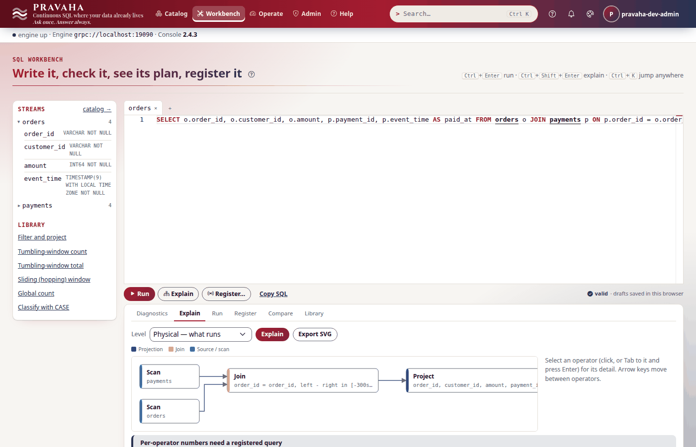
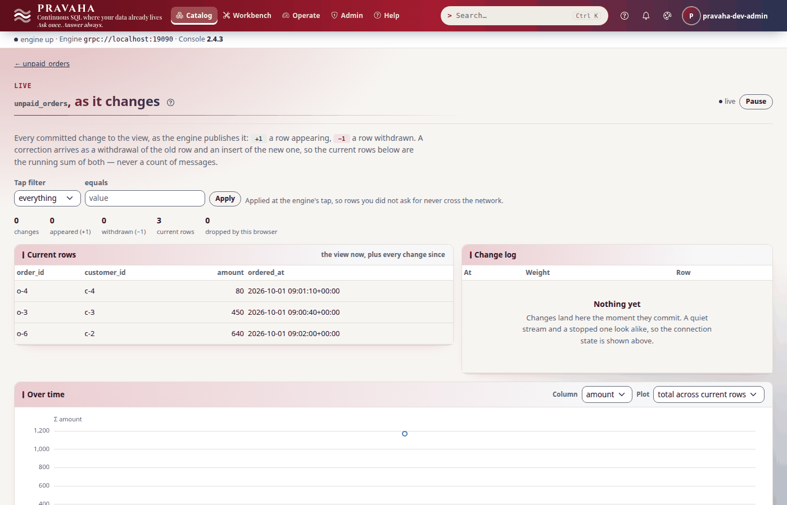
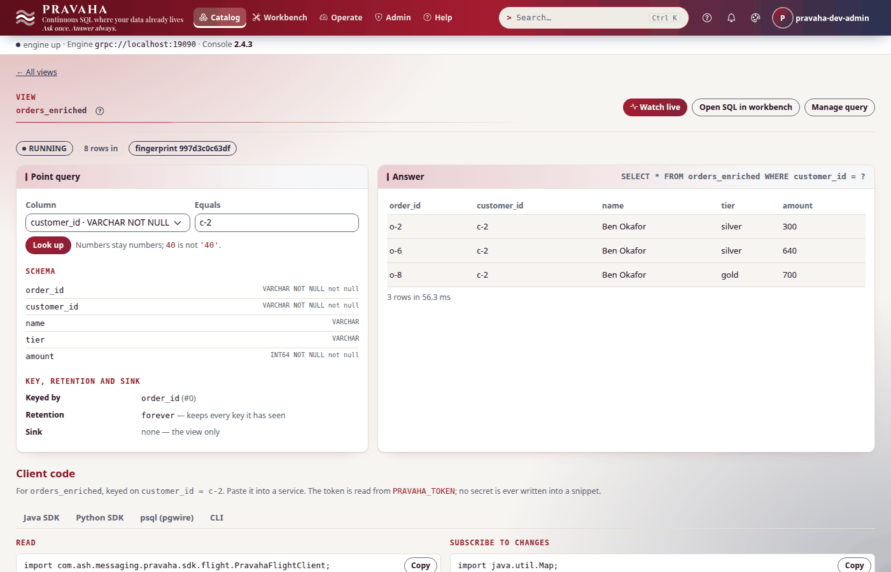
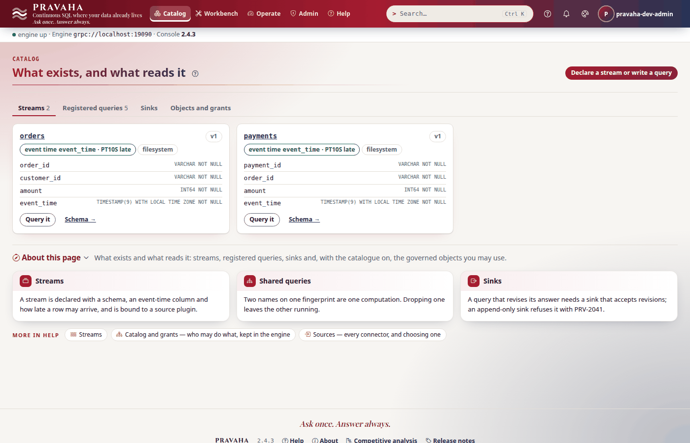

# Tutorial 3 · Joins and lookups

Copyright © 2026 Ashutosh Sinha \<ajsinha@gmail.com\>. All rights reserved.
**Proprietary and confidential** — see [`../../LICENSE`](../../LICENSE).

Most real questions need two things put together: an order and the payment for it, a payment and the
customer who made it. Pravaha does both kinds, continuously. Two **streams** are joined inside a
**time bound**, which says which pairs can match and how long each side is remembered; a stream is
**enriched from a table** by a **lookup**, asked once per row as it arrives. In this tutorial orders
and payments are joined within five minutes, the orders nobody paid are found with a `LEFT` join and
appear only when both streams have moved far enough, every order is enriched with its customer's
tier from a table in a real database (H2, so you need no database server), the key of a view is
chosen wrongly on purpose to see what that does, and the table is changed under a running query.
Every output below was printed by a real node running these steps.

**Time to complete:** about 35 minutes.

## Before you start

- [Tutorial 1](01-first-15-minutes.md) done, and [tutorial 2](02-windows-and-late-data.md) for the
  watermark: a join's time bound is closed by the same clock.
- The tutorial's files, in [data/t03/](data/t03/): `application.yaml`, `orders.csv` (six orders),
  `payments.csv` (four payments), `customers.sql` (the customer table) and three queries.
- **The H2 database jar**, `h2-2.3.232.jar` — one file, from Maven Central
  (`com.h2database:h2:2.3.232`) or `~/.m2/repository/com/h2database/h2/2.3.232/` after a build. H2 is
  an embedded SQL database: the table is a file in the node's home, so the lookup is a real JDBC
  lookup with nothing else to install. In production the same plugin reads PostgreSQL, MySQL or any
  database whose JDBC driver you put in `plugins/` instead.
- A node home with the configuration, the data and the jar in place:

```bash
export PRAVAHA_HOME=$HOME/pravaha-t03
mkdir -p $PRAVAHA_HOME/conf $PRAVAHA_HOME/data/incoming $PRAVAHA_HOME/plugins
cp docs/tutorials/data/t03/application.yaml $PRAVAHA_HOME/conf/
cp docs/tutorials/data/t03/orders.csv docs/tutorials/data/t03/payments.csv $PRAVAHA_HOME/data/incoming/
cp ~/.m2/repository/com/h2database/h2/2.3.232/h2-2.3.232.jar $PRAVAHA_HOME/plugins/
cd docs/tutorials/data/t03            # the commands below read the .sql files from here
```

## What you will learn

- how a lookup is configured (`pravaha.lookups`, the `jdbc-lookup` plugin, a driver in `plugins/`) and how it differs from a stream;
- a stream–stream `JOIN` with a time bound, and what its plan looks like;
- a `LEFT` join that finds what did *not* happen, and why it needs a bound to exist at all;
- why a join is only as current as its slower stream;
- a lookup join with `FOR SYSTEM_TIME AS OF`, what a miss looks like, and how to filter on a looked-up column;
- how the key decides what a view's rows replace;
- what happens when the table changes under a running query.

## Step 1 · Give the node a table to ask

Load the customer table into an H2 file in the node's home with H2's own `RunScript` tool, before the
node starts:

<!-- capture: t03-load-table -->
```text
$ java -cp "$PRAVAHA_HOME/plugins/h2-2.3.232.jar" org.h2.tools.RunScript -url "jdbc:h2:$PRAVAHA_HOME/data/ref/customers;DATABASE_TO_LOWER=TRUE;AUTO_SERVER=TRUE" -user sa -script customers.sql -showResults
-- Tutorial 3: the customer table the lookup asks. Loaded into an H2 file with H2's RunScript tool.
CREATE TABLE customers (
    customer_id VARCHAR(16) PRIMARY KEY,
    name        VARCHAR(64) NOT NULL,
    tier        VARCHAR(16) NOT NULL,
    region      VARCHAR(16) NOT NULL
);
INSERT INTO customers VALUES ('c-1', 'Asha Rao', 'gold', 'west');
INSERT INTO customers VALUES ('c-2', 'Ben Okafor', 'silver', 'east');
INSERT INTO customers VALUES ('c-3', 'Chen Li', 'bronze', 'west');
```
<!-- /capture -->

`DATABASE_TO_LOWER=TRUE` keeps the table's names in lower case, as the SQL writes them;
`AUTO_SERVER=TRUE` lets a second process (H2's shell, in Step 7) open the file while the node holds
it. Customer `c-4` is deliberately missing. The node's configuration declares two streams and one
**lookup**:

```yaml
# data/t03/application.yaml (the lookup)
pravaha:
  lookups:
    customers:
      plugin: jdbc-lookup
      options:
        url: "jdbc:h2:./data/ref/customers;DATABASE_TO_LOWER=TRUE;AUTO_SERVER=TRUE"
        user: sa
        table: customers              # the name a query joins
        key.columns: customer_id
        pool.size: "2"
        cache.seconds: "0"            # ask every time: a change to the table is seen at once
```

A **source** feeds a stream: it is consumed, and its event time drives watermarks. A **lookup** is
only *asked*, one key at a time: it never advances event time and holds no state to checkpoint, so a
cache lost on restart costs latency, never correctness. Start the node and sign in as in tutorial 1
(`bin/pravaha-server --spring.profiles.active=dev,users &`, then `export PRAVAHA_TOKEN=...`). The
node loads the driver from `plugins/` and opens `pool.size` connections when the lookup is bound:

<!-- capture: t03-lookup-plugin -->
```text
$ pravaha plugins
NAME              VERSION  KINDS        COMPATIBLE  LOADED  HEALTH   BINDINGS
filesystem        <version>    sink,source  yes         yes     UNKNOWN  source:orders,source:payments
jdbc-lookup       <version>    lookup       yes         yes     UNKNOWN  lookup:customers
```
<!-- /capture -->

(Only the plugins this tutorial uses are shown.) The streams:

<!-- capture: t03-streams -->
```text
$ pravaha streams list
NAME      VERSION  EVENT TIME  LATENESS  SOURCE      FIELDS
orders    1        event_time  PT10S     filesystem  order_id VARCHAR NOT NULL, customer_id VARCHAR NOT NULL, amount INT64 NOT NULL, event_time TIMESTAMP(9) WITH LOCAL TIME ZONE NOT NULL
payments  1        event_time  PT10S     filesystem  payment_id VARCHAR NOT NULL, order_id VARCHAR NOT NULL, amount INT64 NOT NULL, event_time TIMESTAMP(9) WITH LOCAL TIME ZONE NOT NULL
```
<!-- /capture -->

A driver that is not in `plugins/`, a wrong URL or a refused password fails the binding with the
plugin's own message ("cannot connect to … Check the URL, the credentials, and that the driver is on
the classpath"); a `key.columns` the table lacks is refused when the lookup opens.

You should see `jdbc-lookup` bound as `lookup:customers`, and two streams.

## Step 2 · Join two streams within a time bound

An order is paid when a payment for it arrives within five minutes:

```sql
-- data/t03/paid_orders.sql
SELECT o.order_id, o.customer_id, o.amount, p.payment_id, p.event_time AS paid_at
FROM orders o
JOIN payments p
  ON p.order_id = o.order_id
 AND p.event_time BETWEEN o.event_time AND o.event_time + INTERVAL '5' MINUTE
```

The equality says *which* rows pair; the `BETWEEN` says *when* they may, and with it how long each
side must be remembered: an order can be forgotten five minutes after its own time, a payment as soon
as no order it could match is still open. In the Workbench, **Explain** draws the plan — two scans
into one join, with the bound on it:



<!-- capture: t03-register-paid -->
```text
$ pravaha register --name paid_orders --sql-file paid_orders.sql --keys 0
registered paid_orders  state=RUNNING  fingerprint=695819c91c79
a query with the same fingerprint is the same computation, shared
```
<!-- /capture -->

<!-- capture: t03-query-paid -->
```text
$ pravaha query --sql 'SELECT * FROM paid_orders'
order_id  customer_id  amount  payment_id  paid_at
o-1       c-1          1200    p-1         2026-10-01 09:00:50+00:00
o-2       c-2          300     p-2         2026-10-01 09:02:10+00:00
o-5       c-1          2500    p-3         2026-10-01 09:01:45+00:00
3 rows
```
<!-- /capture -->

`o-3` has a payment, `p-4`, but at 09:07:00 — more than five minutes after the order at 09:00:40 — so
it is not a match. An inner join emits a pair as soon as both rows are there; it does not wait for
the watermark. A time bound with no equality (`PRV-2020`: every row would be a candidate for every
other), or one in months (a month has no fixed length), is refused.

You should see three paid orders, and no `o-3`.

## Step 3 · The orders nobody paid

The interesting question is the opposite one: which orders were *not* paid in time? That is a `LEFT`
join keeping the orders with no partner:

```sql
-- data/t03/unpaid_orders.sql
SELECT o.order_id, o.customer_id, o.amount, o.event_time AS ordered_at
FROM orders o
LEFT JOIN payments p
  ON p.order_id = o.order_id
 AND p.event_time BETWEEN o.event_time AND o.event_time + INTERVAL '5' MINUTE
WHERE p.payment_id IS NULL
```

<!-- capture: t03-register-unpaid -->
```text
$ pravaha register --name unpaid_orders --sql-file unpaid_orders.sql --keys 0
registered unpaid_orders  state=RUNNING  fingerprint=c0a3e1a46fa2
a query with the same fingerprint is the same computation, shared
```
<!-- /capture -->

<!-- capture: t03-query-unpaid-empty -->
```text
$ pravaha query --sql 'SELECT * FROM unpaid_orders'
order_id  customer_id  amount  ordered_at
0 rows
```
<!-- /capture -->

Empty, and correctly so. "Not paid within five minutes" can only be said once five minutes have
passed *in event time* — once the watermark passes the order's time plus five minutes — and then it is
said once and never withdrawn. That is also why the bound is not optional:

<!-- capture: t03-left-unbounded -->
```text
$ pravaha validate --sql 'SELECT o.order_id, p.payment_id FROM orders o LEFT JOIN payments p ON p.order_id = o.order_id'
PRV-2020  a LEFT join between streams needs a time bound in its ON condition. Without one there is no moment at which an unmatched left row can be declared unmatched, so every one is held for as long as the process lives. Add a bound such as AND l.event_time BETWEEN r.event_time - INTERVAL '5' MINUTE AND r.event_time, which is also the point at which the null-padded row is emitted. See docs/guides/CONTINUOUS_QUERIES.md for what this engine executes and what it refuses.
(exit 1)
```
<!-- /capture -->

`RIGHT` and `FULL` joins are refused too, with the way round it:

<!-- capture: t03-right-refused -->
```text
$ pravaha validate --sql "SELECT o.order_id, p.payment_id FROM orders o RIGHT JOIN payments p ON p.order_id = o.order_id AND p.event_time BETWEEN o.event_time AND o.event_time + INTERVAL '5' MINUTE"
PRV-2020  a RIGHT join between streams is not supported; RIGHT and FULL would need the same treatment on the other side and are not built. Swap the inputs and use LEFT, and give the ON condition a time bound in the same edit -- a LEFT join without one is refused in turn, because there is no moment at which an unmatched row can be declared unmatched. For example: LEFT JOIN b ON a.k = b.k AND b.event_time BETWEEN a.event_time AND a.event_time + INTERVAL '1' HOUR. See docs/guides/CONTINUOUS_QUERIES.md for what this engine executes and what it refuses.
(exit 1)
```
<!-- /capture -->

You should see `0 rows`, and `PRV-2020` for both refused shapes.

## Step 4 · When one side is late

A join has two clocks and moves at the slower one: its watermark is the **minimum** of its inputs'.
Right now `orders` is at 09:01:50 (its newest row, 09:02:00, less ten seconds) and `payments` at
09:06:50. Move `orders` on with an order from 09:08:

<!-- capture: t03-order-late -->
```text
$ echo 'o-7,c-3,150,2026-10-01T09:08:00Z' >> "$PRAVAHA_HOME/data/incoming/orders.csv"
```
<!-- /capture -->

<!-- capture: t03-query-unpaid-two -->
```text
$ pravaha query --sql 'SELECT * FROM unpaid_orders'
order_id  customer_id  amount  ordered_at
o-4       c-4          80      2026-10-01 09:01:10+00:00
o-3       c-3          450     2026-10-01 09:00:40+00:00
2 rows
```
<!-- /capture -->

`orders` is now at 09:07:50, but the join is at `min(09:07:50, 09:06:50)` = 09:06:50: **payments**
holds it back. Every order whose five minutes ended by then is decided — `o-3` (paid too late) and
`o-4` (never paid) are unpaid. `o-6`, from 09:02:00, has until 09:07:00, which the join has not
reached, so it is still open even though the orders stream has gone past it. A payment from 09:08:30
moves the slower side:

<!-- capture: t03-payment-moves -->
```text
$ echo 'p-5,o-7,150,2026-10-01T09:08:30Z' >> "$PRAVAHA_HOME/data/incoming/payments.csv"
```
<!-- /capture -->

<!-- capture: t03-query-unpaid-three -->
```text
$ pravaha query --sql 'SELECT * FROM unpaid_orders'
order_id  customer_id  amount  ordered_at
o-4       c-4          80      2026-10-01 09:01:10+00:00
o-3       c-3          450     2026-10-01 09:00:40+00:00
o-6       c-2          640     2026-10-01 09:02:00+00:00
3 rows
```
<!-- /capture -->

The join is now at 09:07:50 and `o-6` is decided. A payments feed that goes quiet stalls the join's
`LEFT` output however busy the orders feed is; that is correct (an unmatched order cannot be declared
while a payment for it could still arrive) and it is the first thing to check when a `LEFT` join's
view stops growing. `pravaha.watermark.idle-after` lets an idle *partition* stop holding a stream
back; a whole stream that stops still holds the join.



You should see two unpaid orders after the order from 09:08, and three after the payment from 09:08:30.

## Step 5 · Enrich from a lookup

A **lookup join** asks the table for each order as it arrives, keyed on the `ON` equality:

```sql
-- data/t03/orders_enriched.sql
SELECT o.order_id, o.customer_id, c.name, c.tier, o.amount
FROM orders o
LEFT JOIN customers FOR SYSTEM_TIME AS OF o.event_time AS c
  ON c.customer_id = o.customer_id
```

<!-- capture: t03-register-enriched -->
```text
$ pravaha register --name orders_enriched --sql-file orders_enriched.sql --keys 0
registered orders_enriched  state=RUNNING  fingerprint=997d3c0c63df
a query with the same fingerprint is the same computation, shared
```
<!-- /capture -->

<!-- capture: t03-query-enriched -->
```text
$ pravaha query --sql 'SELECT * FROM orders_enriched'
order_id  customer_id  name        tier    amount
o-1       c-1          Asha Rao    gold    1200
o-2       c-2          Ben Okafor  silver  300
o-3       c-3          Chen Li     bronze  450
o-4       c-4          NULL        NULL    80
o-5       c-1          Asha Rao    gold    2500
o-6       c-2          Ben Okafor  silver  640
o-7       c-3          Chen Li     bronze  150
7 rows
```
<!-- /capture -->

`o-4`'s customer is not in the table: `LEFT` keeps the order with `NULL`s. No time bound is needed —
a lookup holds no state — and the lookups are fanned out, `pool.size` at a time, so a slow database
costs latency, not ordering. The query joins the lookup by its `table` name, `customers`.

Filtering on a looked-up column in an **inner** lookup join is refused, with the form that works:

<!-- capture: t03-inner-filter-refused -->
```text
$ pravaha validate --sql "SELECT o.order_id, c.tier FROM orders o JOIN customers FOR SYSTEM_TIME AS OF o.event_time AS c ON c.customer_id = o.customer_id WHERE c.tier = 'gold'"
PRV-2020  a filter on a column of the lookup table is refused: a lookup is asked one key at a time and returns that key's row, so there is nothing on its side to filter before the join. Write the join as a LEFT JOIN ... FOR SYSTEM_TIME AS OF and keep the condition in WHERE, which filters the joined rows and plans. See docs/guides/CONTINUOUS_QUERIES.md for what this engine executes and what it refuses.
(exit 1)
```
<!-- /capture -->

<!-- capture: t03-register-gold -->
```text
$ pravaha register --name gold_orders --sql "SELECT o.order_id, c.name, o.amount FROM orders o LEFT JOIN customers FOR SYSTEM_TIME AS OF o.event_time AS c ON c.customer_id = o.customer_id WHERE c.tier = 'gold'" --keys 0
registered gold_orders  state=RUNNING  fingerprint=6650660cce69
a query with the same fingerprint is the same computation, shared
```
<!-- /capture -->

<!-- capture: t03-query-gold -->
```text
$ pravaha query --sql 'SELECT * FROM gold_orders'
order_id  name      amount
o-1       Asha Rao  1200
o-5       Asha Rao  2500
2 rows
```
<!-- /capture -->

The `WHERE` drops the null-padded rows, so the `LEFT` form keeps exactly what the inner form would
have. A condition on a looked-up column inside `ON` is refused the same way (`PRV-2020`): a lookup's
`ON` is its key.

You should see seven enriched orders with `o-4` padded with `NULL`, and two gold orders.

## Step 6 · Choose the key

A view's **key** says what a later row *replaces*. Register the paid orders again, keyed by customer
instead of by order:

<!-- capture: t03-register-by-customer -->
```text
$ pravaha register --name paid_by_customer --sql "SELECT o.customer_id, o.order_id, o.amount FROM orders o JOIN payments p ON p.order_id = o.order_id AND p.event_time BETWEEN o.event_time AND o.event_time + INTERVAL '5' MINUTE" --keys 0
registered paid_by_customer  state=RUNNING  fingerprint=b0b6cd2b272c
a query with the same fingerprint is the same computation, shared
```
<!-- /capture -->

<!-- capture: t03-query-by-customer -->
```text
$ pravaha query --sql 'SELECT * FROM paid_by_customer'
customer_id  order_id  amount
c-1          o-5       2500
c-2          o-2       300
c-3          o-7       150
3 rows
```
<!-- /capture -->

`c-1` paid two orders, `o-1` and `o-5`; keyed by customer, `o-5` replaced `o-1` and the view says
`c-1` paid once. Nothing was refused, because "the latest paid order per customer" is a legitimate
question — it is just not this one. Key a view by the column that identifies one fact (`order_id`
here); a key is part of the query's fingerprint, so two registrations that differ only in their key
are two computations.

You should see three rows, one per customer, and only `o-5` for `c-1`.

## Step 7 · Change the table under a running query

Promote Ben Okafor to gold, in the database, while the node runs — through H2's shell, which reaches
the file the node holds because of `AUTO_SERVER=TRUE`:

<!-- capture: t03-update-table -->
```text
$ java -cp "$PRAVAHA_HOME/plugins/h2-2.3.232.jar" org.h2.tools.Shell -url "jdbc:h2:$PRAVAHA_HOME/data/ref/customers;DATABASE_TO_LOWER=TRUE;AUTO_SERVER=TRUE" -user sa -sql "UPDATE customers SET tier = 'gold' WHERE customer_id = 'c-2'"
(Update count: 1, N ms)
```
<!-- /capture -->

Then a new order from him:

<!-- capture: t03-order-after-update -->
```text
$ echo 'o-8,c-2,700,2026-10-01T09:08:40Z' >> "$PRAVAHA_HOME/data/incoming/orders.csv"
```
<!-- /capture -->

<!-- capture: t03-query-after-update -->
```text
$ pravaha query --sql "SELECT * FROM orders_enriched WHERE customer_id = 'c-2'"
order_id  customer_id  name        tier    amount
o-2       c-2          Ben Okafor  silver  300
o-6       c-2          Ben Okafor  silver  640
o-8       c-2          Ben Okafor  gold    700
3 rows
```
<!-- /capture -->

The new order sees `gold`; the two before it keep `silver`. A lookup is asked **when the row
arrives**, and a change to the table does not reach back and rewrite rows already enriched — the
view records what was true when each order came in. If every row should follow the table, the table
must be a stream (a change-data-capture source such as `postgres-cdc`) joined with a time bound,
not a lookup. With `cache.seconds` above zero a change is seen only once the cached entry expires:
staleness traded for fewer round trips.



The catalogue lists the two streams; the lookup is configuration, and `pravaha plugins` is where its
binding shows:



You should see `o-8` at `gold`, and `o-2` and `o-6` still at `silver`.

## Next steps

- [Tutorial 4 · Following a view](04-following-a-view.md): have the unpaid orders pushed to you as
  they are decided.
- [Tutorial 5 · Changing a running query safely](05-changing-a-running-query.md): change the five
  minutes to ten without taking the answer away.
- The reference: [joins](../../pravaha-console/content/topics/joins.md),
  [lookups](../../pravaha-console/content/topics/lookups.md), and
  [CONTINUOUS_QUERIES.md](../guides/CONTINUOUS_QUERIES.md) §7 and §14 (every join shape, run or refused).

## If something goes wrong

| Symptom | What it means | What to do |
|---|---|---|
| The lookup binding fails with "cannot connect to …" | the driver is not in `plugins/`, or the URL or credentials are wrong | put the driver jar in `$PRAVAHA_HOME/plugins/` and restart; try the URL with the database's own client |
| `Table "customers" not found` from H2 | the table was created with other settings, or in another file | use the same URL, `DATABASE_TO_LOWER=TRUE` included, for `RunScript`, the shell and the node |
| H2's shell says the database is in use | the URL lacks `AUTO_SERVER=TRUE` | use the same URL everywhere, with `AUTO_SERVER=TRUE` |
| `PRV-2020` for a `LEFT` join between streams | it has no time bound | add `AND p.event_time BETWEEN o.event_time AND o.event_time + INTERVAL '5' MINUTE` |
| `PRV-2020` for `RIGHT` or `FULL` | not built | swap the inputs and use `LEFT`, with a bound |
| `PRV-2020` for a filter on a looked-up column | an inner lookup join cannot filter the lookup's side | `LEFT JOIN … FOR SYSTEM_TIME AS OF … WHERE c.tier = 'gold'` |
| `PRV-2002` naming the lookup | the query names it by its key under `pravaha.lookups`, not its `table` | join the name the plugin gives the table (`table:` for `jdbc-lookup`) |
| A `LEFT` join's view stops growing | one input has stopped, and the join moves at the slower stream | read both streams' newest event times; feed the quiet one |
| A view holds fewer rows than you expect | the key conflates rows: a later row replaced an earlier one | key it by the column that identifies one fact |
