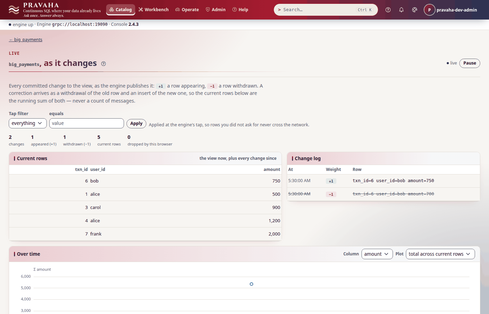
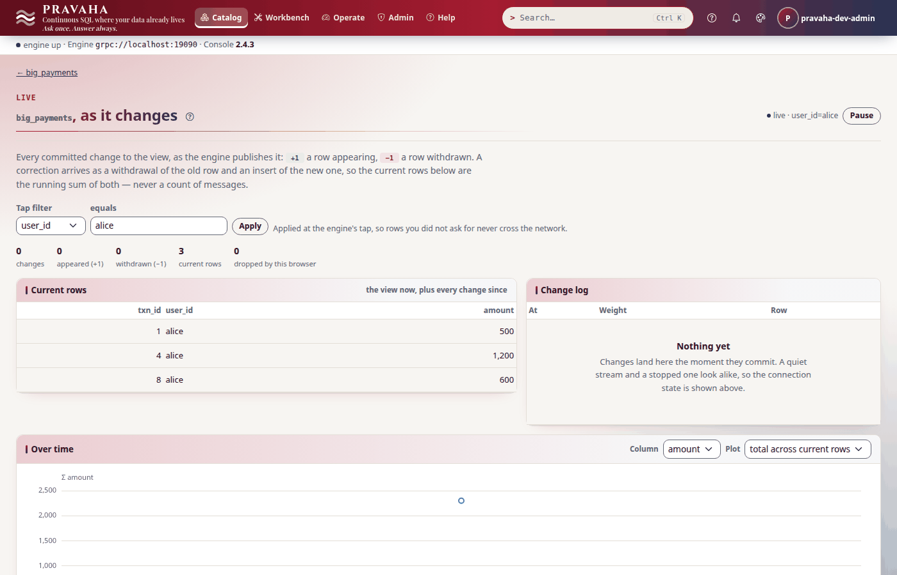
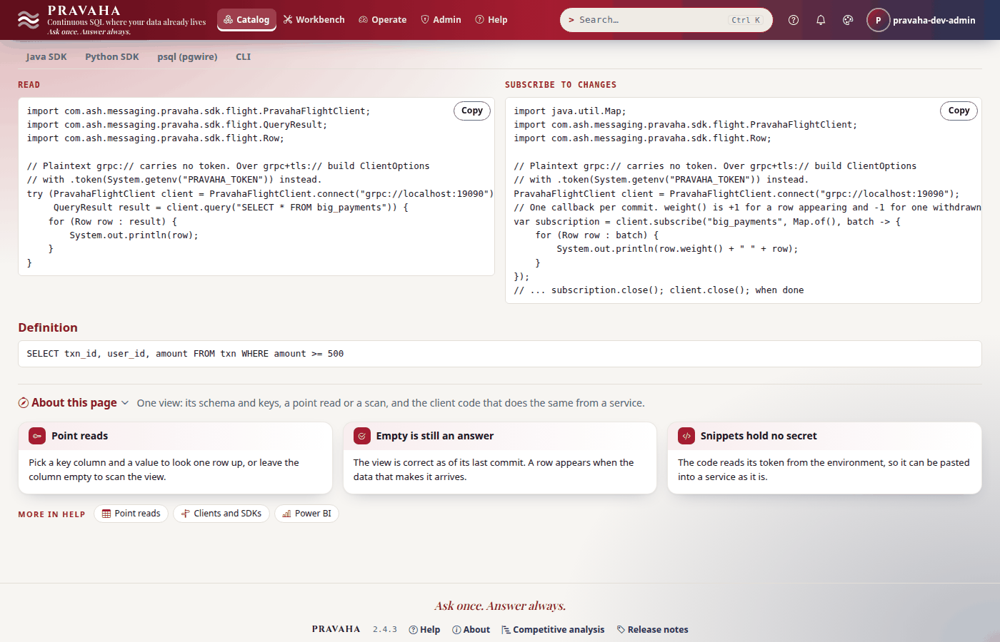
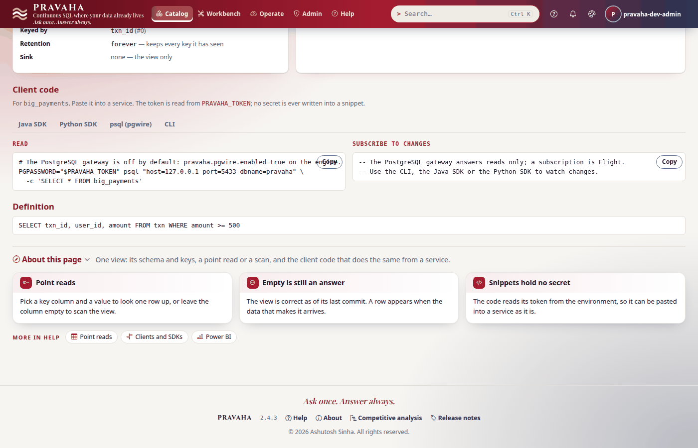

# Tutorial 4 · Following a view

Copyright © 2026 Ashutosh Sinha \<ajsinha@gmail.com\>. All rights reserved.
**Proprietary and confidential** — see [`../../LICENSE`](../../LICENSE).

Asking a view again and again works, but a maintained answer can do better: it can **push** every
change to whoever is following it, the moment the change is committed, with a weight that says
whether a row appeared (`+1`) or was withdrawn (`−1`). In this tutorial you follow one view every way
a reader can: from the command line with a snapshot first, through a correction that arrives as
`−1` and `+1`, with a filter applied at the server, from Python keeping an exact copy by weights,
from Java, and from a BI tool's point of view — `psql` through Pravaha's PostgreSQL gateway with an
API key. Then you restart the node under a subscriber that reconnects, and end a subscription the
way a drop ends it. Every output below was printed by a real node running these steps.

**Time to complete:** about 30 minutes.

## Before you start

- [Tutorial 1](01-first-15-minutes.md) done: a node with `--spring.profiles.active=dev,users`, signed in,
  `PRAVAHA_TOKEN` and `PRAVAHA_INSECURE_TOKEN=true` exported.
- The tutorial's files, in [data/t04/](data/t04/): `application.yaml` (the node, with the PostgreSQL
  gateway on), `streams/txn.yaml` (the stream and its source, a file the node reads from its
  `conf/streams/`), `txn.csv` (six payments) and `follow.py` (Step 4).
- `psql`, the PostgreSQL client (`sudo apt install postgresql-client`, or any version from 9.4 on), for Step 6.
- **Two terminals**: a subscription waits for changes, so follow in one and append rows from the other.
- A node home with the configuration and the data in place:

```bash
export PRAVAHA_HOME=$HOME/pravaha-t04
mkdir -p $PRAVAHA_HOME/conf $PRAVAHA_HOME/data/incoming
cp -r docs/tutorials/data/t04/application.yaml docs/tutorials/data/t04/streams $PRAVAHA_HOME/conf/
cp docs/tutorials/data/t04/txn.csv $PRAVAHA_HOME/data/incoming/
bin/pravaha-server --spring.profiles.active=dev,users &
cd docs/tutorials/data/t04
```

The source reads an **operation column**: a line whose `op` is `D` withdraws the row it repeats, so a
correction to a payment is a `D` line and an `I` line. That is what makes the `−1`s in this tutorial.

```yaml
# conf/streams/txn.yaml (the source)
source:
  plugin: filesystem
  options:
    path: data/incoming/txn.csv
    follow: "true"
    op.column: op              # D withdraws the row it repeats; anything else inserts
```

```yaml
# conf/application.yaml (the gateway)
pravaha:
  pgwire:
    enabled: true              # read-only, off by default
    host: 127.0.0.1            # loopback until TLS is configured
    port: 5433                 # 5432 is usually a real PostgreSQL on the same machine
```

## What you will learn

- a subscription's **snapshot**, its **commits**, and why `--snapshot` closes the gap between reading and following;
- what a **weight** is, and why a copy is kept by summing weights, never by counting rows;
- **filters** applied at the server's tap, and the refusal for a column the view lacks;
- following from **Python** (`snapshot=True`, `overflow="FAIL"`) and from **Java**;
- reading a view from any PostgreSQL client through the **gateway**, with an **API key**, and what it refuses;
- **reconnecting** across a restart, and the ways a subscription ends.

## Step 1 · A snapshot, then every change

Register the view this tutorial follows — every payment of 500 or more, keyed by its id:

<!-- capture: t04-register -->
```text
$ pravaha register --name big_payments --sql 'SELECT txn_id, user_id, amount FROM txn WHERE amount >= 500' --keys 0
registered big_payments  state=RUNNING  fingerprint=9519c229e12e
a query with the same fingerprint is the same computation, shared
```
<!-- /capture -->

Follow it with a snapshot in the first terminal, then append a payment in the second:

```bash
pravaha subscribe --view big_payments --snapshot --limit 5
```

<!-- capture: t04-append-one -->
```text
$ printf '%s\n' '7,frank,2000,COMPLETED,2026-10-01T09:01:50Z,I' >> "$PRAVAHA_HOME/data/incoming/txn.csv"
```
<!-- /capture -->

<!-- capture: t04-subscribe-snapshot -->
```text
$ pravaha subscribe --view big_payments --snapshot --limit 5
subscribing to big_payments; the view's changelog prints first (on a keyed view, every version of a key -- --answer for the rows a read returns), then changes print as they are committed, until 5 rows (at the end of that commit). Ctrl-C to stop.
WEIGHT	txn_id	user_id	amount
+1	1	alice	500
+1	3	carol	900
+1	4	alice	1200
+1	6	bob	700
-- snapshot at frontier 1790845290000000000, 4 rows
+1	7	frank	2000
-- commit, 1 row
```
<!-- /capture -->

The first batch is the whole view, and every batch after it is one **commit** — the unit in which a
view changes; you never receive half of one. The snapshot and the commits are cut at the same point
(the **frontier**, in nanoseconds of event time), so nothing is missed between them and nothing
counted twice. Reading the view and then subscribing *without* a snapshot can lose the commit in
flight between the two, silently: `--snapshot` exists to close that gap. `--limit` stops at the end
of the commit that reaches it; leave it off to follow until Ctrl-C.

You should see four rows in the snapshot, then frank's 2000 as one commit.

## Step 2 · A correction arrives as −1 and +1

Bob's payment 6 was 750, not 700. The sender withdraws the wrong row and sends the right one:

```bash
pravaha subscribe --view big_payments --limit 2
```

<!-- capture: t04-append-correction -->
```text
$ printf '%s\n' '6,bob,700,COMPLETED,2026-10-01T09:01:30Z,D' '6,bob,750,COMPLETED,2026-10-01T09:01:30Z,I' >> "$PRAVAHA_HOME/data/incoming/txn.csv"
```
<!-- /capture -->

<!-- capture: t04-subscribe-correction -->
```text
$ pravaha subscribe --view big_payments --limit 2
subscribing to big_payments; changes print as they are committed, until 2 rows (at the end of that commit). Ctrl-C to stop.
WEIGHT	txn_id	user_id	amount
-1	6	bob	700
+1	6	bob	750
-- commit, 2 rows
```
<!-- /capture -->

An update is a `−1` of the old row and a `+1` of the new one, **in one commit**. A consumer that
treated every row as an insert would now hold two payments numbered 6; one that sums weights holds
exactly the view. Live shows the withdrawn row struck through:



You should see `-1` for 700 and `+1` for 750 in one commit.

## Step 3 · Filter at the server

A subscriber that wants one user's changes says so, and the rest never cross the network:

```bash
pravaha subscribe --view big_payments --filter user_id=alice --limit 1
```

<!-- capture: t04-append-two -->
```text
$ printf '%s\n' '8,alice,600,COMPLETED,2026-10-01T09:02:05Z,I' '9,carol,800,COMPLETED,2026-10-01T09:02:10Z,I' >> "$PRAVAHA_HOME/data/incoming/txn.csv"
```
<!-- /capture -->

<!-- capture: t04-subscribe-filtered -->
```text
$ pravaha subscribe --view big_payments --filter user_id=alice --limit 1
subscribing to big_payments where user_id = 'alice'; changes print as they are committed, until 1 row (at the end of that commit). Ctrl-C to stop.
WEIGHT	txn_id	user_id	amount
+1	8	alice	600
-- commit, 1 row
```
<!-- /capture -->

Carol's 800 was in the same commit and was not sent. Filters are equalities on the view's columns,
applied at the engine's tap; a column the view does not have is refused rather than ignored, because
an ignored filter would deliver everything while you believed you had asked for a slice:

<!-- capture: t04-filter-refused -->
```text
$ pravaha subscribe --view big_payments --filter merchant=acme --limit 1
subscribing to big_payments where merchant = 'acme'; changes print as they are committed, until 1 row (at the end of that commit). Ctrl-C to stop.
PRV-8002  this view has no column 'merchant', so that filter cannot be applied to it. Its columns are [txn_id, user_id, amount]. A filter that was quietly ignored would leave you receiving everything while believing you asked for a slice
  look PRV-8002 up in the console's help under Errors, or in docs/guides/TROUBLESHOOTING.md
(exit 1)
```
<!-- /capture -->

The Live page takes the same filter (**Tap filter**), applied at the same tap:



You should see only alice's 600, and `PRV-8002` for a column the view lacks.

## Step 4 · Keep a copy from Python

A program that keeps a copy of a view — a cache, a materialised table elsewhere — follows it with a
snapshot and **applies the weights**:

<!-- file: data/t04/follow.py -->
```python
copy = Counter()
# snapshot=True: the view as it is, then every commit after it -- none missed, none counted twice.
# overflow="FAIL": a copy built from weights must see every weight, so falling behind ends the stream.
for n, batch in enumerate(client.subscribe("big_payments", snapshot=True, overflow="FAIL")):
    for row in batch:
        r = row.to_dict()
        copy[(r["txn_id"], r["user_id"], r["amount"])] += row.weight     # apply the weight; never count rows
        print("snapshot" if batch.snapshot else "commit  ", f"{row.weight:+d}", r)
    if n == 1:                          # the snapshot, then one commit
        break
```

The whole script, with its connection, is [data/t04/follow.py](data/t04/follow.py). Start it, then
correct carol's payment 9 from 800 to 850:

<!-- capture: t04-append-python -->
```text
$ printf '%s\n' '9,carol,800,COMPLETED,2026-10-01T09:02:10Z,D' '9,carol,850,COMPLETED,2026-10-01T09:02:10Z,I' >> "$PRAVAHA_HOME/data/incoming/txn.csv"
```
<!-- /capture -->

<!-- capture: t04-python -->
```text
$ python follow.py
snapshot +1 {'txn_id': 1, 'user_id': 'alice', 'amount': 500}
snapshot +1 {'txn_id': 3, 'user_id': 'carol', 'amount': 900}
snapshot +1 {'txn_id': 4, 'user_id': 'alice', 'amount': 1200}
snapshot +1 {'txn_id': 7, 'user_id': 'frank', 'amount': 2000}
snapshot +1 {'txn_id': 6, 'user_id': 'bob', 'amount': 750}
snapshot +1 {'txn_id': 8, 'user_id': 'alice', 'amount': 600}
snapshot +1 {'txn_id': 9, 'user_id': 'carol', 'amount': 800}
commit   -1 {'txn_id': 9, 'user_id': 'carol', 'amount': 800}
commit   +1 {'txn_id': 9, 'user_id': 'carol', 'amount': 850}
the copy:
  1 alice 500
  3 carol 900
  4 alice 1200
  6 bob 750
  7 frank 2000
  8 alice 600
  9 carol 850
```
<!-- /capture -->

The copy holds exactly the view. Two settings decide what happens when a subscriber reads more
slowly than the view changes — the server buffers changes for it (`buffer_rows`, 10,000 by default)
and, when the buffer is full, `overflow` says what it does:

| `overflow` | What happens | Use it when |
|---|---|---|
| `CONFLATE` (the default) | keeps only the latest change per key | you want the current state and can skip intermediate values — a dashboard |
| `DROP_OLDEST` | drops the oldest buffered changes | recent changes matter more than old ones |
| `FAIL` | ends the subscription with `PRV-6105` | you keep a copy: a dropped weight is a copy gone wrong; subscribe again with `snapshot=True` |

With `CONFLATE` and `DROP_OLDEST`, `batch.dropped_before` (or `batch.missed_anything()`) says it
happened.

You should see seven rows in the snapshot, one commit of `-1` and `+1`, and a copy with carol's 850.

## Step 5 · Follow it from Java

Every view's page in the console writes the client code for it — Java, Python, `psql` and the CLI —
under **Client code**. This is the Java the console writes for `big_payments`:



On a node with sign-in on, as this one is, connect with the token, and say that sending it over
plaintext to this machine is intended (the same two things the CLI needed in tutorial 1):

```java
import java.util.Map;

import com.ash.messaging.pravaha.sdk.ClientOptions;
import com.ash.messaging.pravaha.sdk.flight.PravahaFlightClient;
import com.ash.messaging.pravaha.sdk.flight.Row;

ClientOptions options = ClientOptions.builder("grpc://localhost:19090")
        .token(System.getenv("PRAVAHA_TOKEN"))
        .allowInsecureToken(true)            // a node on this machine, over plaintext
        .build();
PravahaFlightClient client = PravahaFlightClient.connect(options);
// One callback per commit. weight() is +1 for a row appearing and -1 for one withdrawn.
var subscription = client.subscribe("big_payments", Map.of(), batch -> {
    for (Row row : batch) {
        System.out.println(row.weight() + " " + row);
    }
});
// ... subscription.close(); client.close(); when done
```

The console's snippet for a `grpc://` engine connects without a token, which a node with sign-in on
refuses with `PRV-7001`; use the options above until it does. The Java client has the same snapshot,
filter and overflow options as Python, and a reconnecting form of `subscribe`; the
[clients guide](../../pravaha-console/content/topics/clients.md) has them all.

You should see, on the view page, the read and the subscription written for `big_payments`.

## Step 6 · Read it from a BI tool, over the PostgreSQL protocol

Almost nothing a BI tool has installed speaks Arrow Flight; almost everything speaks PostgreSQL. The
gateway is a second, **read-only** door onto the same views: same planner, same authorization, same
audit trail. A BI tool should not use your session (it ends in hours); make it an **API key**, shown
once:

<!-- capture: t04-key -->
```text
$ pravaha key create bi-reader --days 30
key <id>, expires <time>. Shown once:
<key>
```
<!-- /capture -->

```bash
export KEY=$(pravaha key create bi-reader --days 30)     # the key alone is on stdout
```

The key is the PostgreSQL password; the user name is informational (the credential decides who you
are):

<!-- capture: t04-psql-read -->
```text
$ PGPASSWORD="$KEY" psql "host=127.0.0.1 port=5433 dbname=pravaha user=pravaha-dev-admin" -c 'SELECT * FROM big_payments'
 txn_id | user_id | amount
--------+---------+--------
      1 | alice   |    500
      3 | carol   |    900
      4 | alice   |   1200
      7 | frank   |   2000
      6 | bob     |    750
      8 | alice   |    600
      9 | carol   |    850
(7 rows)
```
<!-- /capture -->

The catalogue answers too, filtered by what the key may read, which is what lets a BI tool's
navigator list the views:

<!-- capture: t04-psql-tables -->
```text
$ PGPASSWORD="$KEY" psql "host=127.0.0.1 port=5433 dbname=pravaha user=pravaha-dev-admin" -c '\dt'
             List of tables
 Schema |     Name     | Type  |  Owner
--------+--------------+-------+---------
 public | big_payments | table | pravaha
(1 row)
```
<!-- /capture -->

It reads; it never changes anything:

<!-- capture: t04-psql-write -->
```text
$ PGPASSWORD="$KEY" psql "host=127.0.0.1 port=5433 dbname=pravaha user=pravaha-dev-admin" -c 'DROP CONTINUOUS QUERY big_payments'
ERROR:  PRV-6211  the PostgreSQL gateway is read-only: it does not register, drop, pause, resume or list continuous queries, or show or change the catalogue's grants (ADR-059). Send the statement over Flight SQL instead -- an SDK's query(), `pravaha query --sql`, or the console's workbench -- where it runs as your principal.
DETAIL:  PGWIRE_READ_ONLY
(exit 1)
```
<!-- /capture -->

The same connection — host, port 5433, database `pravaha`, the key as the password — is what
DBeaver, Grafana or [Power BI](../../pravaha-console/content/topics/power-bi.md) take. A gateway is a
**read** of the current state, not a subscription: a dashboard refreshes. The account's own password
is not accepted here, only a key or a session token (`28P01` otherwise); a revoked key ends an open
connection at its next statement. The view page's **psql (pgwire)** tab writes the command for you:



You should see seven rows through `psql`, `big_payments` in `\dt`, and `PRV-6211` for the `DROP`.

## Step 7 · Survive a restart, and the ways a subscription ends

A subscription is a connection; when the node restarts, it breaks. `--reconnect` opens it again,
with a backoff from a quarter of a second to ten, until `--reconnect-timeout` (300 s) runs out:

```bash
pravaha subscribe --view big_payments --reconnect --limit 1
```

Restart the node (stop it, and start it again as in *Before you start*). It comes back with its
query — a node keeps its registry journal and checkpoints in its data folder, `$PRAVAHA_HOME/data`
here and `./data` for a node with no home, unless told `pravaha.data.dir: none` — and re-reads the
file. Then append a
payment:

<!-- capture: t04-append-after-restart -->
```text
$ printf '%s\n' '10,erin,950,COMPLETED,2026-10-01T09:02:30Z,I' >> "$PRAVAHA_HOME/data/incoming/txn.csv"
```
<!-- /capture -->

<!-- capture: t04-subscribe-reconnect -->
```text
$ pravaha subscribe --view big_payments --reconnect --limit 1
subscribing to big_payments; changes print as they are committed, until 1 row (at the end of that commit). Ctrl-C to stop.
-- reconnected; commits made while disconnected were not delivered
WEIGHT	txn_id	user_id	amount
+1	10	erin	950
-- commit, 1 row
```
<!-- /capture -->

`-- reconnected` says plainly what a reconnect without a snapshot means: the stream resumes at the
next commit, and **commits made while it was down are not delivered**. A consumer that keeps a copy
reconnects with `--snapshot` (or `snapshot=True` with `reconnect=True` in Python): after
`-- reconnected` it receives a fresh snapshot, and its copy is exact again. A subscription also ends
on its own when the view goes. Follow `big_payments` and drop it from the other terminal:

<!-- capture: t04-drop -->
```text
$ pravaha drop --name big_payments --yes
dropped big_payments
```
<!-- /capture -->

<!-- capture: t04-subscribe-ends -->
```text
$ pravaha subscribe --view big_payments
subscribing to big_payments; changes print as they are committed. Ctrl-C to stop.
PRV-8018  'big_payments' has been dropped and no longer exists on this node, so there are no more changes to it. What you received up to here is complete.
  look PRV-8018 up in the console's help under Errors, or in docs/guides/TROUBLESHOOTING.md
(exit 1)
```
<!-- /capture -->

Every ending other than your own says what you received is complete up to that point:

| What happened | How it ends | What to do |
|---|---|---|
| you stopped (Ctrl-C, `break`, `close`) | nothing to report | — |
| the view was dropped | it ends with `PRV-8018` | stop |
| a replacement cut over to a new version ([tutorial 5](05-changing-a-running-query.md)) | it ends with `PRV-4019` | subscribe again, with a snapshot |
| you fell behind with `overflow` `FAIL` | it ends with `PRV-6105` | subscribe again, with a snapshot |
| the node went away | a connection error, or `-- reconnected` with `--reconnect` | `--snapshot` with `--reconnect` when you keep a copy |

You should see `-- reconnected` followed by erin's 950, and `PRV-8018` after the drop.

## Next steps

- [Tutorial 5 · Changing a running query safely](05-changing-a-running-query.md): what a subscriber
  sees when the query under its view is replaced.
- [Tutorial 6 · Investigating an incident](06-investigating-an-incident.md): subscribers in
  `pravaha top`, and what to do when a feed stops.
- The reference: [subscriptions](../../pravaha-console/content/topics/subscriptions.md),
  [the PostgreSQL gateway](../../pravaha-console/content/topics/pgwire.md), and
  [PYTHON_API_GUIDE.md](../guides/PYTHON_API_GUIDE.md) §12 (`subscribe` and `ChangeBatch`).

## If something goes wrong

| Symptom | What it means | What to do |
|---|---|---|
| `PRV-4023` when subscribing | no view by that name | `pravaha views list`; register it first |
| `PRV-8002` for a filter | the view has no such column | filter on one of the columns the message lists |
| `PRV-6105` while following | you fell behind a subscription with `overflow` `FAIL` | subscribe again with a snapshot; raise `buffer_rows` if it recurs |
| `PRV-7001` from the Java or Python client | it connected without a token, or one the node does not know | pass the token, and `allowInsecureToken(true)` / `allow_insecure_token=True` on loopback |
| `psql` says `connection refused` | the gateway is off, or on another port | `pravaha.pgwire.enabled: true`; the node logs `PostgreSQL wire protocol listening on …` |
| `psql` fails with `28P01` | the password is the account's own, or a revoked or expired key | use an API key (`pravaha key create`) or a session token |
| `PRV-6211` from `psql` | the gateway is read-only | register, drop and change queries over Flight: the CLI, an SDK, the Workbench |
| A copy kept by a program drifts from the view | rows were counted rather than weights summed, or commits were missed across a reconnect | sum weights; reconnect with a snapshot |
