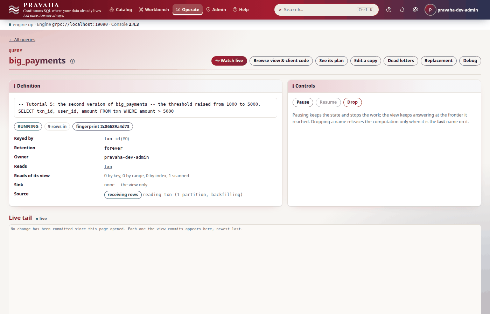

# Tutorial 5 · Changing a running query safely

Copyright © 2026 Ashutosh Sinha \<ajsinha@gmail.com\>. All rights reserved.
**Proprietary and confidential** — see [`../../LICENSE`](../../LICENSE).

`big_payments` answers "payments over 1000", and people are reading it. Now the threshold should be
5000. Dropping the query and registering it again would take the answer away from every reader and
start the new one empty. A **replacement** instead runs the new version beside the old one, fills it
from the source's history, and moves the name across only when you say so — keeping the old version
for an instant **rollback**. In this tutorial you look before you leap with `--dry-run`, start a
replacement and watch it catch up, compare the two answers, cut over while a subscriber follows the
view, roll back without losing a row, abandon one replacement and finish another, and see what each
reader is told at each step. Every output below was printed by a real node running these steps.

**Time to complete:** about 25 minutes.

## Before you start

- [Tutorial 1](01-first-15-minutes.md) done, and [tutorial 4](04-following-a-view.md) for
  subscriptions: a subscriber is told when the view it follows changes version.
- The tutorial's files, in [data/t05/](data/t05/): `streams/txn.yaml` (the stream, a file the node reads
  from its `conf/streams/`), `txn.csv` (eight payments) and
  `big_payments_v2.sql` (the new version).
- A node home with the configuration and the data in place:

```bash
export PRAVAHA_HOME=$HOME/pravaha-t05
mkdir -p $PRAVAHA_HOME/conf $PRAVAHA_HOME/data/incoming
cp -r docs/tutorials/data/t05/streams $PRAVAHA_HOME/conf/
cp docs/tutorials/data/t05/txn.csv $PRAVAHA_HOME/data/incoming/
bin/pravaha-server --spring.profiles.active=dev,users &
cd docs/tutorials/data/t05
export PRAVAHA_TOKEN=$(pravaha login --user pravaha-dev-admin) PRAVAHA_INSECURE_TOKEN=true
```

Replacing, cutting over and rolling back need the *administer* permission on the name: the query's
owner, a principal granted it, or the `admin` role (which `pravaha-dev-admin` has).

## What you will learn

- what `--dry-run` reads and says before `drop`, `replace`, `cutover` and `finish`, and that it changes nothing;
- how a replacement **backfills** from history, splices onto the live stream, and reports `CAUGHT_UP`;
- that the name keeps answering the old version until **cutover**, and what a subscriber sees at the cutover;
- **rollback**: instant, and current, because the old version kept running;
- **abandon** and **finish**, the two ends that cannot be undone;
- where the console shows all of it.

## Step 1 · Look at what is running

Register the first version:

<!-- capture: t05-register -->
```text
$ pravaha register --name big_payments --sql 'SELECT txn_id, user_id, amount FROM txn WHERE amount > 1000' --keys 0
registered big_payments  state=RUNNING  fingerprint=ffdc4688bdf2
a query with the same fingerprint is the same computation, shared
```
<!-- /capture -->

<!-- capture: t05-describe -->
```text
$ pravaha describe big_payments
name         big_payments
state        RUNNING
owner        pravaha-dev-admin
fingerprint  ffdc4688bdf2
lane         own
key          txn_id
retention    forever
sink         -
rows in      8
late rows    0
registered   <time>
shared with  -
reads        txn
feed         RUNNING
execution    interpreted: Project[txn_id, user_id, amount] <- Filter(amount > 1000) <- Scan(txn) -- not generated: PRV-3101  cannot generate a projection of STRING yet (column 'user_id'). The interpreted path handles it; this stage falls back. The interpreted path runs this correctly and more slowly.,generated: Filter(amount > 1000) <- Scan(txn) -- generated: 35 lines, compiled in N ms
sql
SELECT txn_id, user_id, amount FROM txn WHERE amount > 1000
```
<!-- /capture -->

`shared with -` matters: a replacement moves **one name**, so it is refused (`PRV-8003`) while
another name shares the computation — its readers could not be told which version they were
following. Drop or replace the other names first.

You should see `state RUNNING`, `rows in 8` and `shared with -`.

## Step 2 · Look before you leap

The new version is one line:

```sql
-- data/t05/big_payments_v2.sql
SELECT txn_id, user_id, amount FROM txn WHERE amount > 5000
```

Every command that is destructive or hard to undo takes `--dry-run`. It **changes nothing** — not
even with `--yes` — and makes only reads (HTTP `GET`s, and `validate`/`explain`, which plan and keep
nothing), then says what it found and what would happen:

<!-- capture: t05-replace-dry-run -->
```text
$ pravaha replace --name big_payments --sql-file big_payments_v2.sql --keys 0 --dry-run
dry run: replace big_payments -- nothing was changed
state            RUNNING
fingerprint now  ffdc4688bdf2
fingerprint new  2c86689a4d73
planDiff:
--- running
+++ replacement
@@ -1,3 +1,3 @@
 Project[txn_id, user_id, amount]
-  Filter(amount > 1000)
+  Filter(amount > 5000)
     Scan(txn)
would:
  - a candidate version starts beside the running one; 'big_payments' keeps answering the running version meanwhile
  - a backfill starts: the candidate replays the streams' retained history before it can cut over
  - the name moves only on `pravaha cutover --name big_payments`
not known without doing it:
  - whether every stream it reads can be replayed is decided when the backfill starts
```
<!-- /capture -->

The plan diff is the change in one line; the new fingerprint is the computation the name would land
on. The same for a `drop`, which would end every reader:

<!-- capture: t05-drop-dry-run -->
```text
$ pravaha drop --name big_payments --dry-run
dry run: drop big_payments -- nothing was changed
state        RUNNING
fingerprint  ffdc4688bdf2
owner        pravaha-dev-admin
shared with  nothing
reads from   txn
dependants   none
sink         -
subscribers  0
would:
  - the name big_payments goes: a read or subscription of big_payments is refused after it
  - it is the computation's last name: the computation stops and its view and state are released
```
<!-- /capture -->

A dry run exits `1` when the reads show a refusal (a replacement already in flight, `PRV-4017`; a
shared computation, `PRV-8003`; new SQL that does not plan, its own code) and lists what only doing
it can tell, under *not known without doing it*. The console's **Replacement** screen, for a query
that is not being replaced, is the same start from a form, prefilled with what runs now:


You should see the plan diff `-  Filter(amount > 1000)` / `+  Filter(amount > 5000)` and `nothing was changed`.

## Step 3 · Start the replacement and watch it catch up

<!-- capture: t05-replace -->
```text
$ pravaha replace --name big_payments --sql-file big_payments_v2.sql --keys 0 --backfill history --rate-limit 10000 --cutover manual --wait
backfilling big_payments  candidate=2c86689a4d73  replacing=ffdc4688bdf2
  history N rows, N of 1 partitions on the live stream, N rows/s (limit 10000), lag N ms
caught up big_payments  candidate=2c86689a4d73  replacing=ffdc4688bdf2
  history 8 rows, 1 of 1 partitions on the live stream, N rows/s (limit 10000), lag N ms
'big_payments' still answers the version it answered before; `pravaha cutover --name big_payments` is what moves it
```
<!-- /capture -->

| Option | Here | Meaning |
|---|---|---|
| `--backfill` | `history` | replay the source's history into the new version; `none` starts it empty at the live position — right only when the answer does not depend on history |
| `--rate-limit` | `10000` | a ceiling in records a second, so the backfill cannot starve the live query; it can be lowered while it runs (`pravaha throttle`), never raised |
| `--cutover` | `manual` | wait for you; `auto` cuts over as soon as it has caught up |
| `--rollback-retention` | default `PT1H` | how long the old version is kept after the cutover, for a rollback |
| `--wait` | | wait until the backfill has caught up (or failed), printing its progress |

The candidate read the eight records of history, reached the live position on the source's one
partition, and is now following the live stream beside the old version: `CAUGHT_UP`. There is no
percentage and no estimate, deliberately: a source does not say how much history it holds.

<!-- capture: t05-replacements -->
```text
$ pravaha replacements --name big_payments
NAME          STATE      HISTORY  ROWS/S  LIVE  ROLLBACK
big_payments  CAUGHT_UP  8        N      1/1   -
```
<!-- /capture -->

**The name still answers the old version**, and nobody reading it has noticed anything:

<!-- capture: t05-still-old -->
```text
$ pravaha query --sql 'SELECT txn_id, amount FROM big_payments'
txn_id  amount
1       1500
3       3000
4       12000
5       5200
6       7000
8       8000
6 rows
```
<!-- /capture -->


Poll for `CAUGHT_UP` **or** `FAILED`, never `CAUGHT_UP` alone: a backfill that cannot finish becomes
`FAILED`, with `failure_code` and `failure` saying why, and the name goes on answering the old
version. A source that cannot be replayed is refused when the backfill starts (`PRV-4018`).

You should see `caught up big_payments`, `CAUGHT_UP` in `replacements`, and six rows — the old answer.

## Step 4 · Cut over, while someone is following

Have a subscriber on the view in one terminal (`pravaha subscribe --view big_payments`), and in the
other look, then cut over:

<!-- capture: t05-cutover-dry-run -->
```text
$ pravaha cutover --name big_payments --dry-run
dry run: cutover big_payments -- nothing was changed
state           CAUGHT_UP
candidate       2c86689a4d73
replacing       ffdc4688bdf2
rollback until  -
would:
  - the name moves to the candidate; the running version is retained for a rollback
```
<!-- /capture -->

<!-- capture: t05-cutover -->
```text
$ pravaha cutover --name big_payments
cut over big_payments  candidate=2c86689a4d73  replacing=ffdc4688bdf2
  history 8 rows, 1 of 1 partitions on the live stream, N rows/s (limit 10000), lag N ms
  the version it replaced is retained until <time>
```
<!-- /capture -->

The subscriber's stream ends, and says why:

<!-- capture: t05-subscriber-told -->
```text
$ pravaha subscribe --view big_payments
subscribing to big_payments; changes print as they are committed. Ctrl-C to stop.
PRV-4019  'big_payments' was replaced at a cutover and now answers a different query. Every change the version you were following made has been delivered; subscribe again to follow the new one from a fresh snapshot.
  look PRV-4019 up in the console's help under Errors, or in docs/guides/TROUBLESHOOTING.md
(exit 1)
```
<!-- /capture -->

The view now answers the new question:

<!-- capture: t05-new -->
```text
$ pravaha query --sql 'SELECT txn_id, amount FROM big_payments'
txn_id  amount
4       12000
5       5200
6       7000
8       8000
4 rows
```
<!-- /capture -->

The name moved at a point where both versions had consumed exactly the same input, so a reader sees
the old answer up to the seam and the new one after it — never a mixture. A subscriber is told,
because the view it was following now answers a different question; it subscribes again with a
snapshot (`PRV-4019` is the one ending that asks for that). The replacement records every version
that has answered the name:

<!-- capture: t05-history -->
```text
GET /api/v1/queries/big_payments/replacement
200
{
  "state": "CUT_OVER",
  "candidate": "2c86689a4d73",
  "replacing": "ffdc4688bdf2",
  "history": [
    "from the beginning: ffdc4688bdf2",
    "from <time>: 2c86689a4d73"
  ],
  "rollbackAvailable": true
}
```
<!-- /capture -->


You should see `cut over`, `PRV-4019` at the subscriber, four rows, and two versions in `history`.

## Step 5 · Roll back, and lose nothing

During the rollback window both versions keep running. A payment of 1500 arrives — above the old
threshold, below the new:

<!-- capture: t05-append -->
```text
$ echo '9,gina,1500,COMPLETED,2026-10-01T09:02:20Z' >> "$PRAVAHA_HOME/data/incoming/txn.csv"
```
<!-- /capture -->

<!-- capture: t05-new-after-append -->
```text
$ pravaha query --sql 'SELECT txn_id, amount FROM big_payments'
txn_id  amount
4       12000
5       5200
6       7000
8       8000
4 rows
```
<!-- /capture -->

The new version ignores it, correctly. Roll back:

<!-- capture: t05-rollback -->
```text
$ pravaha rollback --name big_payments
rolled back big_payments  candidate=2c86689a4d73  replacing=ffdc4688bdf2
  history 8 rows, 1 of 1 partitions on the live stream, N rows/s (limit 10000), lag N ms
```
<!-- /capture -->

<!-- capture: t05-old-again -->
```text
$ pravaha query --sql 'SELECT txn_id, amount FROM big_payments'
txn_id  amount
1       1500
3       3000
4       12000
5       5200
6       7000
8       8000
9       1500
7 rows
```
<!-- /capture -->

The rollback is instant and current: the old version saw payment 9 while it was standing by, so the
answer it hands back includes it. A rollback ends subscriptions to the name exactly as a cutover does
(`PRV-4019`), and is refused once the window has passed or the replacement is finished (`PRV-8003`).

You should see payment 9 (1500) in the old version's answer.

## Step 6 · Abandon one, finish another

Start the replacement again; this time decide against it. `abandon` without `--yes` only says what
it would do:

<!-- capture: t05-replace-again -->
```text
$ pravaha replace --name big_payments --sql-file big_payments_v2.sql --keys 0 --wait
backfilling big_payments  candidate=2c86689a4d73  replacing=ffdc4688bdf2
  history N rows, N of 1 partitions on the live stream, N rows/s, lag N ms
caught up big_payments  candidate=2c86689a4d73  replacing=ffdc4688bdf2
  history 9 rows, 1 of 1 partitions on the live stream, N rows/s, lag N ms
'big_payments' still answers the version it answered before; `pravaha cutover --name big_payments` is what moves it
```
<!-- /capture -->

<!-- capture: t05-abandon-plan -->
```text
$ pravaha abandon --name big_payments
would abandon the replacement of big_payments: the candidate version is released and its backfill is lost
caught up big_payments  candidate=2c86689a4d73  replacing=ffdc4688bdf2
  history 9 rows, 1 of 1 partitions on the live stream, N rows/s, lag N ms
nothing was changed; run `pravaha abandon --name big_payments --yes` to do it
```
<!-- /capture -->

<!-- capture: t05-abandon -->
```text
$ pravaha abandon --name big_payments --yes
abandoned big_payments  candidate=2c86689a4d73  replacing=ffdc4688bdf2
  history 9 rows, 1 of 1 partitions on the live stream, N rows/s, lag N ms
```
<!-- /capture -->

<!-- capture: t05-replacements-abandoned -->
```text
$ pravaha replacements --name big_payments
NAME          STATE      HISTORY  ROWS/S  LIVE  ROLLBACK
big_payments  ABANDONED  9        N       1/1   -
```
<!-- /capture -->

Abandoning ends a replacement that has not cut over: the candidate is released and the name keeps
the version it had. Now do it for real — replace, cut over, and **finish**:

<!-- capture: t05-replace-third -->
```text
$ pravaha replace --name big_payments --sql-file big_payments_v2.sql --keys 0 --wait
backfilling big_payments  candidate=2c86689a4d73  replacing=ffdc4688bdf2
  history N rows, N of 1 partitions on the live stream, N rows/s, lag N ms
caught up big_payments  candidate=2c86689a4d73  replacing=ffdc4688bdf2
  history 9 rows, 1 of 1 partitions on the live stream, N rows/s, lag N ms
'big_payments' still answers the version it answered before; `pravaha cutover --name big_payments` is what moves it
```
<!-- /capture -->

<!-- capture: t05-cutover-third -->
```text
$ pravaha cutover --name big_payments
cut over big_payments  candidate=2c86689a4d73  replacing=ffdc4688bdf2
  history 9 rows, 1 of 1 partitions on the live stream, N rows/s, lag N ms
  the version it replaced is retained until <time>
```
<!-- /capture -->

<!-- capture: t05-finish-dry-run -->
```text
$ pravaha finish --name big_payments --dry-run
dry run: finish big_payments -- nothing was changed
state           CUT_OVER
candidate       2c86689a4d73
replacing       ffdc4688bdf2
rollback until  <time>
would:
  - the version it replaced is released; there is no rollback after this
```
<!-- /capture -->

<!-- capture: t05-finish -->
```text
$ pravaha finish --name big_payments --yes
finished big_payments  candidate=2c86689a4d73  replacing=ffdc4688bdf2
  history 9 rows, 1 of 1 partitions on the live stream, N rows/s, lag N ms
```
<!-- /capture -->

`finish` confirms the cutover and releases the old version's state at once, rather than at the end of
the rollback window. After it there is no way back but another replacement:

<!-- capture: t05-rollback-refused -->
```text
$ pravaha rollback --name big_payments
PRV-8003  'big_payments' is FINISHED and there is nothing to roll back: the version it replaced has been released, which is what finishing a replacement means
  look PRV-8003 up in the console's help under Errors, or in docs/guides/TROUBLESHOOTING.md
(exit 1)
```
<!-- /capture -->

<!-- capture: t05-final -->
```text
$ pravaha query --sql 'SELECT txn_id, amount FROM big_payments'
txn_id  amount
4       12000
5       5200
6       7000
8       8000
4 rows
```
<!-- /capture -->

<!-- capture: t05-describe-final -->
```text
$ pravaha describe big_payments
name         big_payments
state        RUNNING
owner        pravaha-dev-admin
fingerprint  2c86689a4d73
lane         own
key          txn_id
retention    forever
sink         -
rows in      9
late rows    0
shared with  -
reads        txn
feed         RUNNING
```
<!-- /capture -->

The fingerprint under the name is now the new version's, and it is the only computation running.



You should see `ABANDONED`, then `finished`, then `PRV-8003` for the rollback.

## Next steps

- [Tutorial 6 · Investigating an incident](06-investigating-an-incident.md): when a replacement or a
  feed misbehaves, where to look.
- `CREATE OR REPLACE CONTINUOUS QUERY` starts the same replacement from SQL, over Flight SQL or in the
  Workbench; the console's **Replacement** screen starts one from a form, shows its backfill, and cuts
  over.
- The reference: [backfill and cutover](../../pravaha-console/content/topics/backfill-cutover.md),
  [the query lifecycle](../../pravaha-console/content/topics/query-lifecycle.md), and
  [PYTHON_API_GUIDE.md](../guides/PYTHON_API_GUIDE.md) §14 (every replacement call from Python).

## If something goes wrong

| Symptom | What it means | What to do |
|---|---|---|
| `PRV-8003` at `replace` | another name shares the computation, or the query is not running | drop or replace the other name first; resume it |
| `PRV-4017` at any replacement step | a replacement of that name is already in flight, or there is none to act on | `pravaha replacements`; finish or abandon the one in flight |
| `PRV-4014` at `cutover` | not caught up, or the versions cannot meet at one position | wait for `CAUGHT_UP`; `--wait` on `replace` |
| `PRV-4018` at `replace` | an option this engine does not build, or a source that cannot be replayed | `--backfill none` if the answer does not depend on history |
| The replacement is `FAILED` | the backfill could not finish; `failure_code` says why | fix the cause (often the source), then replace again; the name kept its version |
| A subscriber ends with `PRV-4019` | the view was replaced (or rolled back) under it | subscribe again with a snapshot |
| `PRV-8003` at `rollback` | the replacement is finished, or the window has passed | replace again with the old SQL |
| A wait for `CAUGHT_UP` never ends | the replacement failed and the loop only looks for `CAUGHT_UP` | wait for `CAUGHT_UP` or `FAILED`; `--wait` does |
