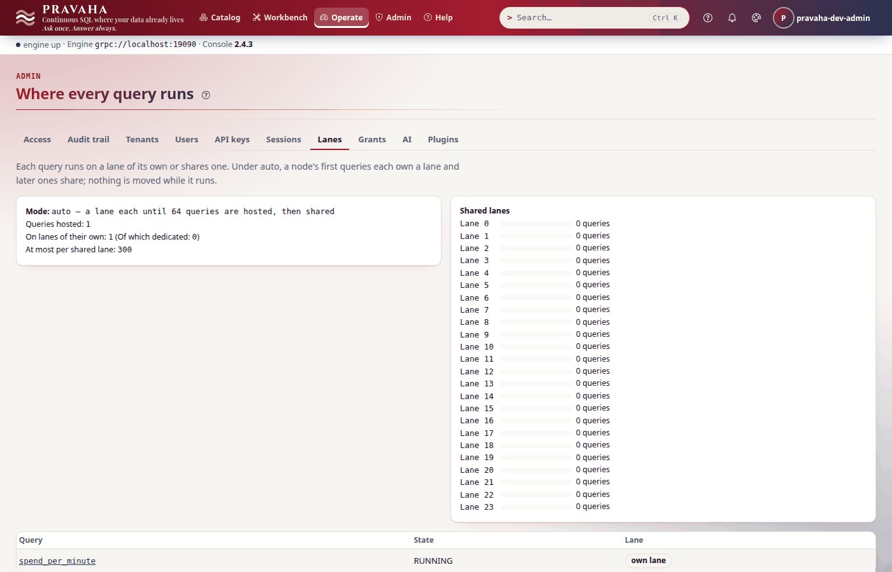
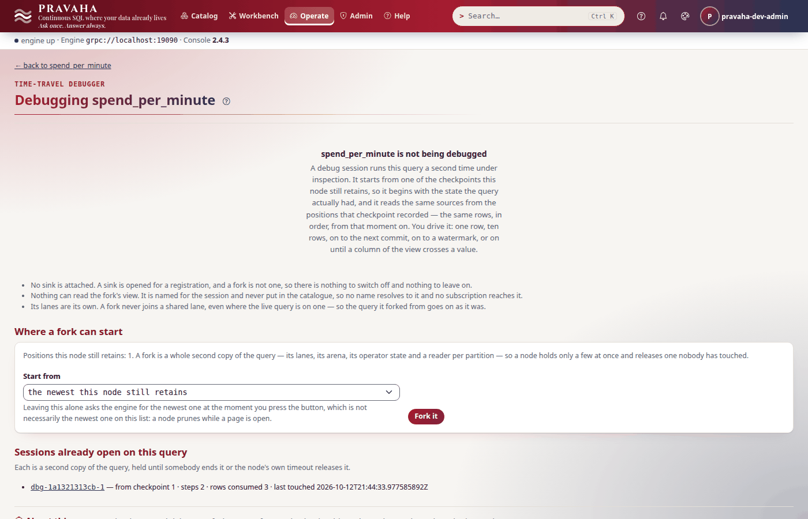

# Tutorial 6 · Investigating an incident

Copyright © 2026 Ashutosh Sinha \<ajsinha@gmail.com\>. All rights reserved.
**Proprietary and confidential** — see [`../../LICENSE`](../../LICENSE).

A customer says erin paid acme twice in the minute from 09:04, 155.47 in all, and one of the two
payments is missing from the totals. In this tutorial you find out why, the way an operator would:
first whether the node is well at all (`pravaha health`, `status`, `top`, the metrics, where each
query runs), then the **dead-letter queue**, where a payment the source could not decode was set
aside rather than stopping everything — inspect it, try a replay and see why it fails again, and
correct it at the source. Then the **time-travel debugger**: fork the running query from a
checkpoint taken before the incident, step it row by row, move its event time yourself, look at its
state and its view, and export what you stepped through as a regression test. Last, how to take a
thread dump when a node stalls. Every output below was printed by a real node running these steps.

**Time to complete:** about 30 minutes, one of which is waiting for a checkpoint.

## Before you start

- [Tutorial 1](01-first-15-minutes.md) done; [tutorial 2](02-windows-and-late-data.md) for windows and
  the watermark, which the debugger lets you move by hand.
- The tutorial's files, in [data/t06/](data/t06/): `application.yaml` (a dead-letter directory, a
  checkpoint every 20 seconds, per-operator metrics on), `streams/txn.yaml` (the stream, a file the
  node reads from its `conf/streams/`), `txn.csv` (ten payments) and
  `spend_per_minute.sql`.
- A node home with the configuration and the data in place:

```bash
export PRAVAHA_HOME=$HOME/pravaha-t06
mkdir -p $PRAVAHA_HOME/conf $PRAVAHA_HOME/data/incoming
cp -r docs/tutorials/data/t06/application.yaml docs/tutorials/data/t06/streams $PRAVAHA_HOME/conf/
cp docs/tutorials/data/t06/txn.csv $PRAVAHA_HOME/data/incoming/
bin/pravaha-server --spring.profiles.active=dev,users &
cd docs/tutorials/data/t06
export PRAVAHA_TOKEN=$(pravaha login --user pravaha-dev-admin) PRAVAHA_INSECURE_TOKEN=true
```

```yaml
# conf/application.yaml (what this tutorial needs beyond a stream and its source)
pravaha:
  dlq:
    directory: data/dlq          # undecodable records set aside, one file per query; the source reads on
  checkpoint:
    interval: 20s                # every query checkpoints this often; the debugger forks from one
    keep: 30
  metrics:
    operators: true              # per-operator numbers in `pravaha plan` and the console's plan view
```

The debugger needs the *administer* permission on the query (`pravaha-dev-admin` has the `admin` role).

## What you will learn

- the first four questions of any incident and the command that answers each: `health`, `status`, `top`, `metrics`;
- where each query runs (**lanes**) and when that matters;
- the **dead-letter queue**: what it holds, how to read an entry, what a **replay** is and is not, and why the fix is at the source;
- the **time-travel debugger**: fork from a checkpoint, step rows, move event time, read state and the fork's view, export a fixture, end the session;
- how to take a **thread dump** of a node that has stalled.

## Step 1 · Is the node well?

Register the view the customer is asking about, then ask the four questions:

<!-- capture: t06-register -->
```text
$ pravaha register --name spend_per_minute --sql-file spend_per_minute.sql --keys 0,1
registered spend_per_minute  state=RUNNING  fingerprint=17c1488869d8
a query with the same fingerprint is the same computation, shared
```
<!-- /capture -->

<!-- capture: t06-health -->
```text
$ pravaha health
UP
```
<!-- /capture -->

`health` exits `1` unless the node is `UP` or `DEGRADED` (a feed stopped, every view still served),
so it doubles as a probe.

<!-- capture: t06-status -->
```text
$ pravaha status
instance       pravaha-node-01
version        <version>
engine         RUNNING
uptime         N s
queries        1
streams        1
stopped feeds  0
flight         localhost:19090
```
<!-- /capture -->

`stopped feeds 0` is the line to read first in an incident: a source that has stopped is the commonest
reason a view stops changing while its query says `RUNNING`.

<!-- capture: t06-top -->
```text
$ pravaha top --once --interval 1
pravaha top  http://localhost:18080  1 query  sorted by name
NAME              STATE    LANE  ROWS IN  ROWS/S  WM DELAY  STATE ROWS  STATE BYTES  VIEW ROWS  SUBS
spend_per_minute  RUNNING  own   10       0.0     Nd        1/2000000   NN.N KiB     8          0
```
<!-- /capture -->

`top` redraws every two seconds until Ctrl-C; `--once` takes two samples and prints one frame.
`WM DELAY` is how far the query's watermark trails *this machine's clock* — days here, because the
sample data is from 2026-10-01; on a live feed it is seconds, and one that grows is late data or a
source that has stopped. `STATE ROWS` is held against the query's ceiling (`PRV-4001` past it).

You should see `UP`, `stopped feeds 0`, and `spend_per_minute` `RUNNING` with 10 rows in.

## Step 2 · Where does it run?

Each query runs on a **lane** — a thread and an inbox. Under `auto`, a node gives each query a lane of
its own until it hosts 64, then shares:

<!-- capture: t06-lanes -->
```text
$ pravaha lanes
mode auto, a lane each until 64, at most 300 per shared lane; 1 hosted, 1 on lanes of their own (0 dedicated)
NAME              STATE    LANE  SHARED LANE
spend_per_minute  RUNNING  own   -
```
<!-- /capture -->



It matters in an incident because a query on a **shared** lane queues behind its neighbours: a slow
neighbour shows up as this query's backpressure. `pravaha lanes rebalance` (an administrator's act,
a plan without `--yes`) moves shared queries onto lanes of their own while there is room.

You should see `spend_per_minute` on lane `own`.

## Step 3 · The incident: a payment on the dead-letter queue

Note the checkpoint the query has now — the last one before the incident. (In a real incident it
already exists; here it is at most twenty seconds away.)

<!-- capture: t06-checkpoints -->
```text
$ pravaha debug checkpoints --name spend_per_minute | tail -n 1
1
```
<!-- /capture -->

`debug checkpoints` lists the positions this node retains, newest first; the oldest, `1`, is from
before anything below happened. Now the two payments arrive. The second came from a system that sends
amounts in major units:

<!-- capture: t06-incident -->
```text
$ printf '%s\n' '11,erin,acme,7777,2026-10-01T09:04:10Z' '12,erin,acme,77.70,2026-10-01T09:04:20Z' >> "$PRAVAHA_HOME/data/incoming/txn.csv"
```
<!-- /capture -->

`amount` is an integer of minor units; `77.70` is not one. With a dead-letter directory configured,
the source sets the line aside and reads on — without one, the source would **stop** at it, and every
later payment with it (`PRV-5040` on the query's page). The metrics say so at once:

<!-- capture: t06-metrics -->
```text
$ pravaha metrics | grep -E '^pravaha_query_(rows_in|dead_letters|dead_letters_fraction|feed_stopped|checkpoint_failures_total)\{'
pravaha_query_checkpoint_failures_total{application="pravaha",node="pravaha-node-01",query="spend_per_minute"} 0.0
pravaha_query_dead_letters{application="pravaha",node="pravaha-node-01",query="spend_per_minute"} 1.0
pravaha_query_dead_letters_fraction{application="pravaha",node="pravaha-node-01",query="spend_per_minute"} 0.0
pravaha_query_feed_stopped{application="pravaha",node="pravaha-node-01",query="spend_per_minute"} 0.0
pravaha_query_rows_in{application="pravaha",node="pravaha-node-01",query="spend_per_minute"} 11.0
```
<!-- /capture -->

Eleven rows in, one dead letter, nothing stopped. `pravaha_query_dead_letters` is the number to alert
on. The queue's totals, which a dashboard polls:

<!-- capture: t06-dlq-count -->
```text
$ pravaha dlq count --name spend_per_minute
query         spend_per_minute
total         1
bytes         602
evicted       0
evictedBytes  0
replayed      0
failedAgain   0
oldest        <time>
newest        <time>
retention     268435456 bytes
configured    yes
```
<!-- /capture -->

The entries, newest first, each with where it was in the source's own terms (`line 13` of the file),
the code and the reason:

<!-- capture: t06-dlq-list -->
```text
$ pravaha dlq list --name spend_per_minute
ID                                    WHEN                    CODE      STREAM  OFFSET   BYTES  STATE  REASON
<id>                                  <time>                  PRV-5040  txn     line 13  39     NEW    PRV-5040  line 13, column 'amount' (INT64): '77.70' is not a number

1 dead letter (602 bytes); retention 268435456 bytes
```
<!-- /capture -->

One entry whole, with the record exactly as it arrived — which is what makes it fixable:

<!-- capture: t06-dlq-show -->
```text
$ pravaha dlq show --name spend_per_minute --id <id>
id      <id>
query   spend_per_minute
stream  txn
offset  line 13
when    <time>
code    PRV-5040  (look PRV-5040 up in the console's help under Errors, or in docs/guides/TROUBLESHOOTING.md)
reason  PRV-5040  line 13, column 'amount' (INT64): '77.70' is not a number
replay  NEW
bytes   39
record
12,erin,acme,77.70,2026-10-01T09:04:20Z
```
<!-- /capture -->


You should see `total 1`, `PRV-5040` at `line 13`, and the raw line with `77.70`.

## Step 4 · Replay it — and why that is not the fix

A **replay** feeds a dead letter back through the query as a new row at its current position:

<!-- capture: t06-dlq-replay -->
```text
$ pravaha dlq replay --name spend_per_minute --id <id>
failed again <id> -> back on the queue as <id>
  the record failed to decode again and has gone back on the queue as a new entry. It is not retried: replaying this id again would decode the same bytes with the same decoder.
a replayed record is a new row at the query's current frontier, not a rewind: nothing is re-read and no earlier answer is recomputed.
(exit 1)
```
<!-- /capture -->

It decodes the **same bytes with the same decoder**, so a record that is simply wrong fails again,
goes back on the queue under a new id, and is not retried. Replay is for a record that failed for a
reason that has since gone away — a decoder or a schema fixed and redeployed. It is not a rewind
(nothing earlier is recomputed), it is not idempotent (replaying an id twice puts the row in twice),
and it is refused (`PRV-4092`) where the source promises exactly-once delivery and will deliver the
record again itself. A record that is wrong is corrected **at the source**: the sender sends it as it
should have been. Here it does, and a later payment moves event time past the minute:

<!-- capture: t06-correction -->
```text
$ printf '%s\n' '12,erin,acme,7770,2026-10-01T09:04:20Z' '13,frank,initech,50,2026-10-01T09:05:30Z' >> "$PRAVAHA_HOME/data/incoming/txn.csv"
```
<!-- /capture -->

<!-- capture: t06-erin -->
```text
$ pravaha query --sql "SELECT * FROM spend_per_minute WHERE user_id = 'erin'"
user_id  window_start               window_end                 spend  txns
erin     2026-10-01 09:04:00+00:00  2026-10-01 09:05:00+00:00  15547  2
1 row
```
<!-- /capture -->

Erin's 09:04 minute is 155.47 over two payments — what the customer said. The correction had to
arrive **before** the minute closed: this stream allows no lateness, so a correction for a minute
already published would have been dropped as late ([tutorial 2](02-windows-and-late-data.md)).

**Operations** shows the whole node at a glance once its meters are in (they are reconciled every
15 seconds) — a verdict, what needs attention, and every query with its rows, state against its
ceiling, watermark lag, subscribers, inbox and last checkpoint:


Both findings are honest. The watermark trails the wall clock by days because the sample data is
from 2026-10-01 — on a live feed that warning means late data or a stopped source. And the queue holds
**two** records: the original and the copy the failed replay put back. Neither leaves the queue until
it ages out under the retention bound; the view is right because the source sent the correction.

You should see `failed again` for the replay, and erin's minute at `15547` over `2` payments.

## Step 5 · Fork the query from before the incident

The view is right now, but an incident review asks *what did the query do, row by row?* Fork a copy
of `spend_per_minute` from checkpoint 1. `fork` prints the session's id alone on standard output, so
it can be kept in a variable:

<!-- capture: t06-fork -->
```text
$ S=$(pravaha debug fork --name spend_per_minute --checkpoint 1)
debug session on 'spend_per_minute', checkpoint 1
DEBUG -- sinks disabled, nothing reads this fork's view
```
<!-- /capture -->

The fork restored the query's state as it was at checkpoint 1 — the eight closed minutes — and
positioned its reader on `txn` at that checkpoint's offset. It reads the same source as the live
query, with **every sink disabled**, and nothing but this session can read its view. The live query,
its view and its subscribers are untouched. Step one row:

<!-- capture: t06-step-row -->
```text
$ pravaha debug step --session "$S" --step row
step 1 (ROW)  1 row
  in   +1 txn#0@12 ['11', 'erin', 'acme', '7777', '1790845450000000000']
  op   n0 WindowedAggregate(TUMBLING 60000ms, keys=[0, 1, 2], [SUM(amount)->spend, COUNT(*)->txns])  in=1 out=0
  op   n1 Project[user_id, window_start, window_end, amount]  in=1 out=1
  op   n2 WindowAssign(TUMBLING size=60000ms slide=60000ms on event_time)  in=1 out=1
  op   n3 Project[txn_id, user_id, merchant, amount, event_time]  in=1 out=1
  op   n4 Scan(txn)  in=1 out=1
  rows consumed 1, view 8 rows
```
<!-- /capture -->

The row is payment 11 (`txn#0@12`: partition 0, the 12th line of the file), erin's 7777. It went
through every operator and stopped in the windowed aggregate (`in=1 out=0`): its minute is still
open. Ask for five more:

<!-- capture: t06-step-rows -->
```text
$ pravaha debug step --session "$S" --step rows:5
step 2 (ROWS)  the sources have no more rows
  in   +1 txn#0@14 ['12', 'erin', 'acme', '7770', '1790845460000000000']
  in   +1 txn#0@15 ['13', 'frank', 'initech', '50', '1790845530000000000']
  op   n0 WindowedAggregate(TUMBLING 60000ms, keys=[0, 1, 2], [SUM(amount)->spend, COUNT(*)->txns])  in=2 out=0
  op   n1 Project[user_id, window_start, window_end, amount]  in=2 out=2
  op   n2 WindowAssign(TUMBLING size=60000ms slide=60000ms on event_time)  in=2 out=2
  op   n3 Project[txn_id, user_id, merchant, amount, event_time]  in=2 out=2
  op   n4 Scan(txn)  in=2 out=2
  rows consumed 3, view 8 rows, sources exhausted
```
<!-- /capture -->

Two rows, not five, and then *the sources have no more rows*. The offsets go from `@12` to `@14`:
**line 13 — the malformed payment — never reached the query**. It was set aside before the scan,
which is exactly what the dead-letter queue said. The fork's state:

<!-- capture: t06-state -->
```text
$ pravaha debug state --session "$S"
OPERATOR  KIND    WHAT              ENTRIES
window#0  window  windows retained  0
```
<!-- /capture -->

`windows retained` counts windows kept after they fired, for corrections; with no allowed lateness
there are none. The open minutes are not listed here; `pravaha debug inspect --session "$S" --operator
<id>` pages through one operator's state without changing it. The console's **Debug** page for the
query lists the session:



You should see payment 11 at `@12`, then payments 12 and 13 at `@14` and `@15`, and no `@13`.

## Step 6 · Move event time yourself, and read the fork's view

**A fork's event time moves only when you say so.** Its watermark did not follow the rows you
stepped, so the 09:04 minute is still open in the fork. Close everything up to 09:06:00 — in epoch
nanoseconds, `1790845560000000000`:

<!-- capture: t06-step-watermark -->
```text
$ pravaha debug step --session "$S" --step watermark:1790845560000000000
step 3 (WATERMARK)  event time at 1790845560000000000
  op   n0 WindowedAggregate(TUMBLING 60000ms, keys=[0, 1, 2], [SUM(amount)->spend, COUNT(*)->txns])  in=0 out=3
  op   n1 Project[user_id, window_start, window_end, amount]  in=0 out=0
  op   n2 WindowAssign(TUMBLING size=60000ms slide=60000ms on event_time)  in=0 out=0
  op   n3 Project[txn_id, user_id, merchant, amount, event_time]  in=0 out=0
  op   n4 Scan(txn)  in=0 out=0
  view +1 ['dave', '1790845380000000000', '1790845440000000000', '45', '1']
  view +1 ['erin', '1790845440000000000', '1790845500000000000', '15547', '2']
  view +1 ['frank', '1790845500000000000', '1790845560000000000', '50', '1']
  rows consumed 3, view 11 rows, watermark 1790845560000000000
```
<!-- /capture -->

Three minutes closed at once: 09:03 (dave's 45, which the checkpoint held as open state), 09:04 —
erin's `15547` over `2` payments, the same as the live view — and 09:05, frank's 50. The live query
has not published 09:05 yet: its watermark is 09:05:25. The fork is ahead of it, because you moved its
clock. Values in a step are strings and times are epoch nanoseconds (`1790845440000000000` is 09:04:00
UTC). The fork's whole view:

<!-- capture: t06-view -->
```text
$ pravaha debug view --session "$S"
+1 ['alice', '1790845200000000000', '1790845260000000000', '620', '2']
+1 ['bob', '1790845200000000000', '1790845260000000000', '50', '1']
+1 ['carol', '1790845200000000000', '1790845260000000000', '900', '1']
+1 ['dave', '1790845260000000000', '1790845320000000000', '150', '1']
+1 ['bob', '1790845260000000000', '1790845320000000000', '75', '1']
+1 ['carol', '1790845260000000000', '1790845320000000000', '300', '1']
+1 ['frank', '1790845320000000000', '1790845380000000000', '1200', '1']
+1 ['bob', '1790845320000000000', '1790845380000000000', '60', '1']
+1 ['dave', '1790845380000000000', '1790845440000000000', '45', '1']
+1 ['erin', '1790845440000000000', '1790845500000000000', '15547', '2']
+1 ['frank', '1790845500000000000', '1790845560000000000', '50', '1']
```
<!-- /capture -->

The `--step` argument takes:

| Step | Advances |
|---|---|
| `row` | one input row |
| `rows:N` | up to N rows |
| `commit` | to the next commit |
| `watermark:<nanos>` | event time, to that instant |
| `until:<column>:<op>:<value>` | until a row of the **view** satisfies it, e.g. `until:spend:>:10000` |

A step it cannot make sense of is refused with `PRV-8015`.

You should see `out=3` on the windowed aggregate and erin's minute at `15547`.

## Step 7 · Keep it as a test, end the session, and take a thread dump

Export what you stepped through as a JUnit test:

<!-- capture: t06-fixture -->
```text
$ pravaha debug fixture --session "$S" --name 'erin payment dead-lettered in minute four' --out ErinFixtureTest.java
wrote ErinFixtureTest.java
it belongs at pravaha-it/src/test/java/com/ash/messaging/pravaha/it/fixtures/ErinPaymentDeadLetteredInMinuteFourFixtureTest.java
not yet formatted: run ./mvnw -pl pravaha-it spotless:apply before committing it
```
<!-- /capture -->

The file is a self-contained test: the query's SQL and key, the stream's schema, the rows you stepped
— payments 11, 12 and 13 — and the watermark you set, replayed from empty state, asserting the view
the session ended with:

<!-- capture: t06-fixture-expected -->
```text
$ sed -n '/EXPECTED = List.of(/,/);/p' ErinFixtureTest.java
    private static final List<String> EXPECTED = List.of(
            "+1[erin, 1790845440000000000, 1790845500000000000, 15547, 2]",
            "+1[frank, 1790845500000000000, 1790845560000000000, 50, 1]");
```
<!-- /capture -->

Saved at the path it names in a checkout (and formatted once with `./mvnw -pl pravaha-it
spotless:apply`), the incident is a regression test: if a change to the engine ever makes erin's
minute come out differently, the build says so. It needs nothing from the node it came from. A
session that has stepped only event time has no rows to replay and is refused with `PRV-8015`.

End the session. Each holds a second copy of the query's state and a reader on the source, and a node
allows only a few at once (`PRV-8014` past the limit):

<!-- capture: t06-end -->
```text
$ pravaha debug end --session "$S"
ended <session>
```
<!-- /capture -->

<!-- capture: t06-sessions -->
```text
$ pravaha debug sessions
no debug session is open
```
<!-- /capture -->

When a node **stalls** — `top` frozen, commits not advancing, nothing in the log — the question is
what every thread is waiting on, and a thread dump answers it. Take two or three, ten seconds apart:

```bash
jcmd $(pgrep -f pravaha-server) Thread.print -l > threads-1.txt    # a JDK on the node's host
kill -QUIT $(pgrep -f pravaha-server)                                # no JDK: the dump goes to the node's stdout
```

The node's container image is a JRE and carries no `jcmd`; [RUNNING_IN_DOCKER.md, "Diagnosing a
stall"](../operations/RUNNING_IN_DOCKER.md#diagnosing-a-stall-thread-dumps) has the sidecar and
`docker kill --signal=QUIT` forms. A lane's thread waiting in its inbox is idle; one blocked on a
sink's write, or the same stack in every dump, is the stall.

You should see `ended` and `no debug session is open`.

## Next steps

- [The case studies](../../examples/case-studies/README.md): complete systems built from the moves
  of these six tutorials — start with one in your own domain.
- The reference: [dead letters](../../pravaha-console/content/topics/dead-letters.md),
  [the time-travel debugger](../../pravaha-console/content/topics/time-travel-debugger.md),
  [observability](../../pravaha-console/content/topics/observability.md) (every metric and alert),
  [lanes](../../pravaha-console/content/topics/lanes.md), and
  [TROUBLESHOOTING.md](../guides/TROUBLESHOOTING.md) for every `PRV` code.

## If something goes wrong

| Symptom | What it means | What to do |
|---|---|---|
| A view stops changing while its query says `RUNNING` | a source has stopped — with no dead-letter directory, at the first record it cannot decode | `pravaha status` (`stopped feeds`), the query's page; set `pravaha.dlq.directory` |
| `PRV-5040` on a query's source | a line the file source cannot decode | find it with `pravaha dlq list`; correct it at the source |
| `dlq list` says the node has no dead-letter directory | `pravaha.dlq.directory` is not set: that is not an empty queue | set it and restart |
| A replay says `failed again` | the same bytes, the same decoder | correct the record at the source; replay is for a fixed decoder |
| `PRV-4091` at `dlq show` or `replay` | no dead letter with that id (a replay gives the record a new one) | `pravaha dlq list` again |
| `PRV-8011` at `debug fork` | the query has no checkpoint yet, or none that old | wait for one (`pravaha.checkpoint.interval`); `debug checkpoints` |
| `PRV-8012` at `debug fork` | a source the fork reads cannot be rewound to the checkpoint | the debugger needs a replayable source |
| `PRV-8014` at `debug fork` | too many debug sessions open | `pravaha debug sessions`; `debug end` the ones you are done with |
| `PRV-8015` at `debug step` or `fixture` | a step, or an export, the session cannot make sense of | check the `--step` form; step rows before exporting |
| `top` shows a growing `WM DELAY` on a live feed | late data, or a source that has stopped | `pravaha status`; the source's own logs |
