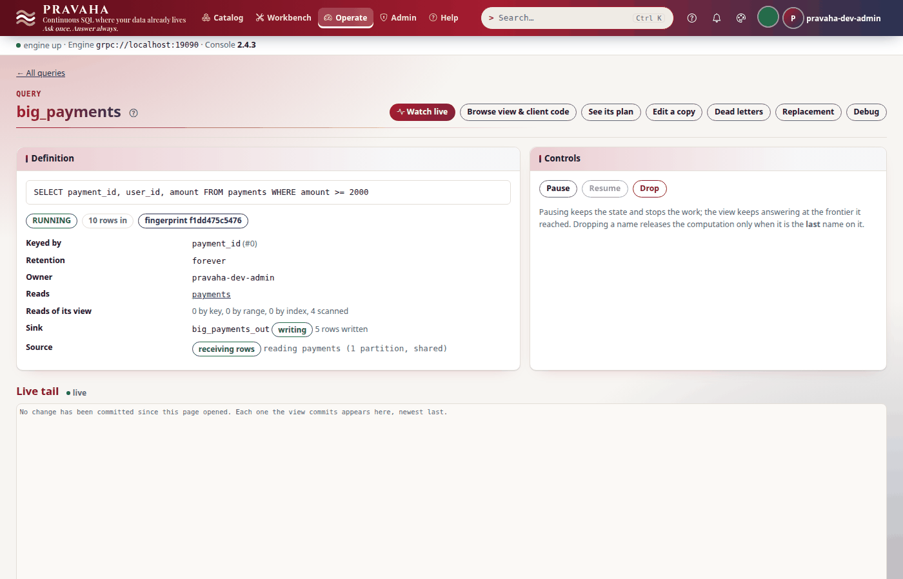
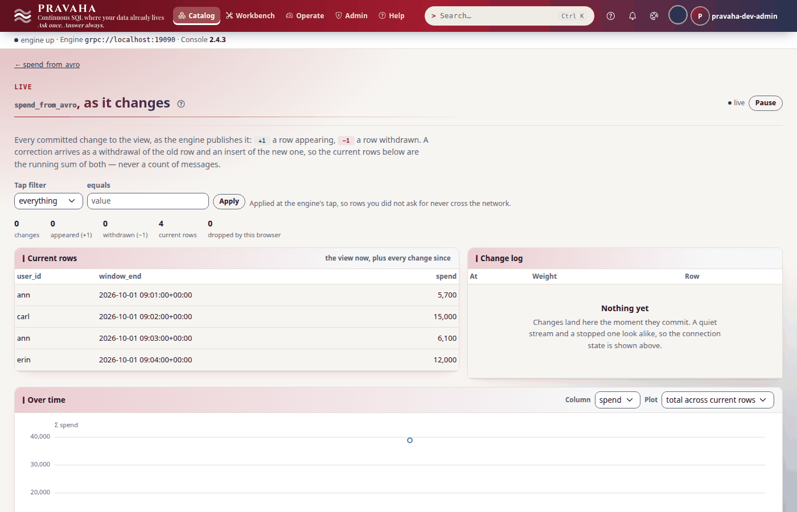

# Tutorial 7 · Kafka end to end

Copyright © 2026 Ashutosh Sinha \<ajsinha@gmail.com\>. All rights reserved.
**Proprietary and confidential** — see [`../../LICENSE`](../../LICENSE).

Payments arrive on a Kafka topic, as JSON, from a service you do not own. In this tutorial you start a
broker of your own, produce the payments, and bind the topic to a stream with the `kafka` source;
register a continuous query over it and write its answer straight back to another topic with
`kafka-sink`, exactly once to a `read_committed` consumer; send a payment whose amount is not a number
and find it on the **dead-letter queue** while the source reads on; then write each user's spend per
minute in **Avro**, against a schema file, and read that topic back as a second stream with the same
file. Every output below was printed by a real node and a real broker running these steps.

**Time to complete:** about 30 minutes, five of which are the broker's image downloading the first time.

## Before you start

- [Tutorial 1](01-first-15-minutes.md) done; [tutorial 2](02-windows-and-late-data.md) for the minute
  windows in step 5, and [tutorial 6](06-investigating-an-incident.md) for the dead-letter queue.
- Docker, to run a Kafka broker. The tutorial uses `apache/kafka:3.9.1` on `localhost:9092`; if
  something of yours already listens there, publish the broker on another port (`-p 29092:9092`) and
  change `bootstrap.servers` to match — in the two files of `connectors/`, the only place it is written.
- The tutorial's files, in [data/t07/](data/t07/): `application.yaml` (a dead-letter queue, checkpoints
  every 5 seconds), two streams fed by Kafka (`streams/`), two Kafka sinks (`sinks/`), the broker as a
  named connection for each plugin (`connectors/`), `payments.jsonl` (eight payments, one JSON object a
  line), `user_spend.sql` and `user_spend.avsc` (the Avro schema both sides use).
- A broker, and a node home with the configuration and the schema in place:

```bash
docker run -d --name pravaha-kafka -p 9092:9092 apache/kafka:3.9.1
export PRAVAHA_HOME=$HOME/pravaha-t07
mkdir -p $PRAVAHA_HOME/conf $PRAVAHA_HOME/data
cp -r docs/tutorials/data/t07/{application.yaml,user_spend.avsc,streams,sinks,connectors} $PRAVAHA_HOME/conf/
cd docs/tutorials/data/t07
```

The node starts in step 1, once the topics exist: a source never creates its topic, and neither does
a sink.

## What you will learn

- how a topic becomes a stream: the `kafka` source, one reader per partition, its position kept in the
  query's checkpoint and nowhere else;
- what happens to a record that does not fit the schema — the **dead-letter queue** — and why the fix is
  at the producer;
- `kafka-sink`: a topic that holds the view, keyed, exactly once to `read_committed` consumers, and what
  that costs;
- **Avro** without a registry: a writer schema in a file, written by the sink and read back by the source;
- which codes each part can raise, and where the console shows each part.

## Step 1 · Start a broker, make the topics, produce the payments

The broker answers once its controller has elected itself, a few seconds after `docker run`. Make the
three topics this tutorial uses — the payments in, the big payments out, each user's spend out and
back in:

<!-- capture: t07-topics -->
```text
$ for topic in payments big-payments user-spend; do docker exec pravaha-kafka /opt/kafka/bin/kafka-topics.sh --bootstrap-server localhost:9092 --create --topic $topic --partitions 1; done
Created topic payments.
Created topic big-payments.
Created topic user-spend.
```
<!-- /capture -->

Produce the eight payments, one record a line, and read the first three back to see what is there:

<!-- capture: t07-produce -->
```text
$ docker exec -i pravaha-kafka /opt/kafka/bin/kafka-console-producer.sh --bootstrap-server localhost:9092 --topic payments < payments.jsonl
```
<!-- /capture -->

<!-- capture: t07-peek -->
```text
$ docker exec pravaha-kafka /opt/kafka/bin/kafka-console-consumer.sh --bootstrap-server localhost:9092 --topic payments --from-beginning --max-messages 3 2>/dev/null
{"payment_id":1,"user_id":"ann","merchant":"acme","amount":1200,"event_time":"2026-10-01T09:00:05Z"}
{"payment_id":2,"user_id":"bob","merchant":"initech","amount":300,"event_time":"2026-10-01T09:00:20Z"}
{"payment_id":3,"user_id":"ann","merchant":"globex","amount":4500,"event_time":"2026-10-01T09:00:40Z"}
```
<!-- /capture -->

Now start the node and sign in:

```bash
bin/pravaha-server --spring.profiles.active=dev,users &
export PRAVAHA_TOKEN=$(pravaha login --user pravaha-dev-admin) PRAVAHA_INSECURE_TOKEN=true
```

You should see three `Created topic` lines, and the payments as JSON objects.

## Step 2 · Bind the topic to a stream

The binding is configuration, a file per stream. The stream says what a payment is; its `source:`
says where payments come from and how a record's value becomes a row. Where the broker is — and, in
production, its TLS and SASL settings — is said once, in a **named connection** every Kafka binding
names:

```yaml
# conf/connectors/kafka-local.yaml (the broker, for the kafka source plugin)
plugin: kafka
options:
  bootstrap.servers: "localhost:9092"
```

```yaml
# conf/streams/payments.yaml
schema: "payment_id:INT64,user_id:STRING,merchant:STRING,amount:INT64,event_time:TIMESTAMP"
event-time: event_time
out-of-orderness: 5s
source:
  connector: kafka-local              # the plugin and bootstrap.servers come from the connection
  options:
    topic: payments
    format: json                      # each value a JSON object of the row, by column name
    start.from: earliest
    monitoring.group: pravaha-payments   # checkpointed offsets reported here; never read back
```

```yaml
# conf/application.yaml
pravaha:
  dlq:
    directory: data/dlq               # a record no source can decode is set aside; the source reads on
  checkpoint:
    interval: 5s                      # the sinks commit what each checkpoint covers
```

A binding's options are the connection's with its own laid over them; on a clash the binding wins. A
connection is for one plugin: the sinks reach the same broker through `kafka-local-out`, whose plugin
is `kafka-sink`, and naming a connection of the other plugin is refused (`PRV-1068`).

`format: json` matches a value's members to the columns **by name**: a member the schema does not name
is ignored, a missing one is null (and refused if the column is not nullable). `start.from: earliest`
reads the topic from its first record — but only the first time: after that the position is the
offset each partition's reader had reached when the last checkpoint was taken, kept in the checkpoint
and nowhere else. **A consumer group's committed offset is never read**: it is committed when a
consumer says so, not when a checkpoint is durable, and resuming from it would lose or repeat whatever
lay between the two.

The node has the `kafka` plugin (and `kafka-sink`, its sink), each bound where the configuration says:

<!-- capture: t07-plugins -->
```text
$ pravaha plugins
NAME              VERSION  KINDS        COMPATIBLE  LOADED  HEALTH   BINDINGS
kafka             <version>    source       yes         yes     UNKNOWN  source:payments,source:user_spend_avro
kafka-sink        <version>    sink         yes         yes     UNKNOWN  sink:big_payments_out,sink:user_spend_out
```
<!-- /capture -->

<!-- capture: t07-streams -->
```text
$ pravaha streams list
NAME             VERSION  EVENT TIME  LATENESS  SOURCE  ORIGIN                                  FIELDS
payments         1        event_time  PT5S      kafka   file:conf/streams/payments.yaml         payment_id INT64 NOT NULL, user_id VARCHAR NOT NULL, merchant VARCHAR NOT NULL, amount INT64 NOT NULL, event_time TIMESTAMP(9) WITH LOCAL TIME ZONE NOT NULL
user_spend_avro  1        window_end  PT10S     kafka   file:conf/streams/user_spend_avro.yaml  user_id VARCHAR NOT NULL, window_end TIMESTAMP(9) WITH LOCAL TIME ZONE NOT NULL, spend INT64 NOT NULL
```
<!-- /capture -->

<!-- capture: t07-sinks -->
```text
$ pravaha sinks
NAME              PLUGIN      EMIT            RETRACTIONS  GUARANTEE     WRITERS  PROBLEM
big_payments_out  kafka-sink  RETRACT,UPSERT  yes          EXACTLY_ONCE  -        -
user_spend_out    kafka-sink  RETRACT,UPSERT  yes          EXACTLY_ONCE  -        -
```
<!-- /capture -->

`HEALTH UNKNOWN` is honest: nothing has opened a reader yet. A source is opened when the first query
over it is registered, not when the node starts. The second stream, `user_spend_avro`, is step 6's.
Each connection lists what names it:

<!-- capture: t07-connectors -->
```text
$ pravaha connectors list
NAME             PLUGIN      ORIGIN                                     USED BY
kafka-local      kafka       file:conf/connectors/kafka-local.yaml      source:payments, source:user_spend_avro
kafka-local-out  kafka-sink  file:conf/connectors/kafka-local-out.yaml  sink:big_payments_out, sink:user_spend_out
```
<!-- /capture -->

A connection something names is not changed or removed under it: its file's change waits, reported
as not applied (`PRV-1065`), until nothing names it.


You should see `kafka` and `kafka-sink` loaded, two streams whose source is `kafka`, two sinks
that promise `EXACTLY_ONCE`, and each connection used by two bindings.

## Step 3 · A continuous query over the topic, written back to Kafka

Register the payments of 2000 or more, keyed by `payment_id`, writing to the sink `big_payments_out`:

```yaml
# conf/sinks/big_payments_out.yaml (the broker comes from conf/connectors/kafka-local-out.yaml)
connector: kafka-local-out
options:
  topic: big-payments
  schema: "payment_id:INT64,user_id:STRING,amount:INT64"
  key.columns: payment_id
  transactional: "true"
```

<!-- capture: t07-register-big -->
```text
$ pravaha register --name big_payments --sql 'SELECT payment_id, user_id, amount FROM payments WHERE amount >= 2000' --keys 0 --sink big_payments_out
registered big_payments  state=RUNNING  fingerprint=f1dd475c5476  sink=big_payments_out
a query with the same fingerprint is the same computation, shared
```
<!-- /capture -->

<!-- capture: t07-query-big -->
```text
$ pravaha query --sql 'SELECT * FROM big_payments'
payment_id  user_id  amount
3           ann      4500
4           carl     15000
5           bob      2200
7           ann      6100
4 rows
```
<!-- /capture -->

The sink's `schema` is the query's `SELECT` list, in order, name and type, and `key.columns` is the
view's key; a registration that disagrees is refused (`PRV-8010`) rather than writing rows the topic's
readers would misread. The target topic must exist (`PRV-5101` if not).

You should see four payments: 3, 4, 5 and 7.

## Step 4 · A malformed payment, and the dead-letter queue

The producer sends a payment whose amount is the text `"12,000"`:

<!-- capture: t07-bad -->
```text
$ printf '%s\n' '{"payment_id":9,"user_id":"erin","merchant":"acme","amount":"12,000","event_time":"2026-10-01T09:03:20Z"}' | docker exec -i pravaha-kafka /opt/kafka/bin/kafka-console-producer.sh --bootstrap-server localhost:9092 --topic payments
```
<!-- /capture -->

`amount` is an `INT64`, and `"12,000"` is not one. The source does not guess (twelve? twelve
thousand?) and does not stop: it sets the record aside, whole, with its position and the reason, and
reads on.

<!-- capture: t07-dlq-list -->
```text
$ pravaha dlq list --name big_payments
ID                                    WHEN                    CODE  STREAM    OFFSET        BYTES  STATE  REASON
<id>                                  <time>                  -     payments  payments/0@8  105    NEW    column 'amount' is INT64 and its value is a string that does not parse as one

1 dead letter (N bytes); retention 268435456 bytes
```
<!-- /capture -->

<!-- capture: t07-dlq-show -->
```text
$ pravaha dlq show --name big_payments --id <id>
id      <id>
query   big_payments
stream  payments
offset  payments/0@8
when    <time>
code    -
reason  column 'amount' is INT64 and its value is a string that does not parse as one
replay  NEW
bytes   105
record
{"payment_id":9,"user_id":"erin","merchant":"acme","amount":"12,000","event_time":"2026-10-01T09:03:20Z"}
```
<!-- /capture -->

`payments/0@8` is the record's address in Kafka — topic, partition, offset — so the producer's team can
find it in their own logs. The queue keeps the bytes exactly as they came: a **replay** decodes those
same bytes again, so it fails again here (tutorial 6 shows it), and is refused outright for an
exactly-once source that has not yet read past the record. The fix is at the producer, which sends
the payment again, correctly — and a later one besides:

<!-- capture: t07-fixed -->
```text
$ printf '%s\n' '{"payment_id":9,"user_id":"erin","merchant":"acme","amount":12000,"event_time":"2026-10-01T09:03:20Z"}' '{"payment_id":10,"user_id":"frank","merchant":"globex","amount":50,"event_time":"2026-10-01T09:04:30Z"}' | docker exec -i pravaha-kafka /opt/kafka/bin/kafka-console-producer.sh --bootstrap-server localhost:9092 --topic payments
```
<!-- /capture -->

<!-- capture: t07-query-big-fixed -->
```text
$ pravaha query --sql 'SELECT * FROM big_payments'
payment_id  user_id  amount
3           ann      4500
4           carl     15000
5           bob      2200
7           ann      6100
9           erin     12000
5 rows
```
<!-- /capture -->


What else is a dead letter from a Kafka topic: a value that is not JSON, a fraction in an integer
column, a decimal with more places than its scale, a **tombstone** (a null value: it says a key was
deleted without saying what row it held, so there is nothing to retract — `tombstone: skip` reads an
upsert topic as insertions only), and in Avro or protobuf a value that does not decode. A protobuf
field sent with the wrong wire type is dead-lettered too, rather than read as zero (PBDRIFT-1).
**Without** `pravaha.dlq.directory` there is nowhere to put such a record, and the source stops with
`PRV-5105` instead: the feed stops and `pravaha health` says `DEGRADED`.

You should see one dead letter at `payments/0@8`, and erin's 12000 in the view once it was sent again.

## Step 5 · What reached the topic, and when

The sink is **transactional**. It does not write a change to `big-payments` when the view commits it: it
writes it to a staging topic, and at each checkpoint it moves what that checkpoint covers to the target
in one Kafka transaction, once the checkpoint is durable. A consumer reading with
`isolation.level=read_committed` therefore sees each change exactly once — never one the engine might
yet take back after a crash — and sees it up to one checkpoint interval (5 seconds here) after the view:

<!-- capture: t07-describe-big -->
```text
$ pravaha describe big_payments
name         big_payments
state        RUNNING
owner        pravaha-dev-admin
fingerprint  f1dd475c5476
lane         own
key          payment_id
retention    forever
sink         big_payments_out (attached, 5 rows written)
rows in      10
late rows    0
shared with  -
reads        payments
feed         RUNNING
```
<!-- /capture -->

`rows in 10`: the source read ten records and one of them is on the queue; the view holds five. The
topic, read as a downstream service would:

<!-- capture: t07-consume-big -->
```text
$ docker exec pravaha-kafka /opt/kafka/bin/kafka-console-consumer.sh --bootstrap-server localhost:9092 --topic big-payments --from-beginning --isolation-level read_committed --property print.key=true --property key.separator=' => ' --max-messages 5 2>/dev/null
{"payment_id":3} => {"payment_id":3,"user_id":"ann","amount":4500}
{"payment_id":4} => {"payment_id":4,"user_id":"carl","amount":15000}
{"payment_id":5} => {"payment_id":5,"user_id":"bob","amount":2200}
{"payment_id":7} => {"payment_id":7,"user_id":"ann","amount":6100}
{"payment_id":9} => {"payment_id":9,"user_id":"erin","amount":12000}
```
<!-- /capture -->

The key is a JSON object of the key columns; the value is the whole row. In this, the default
`mode: upsert`, the topic **is** the view: a row that leaves the view is a tombstone under its key, an
update a tombstone then the new value, so a compacted topic holds one record per key and Kafka
Streams, ksqlDB or a Kafka Connect sink read it as a table. `mode: changelog` writes every change with
its weight instead (`{"op":"delete","weight":-1,"row":{...}}`), for a consumer that keeps its own
aggregate — and the `kafka` source reads that format back with `format: changelog`, retractions and
all. What exactly once costs: every change is written twice (staging, then target).



`monitoring.group: pravaha-payments` receives the offsets each durable checkpoint recorded, so
`kafka-consumer-groups` and lag dashboards see where a restore would resume. When queries share one
reader, the group is given the earliest offset every one of them has made durable, so it never claims
progress a query has not checkpointed. After the checkpoint above, it has caught up with the topic:

<!-- capture: t07-groups -->
```text
$ docker exec pravaha-kafka /opt/kafka/bin/kafka-consumer-groups.sh --bootstrap-server localhost:9092 --describe --group pravaha-payments

Consumer group 'pravaha-payments' has no active members.

GROUP            TOPIC           PARTITION  CURRENT-OFFSET  LOG-END-OFFSET  LAG             CONSUMER-ID     HOST            CLIENT-ID
pravaha-payments payments        0          11              11              0               -               -               -
```
<!-- /capture -->

Until it is fixed, read a query's progress from `pravaha top` and its checkpoints from `pravaha debug
checkpoints` ([tutorial 6](06-investigating-an-incident.md)). The sink's own
group, `pravaha-sink.big_payments_out`, is there: its committed offset is each commit's receipt, which
is what makes a commit repeated after a crash do nothing.

You should see five records on `big-payments`, each keyed by its `payment_id`.

## Step 6 · Avro out, and back in

Each user's spend per closed minute, written in Avro. The schema is a file both sides share:

<!-- file: data/t07/user_spend.avsc -->
```json
{
  "type": "record",
  "name": "UserSpend",
  "namespace": "tutorial.payments",
  "doc": "One user's spend in one closed minute: what the user_spend query writes to the user-spend topic.",
  "fields": [
    {"name": "user_id", "type": "string"},
    {"name": "window_end", "type": {"type": "long", "logicalType": "timestamp-millis"}},
    {"name": "spend", "type": "long"}
  ]
}
```

```yaml
# conf/sinks/user_spend_out.yaml (Avro out)
connector: kafka-local-out
options:
  topic: user-spend
  schema: "user_id:STRING,window_end:TIMESTAMP(3),spend:INT64"
  key.columns: "user_id,window_end"
  format: avro
  schema.file: conf/user_spend.avsc
```

```yaml
# conf/streams/user_spend_avro.yaml (and back in)
schema: "user_id:STRING,window_end:TIMESTAMP,spend:INT64"
event-time: window_end
source:
  connector: kafka-local
  options:
    topic: user-spend
    format: avro
    schema.file: conf/user_spend.avsc   # the writer schema; no registry needed
```

`TIMESTAMP(3)` on the sink is deliberate: an Avro `timestamp-millis` holds milliseconds, and a column
declared finer than the field it is written to is refused (`PRV-5108`) rather than silently truncated.
Columns map to fields **by name**, checked when the query registers. The query:

```sql
-- data/t07/user_spend.sql
SELECT user_id, window_end, SUM(amount) AS spend
FROM TABLE(TUMBLE(TABLE payments, DESCRIPTOR(event_time), INTERVAL '1' MINUTE))
GROUP BY user_id, window_start, window_end
```

<!-- capture: t07-register-spend -->
```text
$ pravaha register --name user_spend --sql-file user_spend.sql --keys 0,1 --sink user_spend_out
registered user_spend  state=RUNNING  fingerprint=b4562300a03f  sink=user_spend_out
a query with the same fingerprint is the same computation, shared
```
<!-- /capture -->

<!-- capture: t07-query-spend -->
```text
$ pravaha query --sql 'SELECT * FROM user_spend'
user_id  window_end                 spend
ann      2026-10-01 09:01:00+00:00  5700
bob      2026-10-01 09:01:00+00:00  300
carl     2026-10-01 09:02:00+00:00  15000
bob      2026-10-01 09:02:00+00:00  2200
dana     2026-10-01 09:03:00+00:00  800
ann      2026-10-01 09:03:00+00:00  6100
carl     2026-10-01 09:04:00+00:00  90
erin     2026-10-01 09:04:00+00:00  12000
8 rows
```
<!-- /capture -->

The query was registered after the payments arrived and still saw all of them: it caught up from the
topic's first record to the position of the reader `big_payments` already had open, and was then
attached to it — one reader per partition feeds every query over the binding. Eight windows are
closed; frank's payment at 09:04:30 holds the 09:05 window open. On the topic each value is Avro's
binary encoding — no field names, a length-prefixed string, zig-zag varints:

<!-- capture: t07-avro-bytes -->
```text
$ docker exec pravaha-kafka /opt/kafka/bin/kafka-console-consumer.sh --bootstrap-server localhost:9092 --topic user-spend --from-beginning --isolation-level read_committed --property print.key=true --max-messages 1 2>/dev/null | od -An -c
   {   "   u   s   e   r   _   i   d   "   :   "   a   n   n   "
   ,   "   w   i   n   d   o   w   _   e   n   d   "   :   "   2
   0   2   6   -   1   0   -   0   1   T   0   9   :   0   1   :
   0   0   Z   "   }  \t 006   a   n   n 300 303 220 353 236   h
 210   Y  \n
```
<!-- /capture -->

The key (before the tab) is still JSON (`key.format` would make it Avro too); the value is `006` (the
length 3, zig-zag) `ann`, then the milliseconds and the spend. Read it back: a query over the second
stream, which decodes those bytes with the same file:

<!-- capture: t07-register-from-avro -->
```text
$ pravaha register --name spend_from_avro --sql 'SELECT user_id, window_end, spend FROM user_spend_avro WHERE spend >= 5000' --keys 0,1
registered spend_from_avro  state=RUNNING  fingerprint=d9755835ccde
a query with the same fingerprint is the same computation, shared
```
<!-- /capture -->

<!-- capture: t07-query-from-avro -->
```text
$ pravaha query --sql 'SELECT * FROM spend_from_avro'
user_id  window_end                 spend
ann      2026-10-01 09:01:00+00:00  5700
carl     2026-10-01 09:02:00+00:00  15000
ann      2026-10-01 09:03:00+00:00  6100
erin     2026-10-01 09:04:00+00:00  12000
4 rows
```
<!-- /capture -->



No Avro library is on the node's classpath: the reader and the writer are the repository's own, from
the specification. With a schema **registry** instead of a file, set `schema.registry.url` on the
source (each value then carries the Confluent prefix, a zero byte and a four-byte schema id, fetched
once and cached) and `schema.id` on the sink; Karapace and Apicurio's compatible endpoint work the
same. `format: protobuf` takes a descriptor set (`protoc --include_imports --descriptor_set_out`) and
a message name instead.

You should see eight rows in `user_spend`, binary values on `user-spend`, and four rows read back.

## Step 7 · Is it all well?

<!-- capture: t07-health -->
```text
$ pravaha health
UP
```
<!-- /capture -->

`UP` with a record on the dead-letter queue is right: the queue is where a bad record goes so the node
can stay well. What would change it is a source in trouble: brokers that do not answer, a partition
more than `lag.warn.records` (100 000) behind, a feed stopped by one of the codes in the table below. When you are done:

```bash
docker rm -f pravaha-kafka
```

You should see `UP`.

## Next steps

- [Tutorial 8 · Change data capture](08-change-data-capture.md): a database's inserts, updates and
  deletes as a stream, where a row can leave the view.
- [Tutorial 9 · Exactly-once sinks](09-exactly-once-sinks.md): kill the node mid-stream and count the
  rows in a sink's table.
- The reference: [the Kafka source](../../pravaha-console/content/topics/source-kafka.md) (every option,
  partitions added at run time, compressed topics, TLS and SASL), [the Kafka
  sink](../../pravaha-console/content/topics/sink-kafka.md), [dead
  letters](../../pravaha-console/content/topics/dead-letters.md), and
  [CONNECTORS.md](../guides/CONNECTORS.md) §7, which argues why the source is exactly once.

## If something goes wrong

| Symptom | What it means | What to do |
|---|---|---|
| `PRV-1068` at start | a binding names a connection of the other plugin (a sink naming `kafka-local`) | sinks name `kafka-local-out`, sources `kafka-local` |
| `PRV-5101` when a query writing to the sink registers | the sink's target topic does not exist; the sink never creates it | create it (`kafka-topics.sh --create`) and register again |
| `PRV-8010` at `register --sink` | the sink's `schema` is not the query's `SELECT` list, or `key.columns` is not the view's key | make them agree, column for column |
| `PRV-5105`, the feed stops, health `DEGRADED` | a record did not decode and there is no dead-letter queue | set `pravaha.dlq.directory`; fix the producer |
| `PRV-5108` at registration | an Avro or protobuf field and a column do not match by name or type, or a `TIMESTAMP` is finer than its Avro field | rename the column or the field; declare `TIMESTAMP(3)` for `timestamp-millis` |
| `PRV-5109`, the reader stops | the schema registry cannot be read | check `schema.registry.url` and its credentials; a registry being down is not a record's fault |
| `PRV-5106` at a restore | retention deleted records the checkpoint had not read, or the topic was recreated | there is no safe position: re-register, accepting the gap, or restore the topic |
| `PRV-5130`, the feed stops | the topic was deleted under a running query | recreate it, then re-register |
| A dead letter's `reason` says a string does not parse | the producer sent a number as text | fix the producer and send the record again; a replay decodes the same bytes |
| Nothing on the sink's topic yet | a transactional sink commits at the next durable checkpoint | wait one `checkpoint.interval`; read with `--isolation-level read_committed` |
| `PRV-2020` for `ORDER BY` | a view has no row order to maintain | sort in whatever reads the rows |
