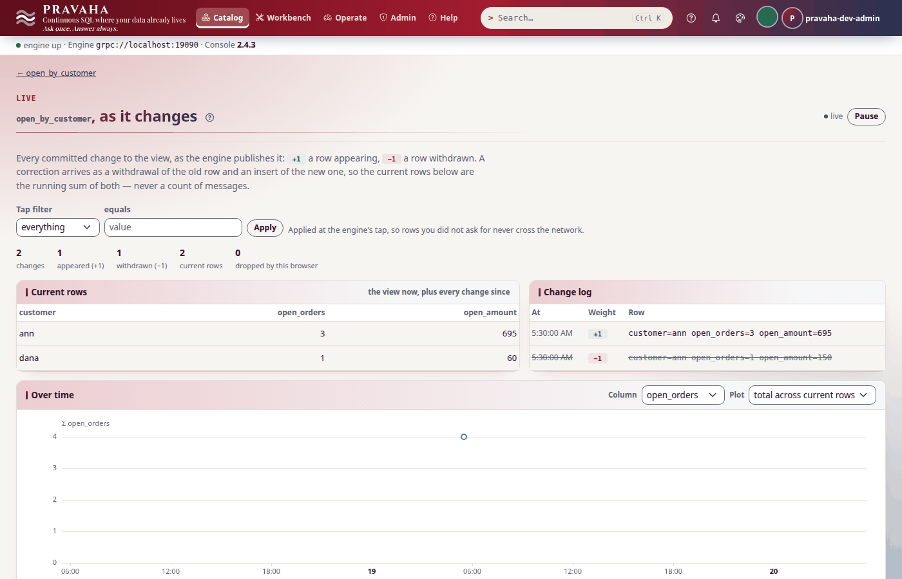
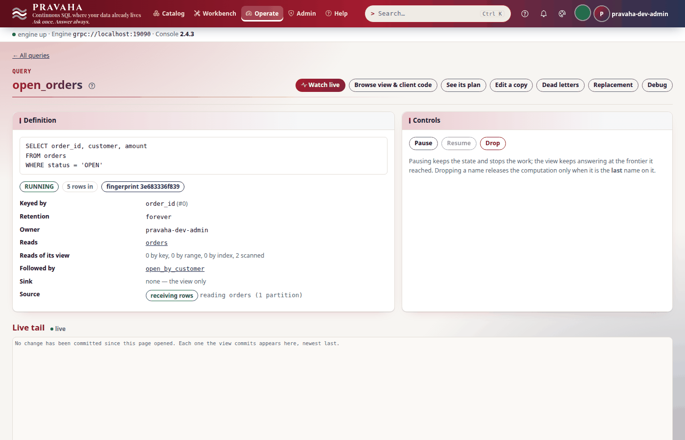

# Tutorial 8 · Change data capture

Copyright © 2026 Ashutosh Sinha \<ajsinha@gmail.com\>. All rights reserved.
**Proprietary and confidential** — see [`../../LICENSE`](../../LICENSE).

The shop's orders live in PostgreSQL, and the question — which orders are open, and how much is each
customer waiting on — changes every time a row does. Polling the table would see each row's latest
value and miss what left: a shipped order, a deleted one. **Change data capture** reads the database's
own write-ahead log instead, so every `INSERT` arrives at `+1`, every `DELETE` as the whole old row at
`−1`, and every `UPDATE` as both. In this tutorial you start a PostgreSQL with logical decoding on, bind
its `orders` table with the `postgres-cdc` source, see what the database must allow and what is refused
when it does not, register a view of the open orders and a total per customer over it, then insert,
update, ship and delete orders and watch each arrive as `+1` and `−1` — in a subscriber, in the console,
and in a total that goes **down**. Last, a change made while the node is down, which the replication
slot keeps for it. Every output below was printed by a real node and a real database running these steps.

**Time to complete:** about 25 minutes.

## Before you start

- [Tutorial 1](01-first-15-minutes.md) done, and [tutorial 4](04-following-a-view.md) for
  subscriptions and what a `−1` means to a reader.
- Docker, for a PostgreSQL 14 or later. The tutorial's runs on `localhost:15432`, so that it is not a
  PostgreSQL of your own on 5432.
- The tutorial's files, in [data/t08/](data/t08/): `streams/orders.yaml` (the `postgres-cdc` binding),
  `connectors/shop-postgres.yaml` (the database, as a named connection), `application.yaml`
  (checkpoints every 10 seconds), `shop.sql` (the `orders` table and four orders) and `open_orders.sql`.
- A database with `wal_level = logical`, the table loaded, and a node home:

```bash
docker run -d --name pravaha-postgres -p 15432:5432 -e POSTGRES_HOST_AUTH_METHOD=trust \
  -e POSTGRES_DB=shop postgres:16-alpine -c wal_level=logical
export PRAVAHA_HOME=$HOME/pravaha-t08
mkdir -p $PRAVAHA_HOME/conf $PRAVAHA_HOME/data
cp -r docs/tutorials/data/t08/{application.yaml,streams,connectors} $PRAVAHA_HOME/conf/
cd docs/tutorials/data/t08
```

`POSTGRES_HOST_AUTH_METHOD=trust` lets anyone on this machine in without a password: it is for a
tutorial's throwaway database only.

<!-- capture: t08-load -->
```text
$ docker exec -i pravaha-postgres psql -U postgres -d shop < shop.sql
CREATE TABLE
INSERT 0 4
```
<!-- /capture -->

<!-- capture: t08-wal-level -->
```text
$ docker exec pravaha-postgres psql -U postgres -d shop -c "SHOW wal_level"
 wal_level
-----------
 logical
(1 row)
```
<!-- /capture -->

Then start the node and sign in:

```bash
bin/pravaha-server --spring.profiles.active=dev,users &
export PRAVAHA_TOKEN=$(pravaha login --user pravaha-dev-admin) PRAVAHA_INSECURE_TOKEN=true
```

## What you will learn

- what a **changelog** source is, and why only one built on the database's log can retract a row;
- the four things PostgreSQL must allow, and how a missing one is refused with the statement that fixes it;
- `snapshot.mode: initial`: the rows already in the table first, then the changes, with no gap and no overlap;
- how an insert, an update, a status change and a delete reach a view, a subscriber and a total over the view;
- the **replication slot**: what it holds, why it is confirmed only at checkpoints, and why one query reads it;
- where MySQL differs (`mysql-cdc`).

## Step 1 · Bind the table

The database is a **named connection** — where it is and who the node is to it, written once for
every table the node follows there — and the stream's file names it and says only what is its own:

```yaml
# conf/connectors/shop-postgres.yaml
plugin: postgres-cdc
options:
  url: "jdbc:postgresql://localhost:15432/shop"
  user: postgres                   # in production a REPLICATION role, password: "${PRAVAHA_CDC_PASSWORD}"
```

```yaml
# conf/streams/orders.yaml
schema: "order_id:INT64,customer:STRING,status:STRING,amount:INT64"
source:
  connector: shop-postgres
  options:
    table: public.orders
    slot: pravaha_orders           # the replication slot: the database keeps WAL until it is confirmed
    publication: pravaha_orders
    snapshot.mode: initial         # the rows already there first (needs a primary key), then the changes
```

```yaml
# conf/application.yaml
pravaha:
  checkpoint:
    interval: 10s                  # the slot is confirmed at checkpoints
    keep: 5
```

A second table from the same database is one more file in `conf/streams/` naming `shop-postgres`, with
its own `table`, `slot` and `publication`. A password in the connection is written `${ENV_NAME}`;
a literal one is refused (`PRV-1063`).

The stream's schema is checked against the table by name when the source opens — leave it out and it
is read from the table. There is no event time: a change happens when its transaction **commits**, and
that is the time the source gives it (`event.time` names a timestamp column instead). The plugin, and
PostgreSQL's driver, are in the server jar.

<!-- capture: t08-stream -->
```text
$ pravaha streams describe orders
name          orders
version       1
event time    -
out of order  -
lateness      -
source        postgres-cdc
origin        file:conf/streams/orders.yaml
not applied   -

ORDINAL  NAME      TYPE              NULLABLE
0        order_id  INT64 NOT NULL    no
1        customer  VARCHAR NOT NULL  no
2        status    VARCHAR NOT NULL  no
3        amount    INT64 NOT NULL    no
```
<!-- /capture -->


You should see `source postgres-cdc` and the table's four columns.

## Step 2 · What the database must allow

Register the open orders:

```sql
-- data/t08/open_orders.sql
SELECT order_id, customer, amount
FROM orders
WHERE status = 'OPEN'
```

<!-- capture: t08-refused -->
```text
$ pravaha register --name open_orders --sql-file open_orders.sql --keys 0
PRV-5091  the 'postgres-cdc' plugin could not be opened for stream 'orders': PRV-5112  plugin 'orders': public.orders has REPLICA IDENTITY DEFAULT, so the before-image of an update or delete carries only the key. Retracting that from a view holding the whole row retracts nothing: a customer moving from silver to gold would leave silver counted for ever, with no error anywhere. Run: ALTER TABLE public.orders REPLICA IDENTITY FULL; -- it writes the whole old row into the WAL on every update and delete, which is the cost of retractions being possible.
  look PRV-5091 up in the console's help under Errors, or in docs/guides/TROUBLESHOOTING.md
(exit 1)
```
<!-- /capture -->

Refused, before any slot was made, with the statement that fixes it. By default PostgreSQL logs only
the key of a row an update or delete replaced, and a `−1` must name the **whole** old row, or it
withdraws nothing and the view is wrong for ever without an error. The four things PostgreSQL must
allow, each refused the same way (`PRV-5112`) when missing: version 14 or later; `wal_level = logical`
(a restart, not a reload); the table `REPLICA IDENTITY FULL`; a role with `REPLICATION` that owns the
table and may `CREATE` in the database, if the plugin is to make the publication. The tutorial's
`postgres` is a superuser; in production it is a role of its own (`CREATE ROLE pravaha_cdc WITH LOGIN
REPLICATION`). Fix it and register again:

<!-- capture: t08-replica-identity -->
```text
$ docker exec pravaha-postgres psql -U postgres -d shop -c "ALTER TABLE public.orders REPLICA IDENTITY FULL"
ALTER TABLE
```
<!-- /capture -->

<!-- capture: t08-register -->
```text
$ pravaha register --name open_orders --sql-file open_orders.sql --keys 0
registered open_orders  state=RUNNING  fingerprint=3e683336f839
a query with the same fingerprint is the same computation, shared
```
<!-- /capture -->

<!-- capture: t08-snapshot -->
```text
$ pravaha query --sql 'SELECT * FROM open_orders'
order_id  customer  amount
1         ann       120
2         bob       80
4         carl      300
3 rows
```
<!-- /capture -->

The three open orders were in the table before the source opened: `snapshot.mode: initial` read the
table as it stood at one point in the log, delivered each row at `+1` in primary-key order, and streams
every change after that point — none missed between the two, none counted twice. With `never` (the
default) only changes from the slot's creation arrive.

You should see `PRV-5112` naming `ALTER TABLE public.orders REPLICA IDENTITY FULL`, then three open orders.

## Step 3 · The slot, and the one reader it allows

Opening the source made a **replication slot** and a **publication** on the database:

<!-- capture: t08-slot -->
```text
$ docker exec pravaha-postgres psql -U postgres -d shop -c "SELECT slot_name, plugin, slot_type, active FROM pg_replication_slots"
   slot_name    |  plugin  | slot_type | active
----------------+----------+-----------+--------
 pravaha_orders | pgoutput | logical   | t
(1 row)
```
<!-- /capture -->

The slot is a position in the log that PostgreSQL keeps WAL for until the reader **confirms** it, and
the source confirms only what a durable checkpoint covers — so a restore can always ask for what it
has not yet counted. That is why checkpoints are a requirement here, not an option: without them the
slot never advances and the database keeps every byte of WAL since the slot was made. Health turns
`DEGRADED` when a slot holds more than `slot.lag.warn.bytes` (1 GiB). A slot also streams to **one**
connection at a time, so a second, different query over the same binding is refused:

<!-- capture: t08-second-refused -->
```text
$ pravaha register --name big_orders --sql 'SELECT order_id, amount FROM orders WHERE amount > 100' --keys 0
PRV-8028  'big_orders' cannot read stream 'orders': query 'open_orders' is already reading it, and the 'postgres-cdc' source bound to it streams replication slot 'pravaha_orders', which PostgreSQL streams to one connection at a time -- the running version holds it -- and which keeps no WAL from before its confirmed position, so a second reader could neither start beside the running version nor replay what it has already read. Replace it by dropping it and registering the new version (with snapshot.mode: initial to count the rows already in the table), or register the new version under another name on a binding with a slot of its own. A second, different query over the same table needs a second binding -- the table bound again under another stream name, with a slot (or server.id) of its own -- or a query over 'open_orders''s view.
  look PRV-8028 up in the console's help under Errors, or in docs/guides/TROUBLESHOOTING.md
(exit 1)
```
<!-- /capture -->

The refusal says the two ways round it. The second — a query over `open_orders`'s view — is the
natural one here: each customer's open orders and the amount they are waiting on.

<!-- capture: t08-register-by-customer -->
```text
$ pravaha register --name open_by_customer --sql 'SELECT customer, COUNT(*) AS open_orders, SUM(amount) AS open_amount FROM open_orders GROUP BY customer' --keys 0
registered open_by_customer  state=RUNNING  fingerprint=7d1d4bceeafd
a query with the same fingerprint is the same computation, shared
```
<!-- /capture -->

<!-- capture: t08-by-customer -->
```text
$ pravaha query --sql 'SELECT * FROM open_by_customer'
customer  open_orders  open_amount
ann       1            120
bob       1            80
carl      1            300
3 rows
```
<!-- /capture -->

A `GROUP BY` with no window is refused over a stream, whose keys never stop arriving; over a view it is
allowed, because the view's rows are bounded and every one of them can be withdrawn. `COUNT`, `SUM` and
`AVG` only: `MIN` and `MAX` cannot be maintained when their row is withdrawn (`PRV-2075`).

You should see the slot `pravaha_orders`, active; `PRV-8028` for a second reader; and three customers.

## Step 4 · Insert, update, ship, delete

Follow the view in one terminal (`pravaha subscribe --view open_orders`), and in another change the
table four ways:

<!-- capture: t08-insert -->
```text
$ docker exec pravaha-postgres psql -U postgres -d shop -c "INSERT INTO orders VALUES (5, 'dana', 'OPEN', 60)"
INSERT 0 1
```
<!-- /capture -->

<!-- capture: t08-update -->
```text
$ docker exec pravaha-postgres psql -U postgres -d shop -c "UPDATE orders SET amount = 150 WHERE order_id = 1"
UPDATE 1
```
<!-- /capture -->

<!-- capture: t08-ship -->
```text
$ docker exec pravaha-postgres psql -U postgres -d shop -c "UPDATE orders SET status = 'SHIPPED' WHERE order_id = 4"
UPDATE 1
```
<!-- /capture -->

<!-- capture: t08-delete -->
```text
$ docker exec pravaha-postgres psql -U postgres -d shop -c "DELETE FROM orders WHERE order_id = 2"
DELETE 1
```
<!-- /capture -->

The subscriber saw each change as the view did:

<!-- capture: t08-subscribed -->
```text
$ pravaha subscribe --view open_orders --limit 5
subscribing to open_orders; changes print as they are committed, until 5 rows (at the end of that commit). Ctrl-C to stop.
WEIGHT	order_id	customer	amount
+1	5	dana	60
-- commit, 1 row
-1	1	ann	120
+1	1	ann	150
-- commit, 2 rows
-1	4	carl	300
-- commit, 1 row
-1	2	bob	80
-- commit, 1 row
```
<!-- /capture -->

| In the table | From the log | In the view |
|---|---|---|
| `INSERT` order 5 | `+1` the new row | `+1` — it is open |
| `UPDATE` order 1's amount | `−1` the old row, `+1` the new, one transaction | both, in one commit: a reader never sees order 1 missing, or twice |
| `UPDATE` order 4 to `SHIPPED` | `−1` the open row, `+1` the shipped one | `−1` only: the shipped row fails `WHERE status = 'OPEN'` |
| `DELETE` order 2 | `−1` the whole old row (this is what `REPLICA IDENTITY FULL` bought) | `−1` |

<!-- capture: t08-after -->
```text
$ pravaha query --sql 'SELECT * FROM open_orders'
order_id  customer  amount
5         dana      60
1         ann       150
2 rows
```
<!-- /capture -->

<!-- capture: t08-by-customer-after -->
```text
$ pravaha query --sql 'SELECT * FROM open_by_customer'
customer  open_orders  open_amount
dana      1            60
ann       1            150
2 rows
```
<!-- /capture -->

bob and carl are gone from the totals — not set to zero, **gone**, because their last open order was
withdrawn. A poll of the table could have seen ann's new amount, but never bob's deleted order.


You should see `+1` for order 5, `−1`/`+1` for order 1 in one commit, `−1` for orders 4 and 2, and two customers left.

## Step 5 · A transaction arrives whole

Two changes in one transaction — order 3 reopened, a new order for ann:

<!-- capture: t08-transaction -->
```text
$ docker exec pravaha-postgres psql -U postgres -d shop -c "BEGIN; UPDATE orders SET status = 'OPEN' WHERE order_id = 3; INSERT INTO orders VALUES (6, 'ann', 'OPEN', 500); COMMIT;"
BEGIN
UPDATE 1
INSERT 0 1
COMMIT
```
<!-- /capture -->

<!-- capture: t08-by-customer-transaction -->
```text
$ pravaha query --sql 'SELECT * FROM open_by_customer'
customer  open_orders  open_amount
dana      1            60
ann       3            695
2 rows
```
<!-- /capture -->

ann went from one open order to three in one step: the source hands the engine a transaction whole, so
a view never publishes half of one (unless a single transaction is larger than any batch the engine
asks for, when it arrives in order across batches). Nothing arrives before `COMMIT`; a rolled-back
transaction never arrives at all.



You should see ann at `3` and `695`.

## Step 6 · A change while the node is down

Stop the node, ship dana's order while it is down, and start it again:

```bash
kill %1                                   # the node
```

<!-- capture: t08-while-down -->
```text
$ docker exec pravaha-postgres psql -U postgres -d shop -c "UPDATE orders SET status = 'SHIPPED' WHERE order_id = 5"
UPDATE 1
```
<!-- /capture -->

```bash
bin/pravaha-server --spring.profiles.active=dev,users &
export PRAVAHA_TOKEN=$(pravaha login --user pravaha-dev-admin)
```

<!-- capture: t08-after-restart -->
```text
$ pravaha query --sql 'SELECT * FROM open_orders'
order_id  customer  amount
1         ann       150
3         ann       45
6         ann       500
3 rows
```
<!-- /capture -->

<!-- capture: t08-describe -->
```text
$ pravaha describe open_orders
name         open_orders
state        RUNNING
owner        pravaha-dev-admin
fingerprint  3e683336f839
lane         own
key          order_id
retention    forever
sink         -
late rows    0
shared with  -
reads        orders
feed         RUNNING
```
<!-- /capture -->

The node came back with `open_orders` registered — a node keeps its registry journal and checkpoints
in its data folder (`$PRAVAHA_HOME/data` here, `./data` for a node with no home) unless told
`pravaha.data.dir: none` — restored it from its last checkpoint, and the source asked the slot for everything
after the position that checkpoint confirmed — dana's shipment among it — so the view lost nothing and
counted nothing twice. The slot held the WAL while the node was down; that is its whole job, and also
its cost: a node down for a week holds a week of WAL on the database. `pravaha.checkpoint` and
`max_slot_wal_keep_size` on the database are the two settings to agree with the database's owners.
`drop.slot.on.close: "true"` drops the slot at shutdown, and the next start then has nothing to
resume from — for tests only.



You should see dana's order 5 gone, and ann's three orders.

## Step 7 · The same from MySQL

`mysql-cdc` reads a MySQL 8 table's row-based binary log as a replica, with the same weights — insert
`+1`, delete `−1`, update both — and no JDBC driver:

```yaml
# conf/streams/orders.yaml, from MySQL
schema: "order_id:INT64,customer:STRING,status:STRING,amount:INT64"
source:
  plugin: mysql-cdc
  options:
    host: db-1.internal
    port: "3306"
    user: pravaha_cdc
    password: "${PRAVAHA_CDC_PASSWORD}"
    table: shop.orders
    server.id: "6401"              # the replica id: unique among the server's replicas
```

What differs: the server must log `binlog_format = ROW` and `binlog_row_image = FULL` (MySQL 8's
defaults; `MINIMAL` is the same trap as `REPLICA IDENTITY DEFAULT`, refused with `PRV-5152`); the user
needs `REPLICATION SLAVE, REPLICATION CLIENT`; there is **no initial snapshot** yet (`snapshot.mode:
initial` is `PRV-5150`) — changes from the moment it opened only; and the position is a binlog file and
offset, or with `gtid_mode = ON` the executed GTID set, which survives a failover to a replica. MySQL
deletes binlog files by age, not by what a replica has read: a checkpoint whose file is gone is refused
at restart (`PRV-5155`), so keep `binlog_expire_logs_seconds` longer than any outage. When you are done
with this tutorial:

```bash
docker rm -f pravaha-postgres
```

You should see the MySQL binding needs a `server.id` and has no `snapshot.mode`.

## Next steps

- [Tutorial 9 · Exactly-once sinks](09-exactly-once-sinks.md): write a view like `open_orders` into a
  table, and kill the node mid-stream.
- [Tutorial 10 · Alerts](10-alerts.md): be told when a row enters a view like this one — and when it leaves.
- The reference: [the postgres-cdc source](../../pravaha-console/content/topics/source-postgres-cdc.md)
  (every option, the heartbeat, slot lag and dropping a slot), [the mysql-cdc
  source](../../pravaha-console/content/topics/source-mysql-cdc.md), [Z-set
  weights](../../pravaha-console/content/topics/zset-weights.md), and [CONNECTORS.md](../guides/CONNECTORS.md)
  §5 on why CDC is the natural fit for a view.

## If something goes wrong

| Symptom | What it means | What to do |
|---|---|---|
| `PRV-5112` at registration | the database does not allow something: `wal_level`, `REPLICA IDENTITY FULL`, the role's `REPLICATION`, the publication | run the statement the message names; `wal_level` needs a PostgreSQL restart |
| `PRV-8028` at registration | another query already reads the binding's slot | query the first view, or bind the table again with a slot of its own |
| `PRV-5118` when the snapshot starts | a transaction was left open from before the snapshot | end it (`pg_stat_activity`); `start.timeout` bounds the wait |
| `PRV-5116`, the feed stops | someone ran `TRUNCATE`: it carries no rows to withdraw | drop and re-register with `snapshot.mode: initial` |
| Health `DEGRADED`, slot lag | the slot holds more than `slot.lag.warn.bytes` of WAL: checkpoints are not advancing it, or the node was down | check `pravaha.checkpoint`; see OPERATIONS.md on the slot |
| `PRV-2075` over the view | `MIN`, `MAX` or `COUNT(DISTINCT)` cannot be maintained when rows are withdrawn | use `COUNT`, `SUM` or `AVG`, or a window over a stream |
| A total never goes down | the table is read by the polling `jdbc` source, which sees a row's latest value and never a delete | read it with `postgres-cdc` |
| `PRV-5152` / `PRV-5155` with MySQL | the binlog format or row image, or a binlog file already purged | the statement in the message; a longer `binlog_expire_logs_seconds` |
