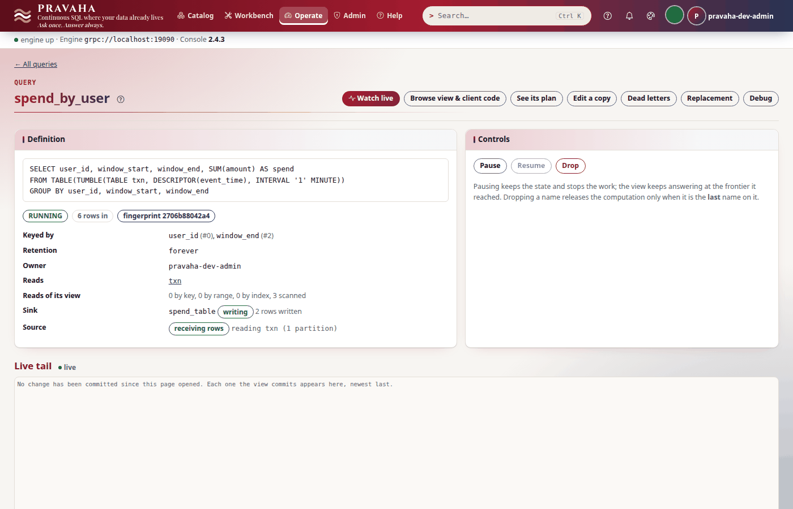
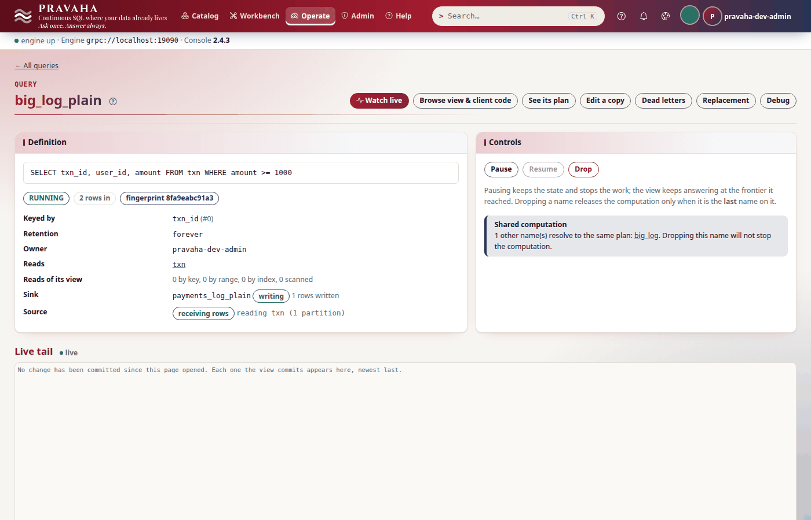
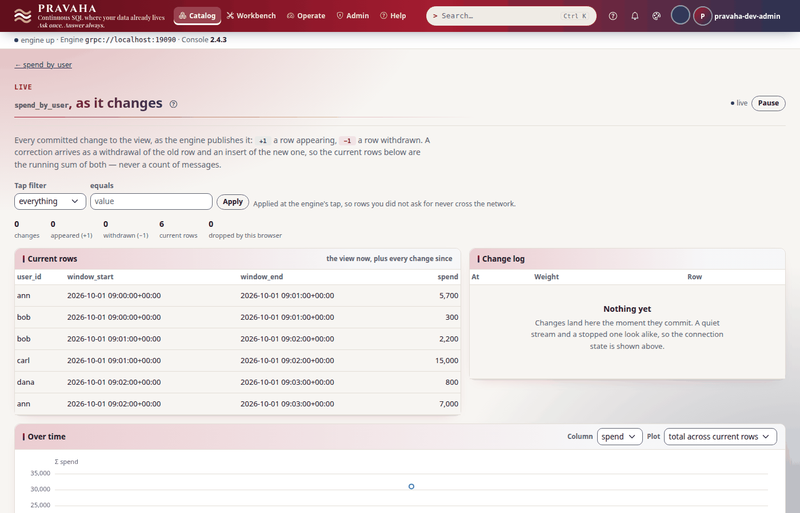

# Tutorial 9 · Exactly-once sinks

Copyright © 2026 Ashutosh Sinha \<ajsinha@gmail.com\>. All rights reserved.
**Proprietary and confidential** — see [`../../LICENSE`](../../LICENSE).

A view answers whoever asks the node; a **sink** puts the answer where other systems already look — here
a relational table. The hard part is not writing rows, it is what happens when the node dies between
two writes: the restart replays what came after the last checkpoint, and a sink that cannot tell a
replayed row from a new one writes it twice. In this tutorial you keep each user's spend per minute in
a table with `jdbc-sink` — upserted by key, applied once per checkpoint — and log the big payments to
two tables, one **transactional** and one not. Then you wait for a checkpoint, send payments, and
**kill the node** (`kill -9`: no shutdown, no last checkpoint) before the next one: while it is down, look
at what each table holds; after the restart, count the copies. The transactional tables end exactly
right; the other holds a duplicate. Every output below was printed by a real node running these
steps — including the crash.

**Time to complete:** about 25 minutes, two of which are waiting for checkpoints.

## Before you start

- [Tutorial 1](01-first-15-minutes.md) done, and [tutorial 2](02-windows-and-late-data.md) for the minute
  windows.
- The H2 database jar, `h2-2.3.232.jar` (Maven Central, `com.h2database:h2:2.3.232`), for the tables: a
  database in one file, so this tutorial needs no server. The same sink writes PostgreSQL (its driver is
  in the server jar), and any database with a JDBC driver in `plugins/`.
- The tutorial's files, in [data/t09/](data/t09/): `streams/txn.yaml` (the stream), three sinks in
  `sinks/`, the database they write as a named connection (`connectors/warehouse.yaml`),
  `application.yaml` (a checkpoint every 30 seconds), `txn.csv` (six payments), `warehouse.sql` (the
  three tables) and `spend_by_user.sql`.
- A node home with the configuration, the data, the driver in `plugins/`, and the tables made before the
  node starts — **a sink never creates or alters its table**:

```bash
export PRAVAHA_HOME=$HOME/pravaha-t09
mkdir -p $PRAVAHA_HOME/conf $PRAVAHA_HOME/data/incoming $PRAVAHA_HOME/plugins
cp -r docs/tutorials/data/t09/{application.yaml,streams,sinks,connectors} $PRAVAHA_HOME/conf/
cp docs/tutorials/data/t09/txn.csv $PRAVAHA_HOME/data/incoming/
cp ~/.m2/repository/com/h2database/h2/2.3.232/h2-2.3.232.jar $PRAVAHA_HOME/plugins/
cd docs/tutorials/data/t09
```

<!-- capture: t09-create -->
```text
$ java -cp "$PRAVAHA_HOME/plugins/h2-2.3.232.jar" org.h2.tools.RunScript -url "jdbc:h2:$PRAVAHA_HOME/data/warehouse/warehouse;AUTO_SERVER=TRUE" -user sa -script warehouse.sql
```
<!-- /capture -->

```bash
bin/pravaha-server --spring.profiles.active=dev,users &   # loads the driver from plugins/
export PRAVAHA_TOKEN=$(pravaha login --user pravaha-dev-admin) PRAVAHA_INSECURE_TOKEN=true
```

`AUTO_SERVER=TRUE` lets H2's own shell read the file while the node holds it open.

## What you will learn

- the three delivery guarantees — at least once, effectively once, exactly once — and which one a sink
  gives, as the node itself says;
- how `jdbc-sink` makes a table exactly once: a **staging table**, one database transaction per
  checkpoint, and what that costs in latency;
- **upsert** (the table is the view, by key) against **append** (a log of rows);
- what a crash does to each kind of table, seen while the node is down and after it is back;
- what the sink TCK checks before a sink may claim any of it.

## Step 1 · Three sinks, three tables

The three sinks write one database, so the database is a **named connection** — said once — and each
sink's file names it and says only what is its own:

```yaml
# conf/connectors/warehouse.yaml (the database)
plugin: jdbc-sink
options:
  url: "jdbc:h2:./data/warehouse/warehouse;AUTO_SERVER=TRUE"
  user: sa
```

```yaml
# conf/sinks/spend_table.yaml
connector: warehouse
options:
  table: spend_by_user
  schema: "user_id:STRING,window_start:TIMESTAMP,window_end:TIMESTAMP,spend:INT64"
  key.columns: "user_id,window_end"
  mode: upsert
  transactional: "true"
```

```yaml
# conf/sinks/payments_log.yaml
connector: warehouse
options:
  table: payments_log
  schema: "txn_id:INT64,user_id:STRING,amount:INT64"
  mode: append
  transactional: "true"
```

```yaml
# conf/sinks/payments_log_plain.yaml
connector: warehouse
options:
  table: payments_log_plain
  schema: "txn_id:INT64,user_id:STRING,amount:INT64"
  mode: append
  transactional: "false"
```

```yaml
# conf/application.yaml
pravaha:
  checkpoint:
    interval: 30s
    keep: 5
```

A sink's options are the connection's with its own laid over them — moving the warehouse to
PostgreSQL is one file's `url`, `user` and `password: "${ENV_NAME}"` (a literal password is refused,
`PRV-1063`).

The tables are ordinary: `spend_by_user` has a primary key on exactly `key.columns`, which is what an
upsert resolves against; the two logs have none.

<!-- file: data/t09/warehouse.sql -->
```text
CREATE TABLE spend_by_user (
    user_id       VARCHAR(32) NOT NULL,
    window_start  TIMESTAMP WITH TIME ZONE NOT NULL,
    window_end    TIMESTAMP WITH TIME ZONE NOT NULL,
    spend         BIGINT NOT NULL,
    PRIMARY KEY (user_id, window_end)
);
```

What the node will promise for each, before anything is registered:

<!-- capture: t09-sinks -->
```text
$ pravaha sinks
NAME                PLUGIN     EMIT            RETRACTIONS  GUARANTEE      WRITERS  PROBLEM
payments_log        jdbc-sink  APPEND          no           EXACTLY_ONCE   -        -
payments_log_plain  jdbc-sink  APPEND          no           AT_LEAST_ONCE  -        -
spend_table         jdbc-sink  RETRACT,UPSERT  yes          EXACTLY_ONCE   -        -
```
<!-- /capture -->

| Guarantee | Means | After a crash the table |
|---|---|---|
| **exactly once** | every change reaches the table once, and a checkpoint's changes become visible together | holds what the restored checkpoint committed, then the replay's changes, once |
| **effectively once** | a change may be *written* twice, but a repeated upsert puts the value already there | converges to the view |
| **at least once** | nothing is lost; some rows may arrive twice | holds a repeat of what was written after the last checkpoint |

`GUARANTEE` is what **this node** gives, not what the plugin could: a transactional sink is exactly
once only on a node that takes checkpoints, because the transaction is tied to one. The same
`jdbc-sink` with `transactional: false` is effectively once in upsert mode (a repeated upsert rewrites
the same value) and at least once in append mode — nothing in an appended row says it is a repeat.

You should see `EXACTLY_ONCE` twice and `AT_LEAST_ONCE` for `payments_log_plain`.

## Step 2 · Register, and read the table

Each user's spend per minute, keyed by `user_id` and `window_end` (columns 0 and 2) — the same as the
sink's `key.columns`:

```sql
-- data/t09/spend_by_user.sql
SELECT user_id, window_start, window_end, SUM(amount) AS spend
FROM TABLE(TUMBLE(TABLE txn, DESCRIPTOR(event_time), INTERVAL '1' MINUTE))
GROUP BY user_id, window_start, window_end
```

<!-- capture: t09-register-spend -->
```text
$ pravaha register --name spend_by_user --sql-file spend_by_user.sql --keys 0,2 --sink spend_table
registered spend_by_user  state=RUNNING  fingerprint=2706b88042a4  sink=spend_table
a query with the same fingerprint is the same computation, shared
```
<!-- /capture -->

The big payments, twice — the same SQL under two names, each writing to its own log:

<!-- capture: t09-register-log -->
```text
$ pravaha register --name big_log --sql 'SELECT txn_id, user_id, amount FROM txn WHERE amount >= 1000' --keys 0 --sink payments_log
registered big_log  state=RUNNING  fingerprint=8fa9eabc91a3  sink=payments_log
a query with the same fingerprint is the same computation, shared
```
<!-- /capture -->

<!-- capture: t09-register-plain -->
```text
$ pravaha register --name big_log_plain --sql 'SELECT txn_id, user_id, amount FROM txn WHERE amount >= 1000' --keys 0 --sink payments_log_plain
registered big_log_plain  state=RUNNING  fingerprint=8fa9eabc91a3  sink=payments_log_plain
a query with the same fingerprint is the same computation, shared
```
<!-- /capture -->

Same fingerprint: one computation, two names, two sinks. The node logs the guarantee each
registration actually gets, and why — the authority for one registration, since only it knows the
query's source:

<!-- capture: t09-guarantee -->
```text
$ grep -ho "query '[a-z_]*' writes to sink .*" "$PRAVAHA_HOME/logs/pravaha-server.log" | sort | cut -c1-150
query 'big_log_plain' writes to sink 'payments_log_plain', at-least-once: the sink appends and is not transactional, so a restart delivers again what
query 'big_log' writes to sink 'payments_log', exactly-once: the sink is transactional, so what is written between checkpoints is prepared at each che
query 'spend_by_user' writes to sink 'spend_table', exactly-once: the sink is transactional, so what is written between checkpoints is prepared at eac
```
<!-- /capture -->

<!-- capture: t09-view -->
```text
$ pravaha query --sql 'SELECT * FROM spend_by_user'
user_id  window_start               window_end                 spend
ann      2026-10-01 09:00:00+00:00  2026-10-01 09:01:00+00:00  5700
bob      2026-10-01 09:00:00+00:00  2026-10-01 09:01:00+00:00  300
2 rows
```
<!-- /capture -->

After the first checkpoint (at most 30 seconds), the table holds the same rows:

<!-- capture: t09-table -->
```text
$ java -cp "$PRAVAHA_HOME/plugins/h2-2.3.232.jar" org.h2.tools.Shell -url "jdbc:h2:$PRAVAHA_HOME/data/warehouse/warehouse;AUTO_SERVER=TRUE" -user sa -sql "SELECT * FROM spend_by_user ORDER BY window_end, user_id"
USER_ID | WINDOW_START           | WINDOW_END             | SPEND
ann     | 2026-10-01 09:00:00+00 | 2026-10-01 09:01:00+00 | 5700
bob     | 2026-10-01 09:00:00+00 | 2026-10-01 09:01:00+00 | 300
(2 rows, N ms)
```
<!-- /capture -->

<!-- capture: t09-counts -->
```text
$ java -cp "$PRAVAHA_HOME/plugins/h2-2.3.232.jar" org.h2.tools.Shell -url "jdbc:h2:$PRAVAHA_HOME/data/warehouse/warehouse;AUTO_SERVER=TRUE" -user sa -sql "SELECT (SELECT COUNT(*) FROM payments_log) AS logged, (SELECT COUNT(*) FROM payments_log_plain) AS logged_plain, (SELECT COUNT(*) FROM spend_by_user) AS spend_rows"
LOGGED | LOGGED_PLAIN | SPEND_ROWS
4      | 4            | 2
(1 row, N ms)
```
<!-- /capture -->



You should see two rows in the view and the same two in the table; four payments in each log.

## Step 3 · How the transactional sink writes

A transactional `jdbc-sink` does not write a batch to the target table. It:

1. **writes** each batch, as bytes, to a **staging table** (`pravaha_sink_staging`, made on first open)
   under the sink's `transaction.id` and the open transaction's label, and commits that — durable, and
   invisible to anyone reading the target;
2. **prepares** at the checkpoint's cut: names the label, which the checkpoint records;
3. **commits** once the checkpoint is durable: every batch staged under the label is applied to the
   target **and** deleted from staging, in **one** database transaction. Readers see a checkpoint's
   changes all at once; a commit repeated after a crash finds nothing staged and does nothing;
4. on **restore**, deletes everything staged after the restored checkpoint — the replay writes it again.

Why not the database's own `PREPARE TRANSACTION`: PostgreSQL disables it by default, and a prepared
transaction holds its row locks until the checkpoint is stored, blocking every other writer. What the
staging table costs: every row is written twice, and **the table trails the view by up to one
checkpoint interval**. With `transactional: false` the sink writes each batch straight to the table,
current within a commit — and a crash repeats whatever came after the last checkpoint.

You should see why the first rows took up to 30 seconds to reach the table.

## Step 4 · Kill the node between two checkpoints

Wait for a checkpoint (`pravaha debug checkpoints --name big_log` lists them, newest first), and right
after it send two payments — ann's 7000, a big one, and carl's 90, whose time closes two minute windows:

<!-- capture: t09-append -->
```text
$ printf '%s\n' '7,ann,7000,2026-10-01T09:02:30Z' '8,carl,90,2026-10-01T09:03:10Z' >> "$PRAVAHA_HOME/data/incoming/txn.csv"
```
<!-- /capture -->

The view has ann's 7000 at once:

<!-- capture: t09-view-ahead -->
```text
$ pravaha query --sql 'SELECT * FROM big_log'
txn_id  user_id  amount
1       ann      1200
3       ann      4500
4       carl     15000
5       bob      2200
7       ann      7000
5 rows
```
<!-- /capture -->

The tables, a second later, differ — the plain log has it, the transactional one has staged it:

<!-- capture: t09-counts-ahead -->
```text
$ java -cp "$PRAVAHA_HOME/plugins/h2-2.3.232.jar" org.h2.tools.Shell -url "jdbc:h2:$PRAVAHA_HOME/data/warehouse/warehouse;AUTO_SERVER=TRUE" -user sa -sql "SELECT (SELECT COUNT(*) FROM payments_log) AS logged, (SELECT COUNT(*) FROM payments_log_plain) AS logged_plain, (SELECT COUNT(*) FROM spend_by_user) AS spend_rows"
LOGGED | LOGGED_PLAIN | SPEND_ROWS
4      | 5            | 2
(1 row, N ms)
```
<!-- /capture -->

<!-- capture: t09-staged -->
```text
$ java -cp "$PRAVAHA_HOME/plugins/h2-2.3.232.jar" org.h2.tools.Shell -url "jdbc:h2:$PRAVAHA_HOME/data/warehouse/warehouse;AUTO_SERVER=TRUE" -user sa -sql "SELECT sink_id, COUNT(*) AS staged_batches FROM pravaha_sink_staging GROUP BY sink_id ORDER BY sink_id"
SINK_ID      | STAGED_BATCHES
payments_log | 1
spend_table  | 1
(2 rows, N ms)
```
<!-- /capture -->

Now kill the node — not a shutdown, which would take a last checkpoint, but the way a machine dies:

```bash
kill -9 %1
```

While it is down, the tables hold exactly what they held:

<!-- capture: t09-while-down -->
```text
$ java -cp "$PRAVAHA_HOME/plugins/h2-2.3.232.jar" org.h2.tools.Shell -url "jdbc:h2:$PRAVAHA_HOME/data/warehouse/warehouse;AUTO_SERVER=TRUE" -user sa -sql "SELECT (SELECT COUNT(*) FROM payments_log) AS logged, (SELECT COUNT(*) FROM payments_log_plain) AS logged_plain, (SELECT COUNT(*) FROM spend_by_user) AS spend_rows"
LOGGED | LOGGED_PLAIN | SPEND_ROWS
4      | 5            | 2
(1 row, N ms)
```
<!-- /capture -->

The engine's memory of payment 7 is gone; the last checkpoint is from before it. The transactional
tables are at that checkpoint — consistent with it, if behind the view. The plain log is **ahead** of
any checkpoint the restart can restore, and nothing in its row says so.

You should see `logged 4`, `logged_plain 5` and a batch staged for each transactional sink.

## Step 5 · Restart, and count the copies

```bash
bin/pravaha-server --spring.profiles.active=dev,users &
export PRAVAHA_TOKEN=$(pravaha login --user pravaha-dev-admin)
```

The node restores every query from its newest checkpoint, the source rewinds the file to the offset
that checkpoint recorded, and the two payments are read and computed again. The transactional sinks
delete what was staged after the checkpoint, stage the replay's rows, and commit them at the next
checkpoint. Once it has:

<!-- capture: t09-counts-after -->
```text
$ java -cp "$PRAVAHA_HOME/plugins/h2-2.3.232.jar" org.h2.tools.Shell -url "jdbc:h2:$PRAVAHA_HOME/data/warehouse/warehouse;AUTO_SERVER=TRUE" -user sa -sql "SELECT (SELECT COUNT(*) FROM payments_log) AS logged, (SELECT COUNT(*) FROM payments_log_plain) AS logged_plain, (SELECT COUNT(*) FROM spend_by_user) AS spend_rows"
LOGGED | LOGGED_PLAIN | SPEND_ROWS
5      | 6            | 6
(1 row, N ms)
```
<!-- /capture -->

Five big payments, and the plain log has six rows:

<!-- capture: t09-duplicates -->
```text
$ java -cp "$PRAVAHA_HOME/plugins/h2-2.3.232.jar" org.h2.tools.Shell -url "jdbc:h2:$PRAVAHA_HOME/data/warehouse/warehouse;AUTO_SERVER=TRUE" -user sa -sql "SELECT 'payments_log' AS t, txn_id, COUNT(*) AS copies FROM payments_log GROUP BY txn_id HAVING COUNT(*) > 1 UNION ALL SELECT 'payments_log_plain', txn_id, COUNT(*) FROM payments_log_plain GROUP BY txn_id HAVING COUNT(*) > 1"
T                  | TXN_ID | COPIES
payments_log_plain | 7      | 2
(1 row, N ms)
```
<!-- /capture -->

Payment 7 is in the plain log twice: written before the crash, and again by the replay. The
transactional log has each payment once, none lost and none repeated:

<!-- capture: t09-log -->
```text
$ java -cp "$PRAVAHA_HOME/plugins/h2-2.3.232.jar" org.h2.tools.Shell -url "jdbc:h2:$PRAVAHA_HOME/data/warehouse/warehouse;AUTO_SERVER=TRUE" -user sa -sql "SELECT * FROM payments_log ORDER BY txn_id"
TXN_ID | USER_ID | AMOUNT
1      | ann     | 1200
3      | ann     | 4500
4      | carl    | 15000
5      | bob     | 2200
7      | ann     | 7000
(5 rows, N ms)
```
<!-- /capture -->



You should see no duplicate in `payments_log` and payment 7 twice in `payments_log_plain`.

## Step 6 · Upsert: the table is the view

The spend table has the four new rows the two closed windows produced, and it is the view, row for row:

<!-- capture: t09-table-after -->
```text
$ java -cp "$PRAVAHA_HOME/plugins/h2-2.3.232.jar" org.h2.tools.Shell -url "jdbc:h2:$PRAVAHA_HOME/data/warehouse/warehouse;AUTO_SERVER=TRUE" -user sa -sql "SELECT * FROM spend_by_user ORDER BY window_end, user_id"
USER_ID | WINDOW_START           | WINDOW_END             | SPEND
ann     | 2026-10-01 09:00:00+00 | 2026-10-01 09:01:00+00 | 5700
bob     | 2026-10-01 09:00:00+00 | 2026-10-01 09:01:00+00 | 300
bob     | 2026-10-01 09:01:00+00 | 2026-10-01 09:02:00+00 | 2200
carl    | 2026-10-01 09:01:00+00 | 2026-10-01 09:02:00+00 | 15000
ann     | 2026-10-01 09:02:00+00 | 2026-10-01 09:03:00+00 | 7000
dana    | 2026-10-01 09:02:00+00 | 2026-10-01 09:03:00+00 | 800
(6 rows, N ms)
```
<!-- /capture -->

<!-- capture: t09-view-after -->
```text
$ pravaha query --sql 'SELECT * FROM spend_by_user'
user_id  window_start               window_end                 spend
ann      2026-10-01 09:00:00+00:00  2026-10-01 09:01:00+00:00  5700
bob      2026-10-01 09:00:00+00:00  2026-10-01 09:01:00+00:00  300
bob      2026-10-01 09:01:00+00:00  2026-10-01 09:02:00+00:00  2200
carl     2026-10-01 09:01:00+00:00  2026-10-01 09:02:00+00:00  15000
dana     2026-10-01 09:02:00+00:00  2026-10-01 09:03:00+00:00  800
ann      2026-10-01 09:02:00+00:00  2026-10-01 09:03:00+00:00  7000
6 rows
```
<!-- /capture -->

**Upsert** keeps the table equal to the view by key: a new row is inserted, a changed one replaced
(`MERGE INTO ... KEY (...)` on H2, `INSERT ... ON CONFLICT ... DO UPDATE` on PostgreSQL, `UPDATE` then
`INSERT` elsewhere), and a row that leaves the view is deleted — so it takes any query, including one
whose answer is corrected (a late payment in a window with allowed lateness, a CDC delete). Even
without a transaction an upsert is effectively once: a replayed upsert writes the value already there.
**Append** inserts every row and accepts only a query that never takes a row back (`PRV-2041`
otherwise); it is a log, and only a transaction keeps a log free of repeats.



The plugin page shows each binding and what the plugin declares; the `GUARANTEE` above is what the node
makes of it:


**How a sink earns the word.** Every sink plugin runs the sink TCK (`pravaha-testkit`'s
`SinkPluginTck`), which does not believe a declaration: it checks that a batch is written whole, that a
retraction removes its record, that a sink declaring idempotent upsert is unchanged by a replayed batch,
and that a sink declaring itself transactional shows nothing before commit, commits a prepared
transaction once even when asked twice, and abandons what came after a restored checkpoint. The Kafka,
Delta and Iceberg sinks are transactional the same way: a staging topic, a Delta commit, an Iceberg
snapshot per checkpoint.

You should see the table and the view hold the same six rows.

## Next steps

- [Tutorial 10 · Alerts](10-alerts.md): instead of writing the answer somewhere, be told when it changes.
- [Tutorial 7 · Kafka end to end](07-kafka-end-to-end.md): the same exactly-once argument for a topic,
  to a `read_committed` consumer.
- The reference: [the jdbc sink](../../pravaha-console/content/topics/sink-jdbc.md) (every option, the
  statements per database, the staging table), [delivery
  guarantees](../../pravaha-console/content/topics/delivery-guarantees.md), [checkpoints and
  recovery](../../pravaha-console/content/topics/checkpoints-recovery.md), and the
  [Delta](../../pravaha-console/content/topics/sink-delta.md) and
  [Iceberg](../../pravaha-console/content/topics/sink-iceberg.md) sinks.

## If something goes wrong

| Symptom | What it means | What to do |
|---|---|---|
| `PRV-8010` at `register --sink` | the sink's `schema` is not the query's `SELECT` list in order, name and type, or `key.columns` is not the view's key | make them agree; `--keys` takes output-column ordinals |
| `PRV-5075` when the sink opens | the table's columns do not match the sink's `schema`, or the table is missing | create or fix the table; the sink never does |
| `PRV-2041` at registration | an append sink was named by a query whose answer can be corrected | use `mode: upsert`, or a query that never retracts |
| `PRV-5074` | a `tls.*` option on a JDBC sink | put TLS in the URL (`sslmode=verify-full`) |
| The table is empty, the view is not | a transactional sink commits at the next durable checkpoint | wait one `checkpoint.interval`; check `pravaha debug checkpoints` |
| `GUARANTEE` says `AT_LEAST_ONCE` for a transactional sink | the node takes no checkpoints | set `pravaha.checkpoint.*` |
| Duplicates in an append table after a restart | the sink is `transactional: false` | set `transactional: "true"`, or deduplicate downstream by the key |
| Rows staged and never applied after a binding is retired | a run that was never restored left them | delete them from `pravaha_sink_staging` by `sink_id` |
