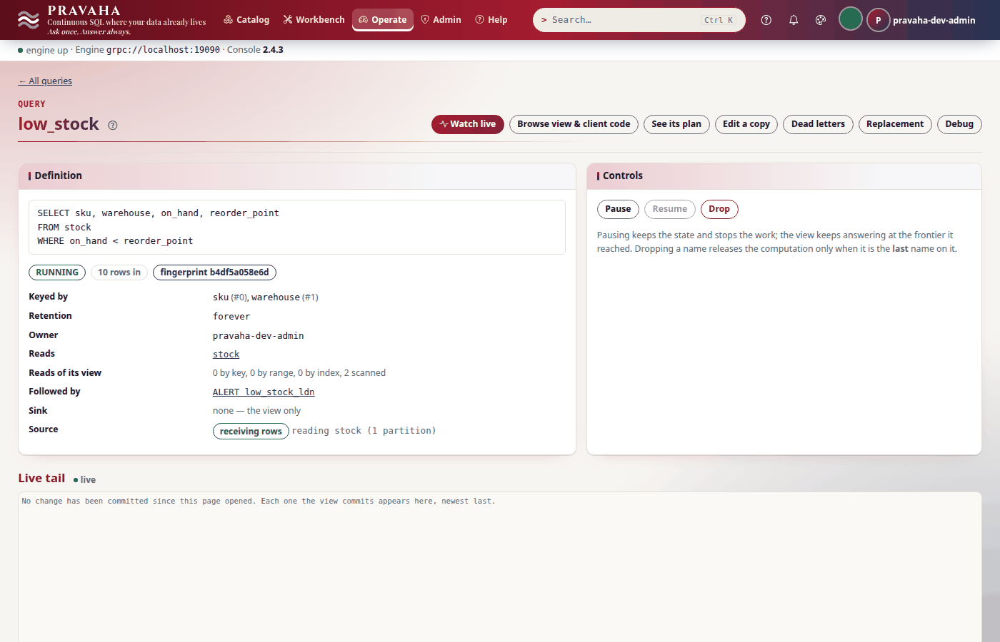

# Tutorial 10 · Alerts

Copyright © 2026 Ashutosh Sinha \<ajsinha@gmail.com\>. All rights reserved.
**Proprietary and confidential** — see [`../../LICENSE`](../../LICENSE).

The buyers in London want to know when a product falls below its reorder point — and, just as much,
when it is back above it, so that nobody orders stock that has already arrived. A view already answers
"what is low"; an **alert** watches that answer and tells somebody when a row **enters** it (the key
*fires*) and when it **leaves** (the key *clears*). In this tutorial you bind two channels — a signed
webhook, received by a small catcher script you run, and the node's log — create an alert on the
London rows, and watch keys fire and clear as stock is counted again. Then you quiet it the three ways
an operator does: **snooze** (and see what it was holding back arrive on resume), **acknowledge**, and
**pause**. You meet the refusals, `SHOW ALERTS`, and the console's **Alerts** pages. Every output below
was printed by a real node, and every notification was received by the catcher, in these steps.

**Time to complete:** about 25 minutes.

## Before you start

- [Tutorial 1](01-first-15-minutes.md) done, and [tutorial 4](04-following-a-view.md) for what a `−1`
  means: an alert clears because the view withdraws the row.
- The tutorial's files, in [data/t10/](data/t10/): `application.yaml` (the stream, the two channels),
  `stock.csv` (four stock counts), `low_stock.sql`, and `catcher.py`, a webhook receiver in the Python
  standard library that checks each notification's signature.
- A node home with the configuration and the data, and a shared secret the webhook signs with — a
  secret is never configuration, so it lives in a file the configuration names:

```bash
export PRAVAHA_HOME=$HOME/pravaha-t10
mkdir -p $PRAVAHA_HOME/conf $PRAVAHA_HOME/data/incoming
cp docs/tutorials/data/t10/application.yaml $PRAVAHA_HOME/conf/
cp docs/tutorials/data/t10/stock.csv $PRAVAHA_HOME/data/incoming/
```

<!-- capture: t10-secret -->
```text
$ python3 -c 'import secrets; print(secrets.token_hex(32))' > "$PRAVAHA_HOME/conf/hook.secret"
```
<!-- /capture -->

```bash
bin/pravaha-server --spring.profiles.active=dev,users &
cd docs/tutorials/data/t10
export PRAVAHA_TOKEN=$(pravaha login --user pravaha-dev-admin) PRAVAHA_INSECURE_TOKEN=true
python catcher.py --port 18099 --secret-file "$PRAVAHA_HOME/conf/hook.secret" --log hooks.log &
```

## What you will learn

- what an alert follows — a view's **answer**, not its changelog — and why that makes a clear honest;
- channels: a **webhook** (JSON, HMAC-signed, retried, with an idempotency key) and the **log**;
- `CREATE ALERT` and `pravaha alert create`: the condition, the channels, severity and the columns a
  notification carries;
- **what is true** against **what is said**: snooze, pause and acknowledge change the second, never the first;
- the refusals (`PRV-2072`, `PRV-8043`, `PRV-8024`), `SHOW ALERTS`, and the console's Alerts pages.

## Step 1 · Channels, and a view to watch

```yaml
# data/t10/application.yaml (the channels)
pravaha:
  notifiers:
    buyers:
      plugin: webhook
      options:
        url: http://localhost:18099/hook
        secret-file: conf/hook.secret
        retries: "2"
    ops-log:
      plugin: log
```

<!-- capture: t10-channels -->
```text
$ pravaha alerts channels
NAME     PLUGIN
buyers   webhook
ops-log  log
```
<!-- /capture -->

A channel the node cannot open — no URL, a secret file it cannot read, an option called `secret` or
`password` written into the configuration — refuses the **start** (`PRV-8046`): a pager found broken
at the first page is worse than a node that did not start. The view the alert will watch:

```sql
-- data/t10/low_stock.sql
SELECT sku, warehouse, on_hand, reorder_point
FROM stock
WHERE on_hand < reorder_point
```

<!-- capture: t10-register -->
```text
$ pravaha register --name low_stock --sql-file low_stock.sql --keys 0,1
registered low_stock  state=RUNNING  fingerprint=b4df5a058e6d
a query with the same fingerprint is the same computation, shared
```
<!-- /capture -->

<!-- capture: t10-low-stock -->
```text
$ pravaha query --sql 'SELECT * FROM low_stock'
sku      warehouse  on_hand  reorder_point
sku-200  LDN        8        10
sku-300  NYC        3        5
sku-400  LDN        12       20
3 rows
```
<!-- /capture -->

The stock file has an `op` column: a count that changes is a `D` of the old line and an `I` of the
new (`op.column: op`), so a product topped up **leaves** `low_stock` as a `−1` — the event an alert
clears on.

You should see two channels and three low lines, two of them in London.

## Step 2 · Create the alert

`pravaha alert create` writes a `CREATE ALERT` statement and sends it over Flight; `--print-sql` shows
the statement and sends nothing:

<!-- capture: t10-print-sql -->
```text
$ pravaha alert create low_stock_ldn --on low_stock --where "warehouse = 'LDN'" --notify buyers,ops-log --severity warning --include on_hand,reorder_point --print-sql
CREATE ALERT low_stock_ldn ON low_stock WHERE warehouse = 'LDN' NOTIFY buyers, "ops-log" WITH (severity = 'warning', include = (on_hand, reorder_point))
```
<!-- /capture -->

The same statement runs wherever `CREATE CONTINUOUS QUERY` does — the Workbench, `pravaha query --sql`,
Flight SQL, JDBC.

<!-- capture: t10-create -->
```text
$ pravaha alert create low_stock_ldn --on low_stock --where "warehouse = 'LDN'" --notify buyers,ops-log --severity warning --include on_hand,reorder_point
low_stock_ldn: ACTIVE -- watches low_stock and notifies [buyers, ops-log]
```
<!-- /capture -->

The two London lines were already in the view, so both keys fire at once. The catcher received:

<!-- capture: t10-fired -->
```text
$ sort hooks.log
FIRED     low_stock_ldn FIRED (warning) for sku=sku-200, warehouse=LDN  [on_hand=8, reorder_point=10]  episode 1  signature ok
FIRED     low_stock_ldn FIRED (warning) for sku=sku-400, warehouse=LDN  [on_hand=12, reorder_point=20]  episode 1  signature ok
```
<!-- /capture -->

Each notification is a JSON body — the alert, the view, `kind` (`FIRED`, `CLEARED` or `REMINDER`), the
key, the `include`d columns, the episode, `summary` — with headers a receiver needs:
`X-Pravaha-Signature: sha256=…`, the HMAC-SHA256 of `<X-Pravaha-Timestamp>.<body>` under the shared
secret (the catcher recomputes it: `signature ok`), and `Idempotency-Key`, the same on every attempt to
deliver one notification. Delivery is **at least once** — a webhook that times out or answers 5xx is
sent the notification again, with backoff — so a receiver that must act once de-duplicates on that
key. The alert's own state is **exactly once**: every decision is journalled and forced to disk before
anything is sent, so a restart neither re-fires a firing key nor loses a clear.

<!-- capture: t10-ls -->
```text
$ pravaha alerts ls
NAME           VIEW       STATE   FIRING  PENDING  SEVERITY  CHANNELS        PROBLEM
low_stock_ldn  low_stock  ACTIVE  2       0        warning   buyers,ops-log  -
```
<!-- /capture -->

<!-- capture: t10-show -->
```text
$ pravaha alerts show low_stock_ldn
name       low_stock_ldn
view       low_stock
state      ACTIVE
following  FOLLOWING
condition  warehouse = 'LDN'
channels   buyers, ops-log
severity   warning
options    include=on_hand,reorder_point
owner      pravaha-dev-admin
firing     2
pending    0
delivery   up to date

keys:
KEY                         STATE   EPISODE  SINCE                           NOTIFIED  OWED  ACK
sku=sku-200, warehouse=LDN  FIRING  1        <time>                          FIRED     -     -
sku=sku-400, warehouse=LDN  FIRING  1        <time>                          FIRED     -     -

recent notifications:
AT                              KIND   KEY                         EPISODE  OUTCOME    DETAIL
<time>                          FIRED  sku=sku-200, warehouse=LDN  1        DELIVERED  buyers: HTTP 200; ops-log: logged
<time>                          FIRED  sku=sku-400, warehouse=LDN  1        DELIVERED  buyers: HTTP 200; ops-log: logged
```
<!-- /capture -->

The log channel wrote one line per notification under the logger `pravaha.alerts`, followed by the same
JSON body:

<!-- capture: t10-log-channel -->
```text
$ grep -o 'pravaha.alerts .*: alert low_stock_ldn FIRED[^{]*' "$PRAVAHA_HOME/logs/pravaha-server.log" | sort
pravaha.alerts                           : alert low_stock_ldn FIRED (warning) for sku=sku-200, warehouse=LDN
pravaha.alerts                           : alert low_stock_ldn FIRED (warning) for sku=sku-400, warehouse=LDN
```
<!-- /capture -->


You should see two `FIRED` notifications with `signature ok`, and two keys `FIRING`.

## Step 3 · A key clears

sku-200 is counted again at 60, above its reorder point:

<!-- capture: t10-restock -->
```text
$ printf '%s\n' 'sku-200,LDN,8,10,2026-10-01T09:00:05Z,D' 'sku-200,LDN,60,10,2026-10-01T09:01:00Z,I' >> "$PRAVAHA_HOME/data/incoming/stock.csv"
```
<!-- /capture -->

<!-- capture: t10-cleared -->
```text
$ tail -n 1 hooks.log
CLEARED   low_stock_ldn CLEARED (warning) for sku=sku-200, warehouse=LDN  []  episode 1  signature ok
```
<!-- /capture -->

The old line's `D` withdrew sku-200 from `low_stock`, and the alert was told so in the same commit.
Because it follows the view's **answer**, an update across the threshold is seen as the old row leaving
— which a consumer of a keyed view's changelog would see only as a new value. A clear carries no row:
the row has left. Had the new count still been below 10, the key would have stayed firing, with no
notification at all.

You should see `CLEARED` for sku-200.

## Step 4 · Snooze: what is true, and what is said

Each key has two states, kept apart: **what is true** — firing or not — and **what the channels were
last told**. Snoozing, pausing and `dedupe` hold the second back; they never change the first. Snooze
for an hour, then let sku-100 fall to 6:

<!-- capture: t10-snooze -->
```text
$ pravaha alerts snooze low_stock_ldn 1h
low_stock_ldn snoozed until <time>
```
<!-- /capture -->

<!-- capture: t10-sku-100-low -->
```text
$ printf '%s\n' 'sku-100,LDN,40,10,2026-10-01T09:00:00Z,D' 'sku-100,LDN,6,10,2026-10-01T09:01:30Z,I' >> "$PRAVAHA_HOME/data/incoming/stock.csv"
```
<!-- /capture -->

<!-- capture: t10-snoozed-keys -->
```text
$ pravaha alerts show low_stock_ldn
keys:
KEY                         STATE    EPISODE  SINCE                           NOTIFIED  OWED   ACK
sku=sku-400, warehouse=LDN  FIRING   1        <time>                          FIRED     -      -
sku=sku-100, warehouse=LDN  FIRING   1        <time>                          NONE      FIRED  -
sku=sku-200, warehouse=LDN  CLEARED  1        <time>                          CLEARED   -      -
```
<!-- /capture -->

(Only the keys are shown.) sku-100 **is** firing; the channels have been told `NONE` and are **owed**
`FIRED`. The catcher has still had three notifications:

<!-- capture: t10-nothing-sent -->
```text
$ wc -l < hooks.log
3
```
<!-- /capture -->


Resume, and what is owed is sent — once, and only if it still differs from what was last said:

<!-- capture: t10-resume -->
```text
$ pravaha alerts resume low_stock_ldn
low_stock_ldn resumed: what changed meanwhile is sent now
```
<!-- /capture -->

<!-- capture: t10-sent-on-resume -->
```text
$ tail -n 1 hooks.log
FIRED     low_stock_ldn FIRED (warning) for sku=sku-100, warehouse=LDN  [on_hand=6, reorder_point=10]  episode 1  signature ok
```
<!-- /capture -->

A snooze ends by itself at its time, or at `resume`.

You should see sku-100 `FIRING` and owed `FIRED` while snoozed, and its `FIRED` on resume.

## Step 5 · Acknowledge, and pause

Somebody has ordered sku-400; say so, so that `resend_every` (reminders until acknowledged, if the alert
had it) stops for that key:

<!-- capture: t10-ack -->
```text
$ pravaha alerts ack low_stock_ldn --key 'sku=sku-400, warehouse=LDN'
low_stock_ldn: 1 firing key acknowledged
```
<!-- /capture -->

`ACK ALERT low_stock_ldn` (or the console's **Acknowledge every firing key**) acknowledges every key
firing now. Now **pause** — keep following, say nothing — and let the order arrive:

<!-- capture: t10-pause -->
```text
$ pravaha alerts pause low_stock_ldn
low_stock_ldn paused: it keeps following its view and says nothing
```
<!-- /capture -->

<!-- capture: t10-sku-400-restock -->
```text
$ printf '%s\n' 'sku-400,LDN,12,20,2026-10-01T09:00:15Z,D' 'sku-400,LDN,30,20,2026-10-01T09:02:00Z,I' >> "$PRAVAHA_HOME/data/incoming/stock.csv"
```
<!-- /capture -->

<!-- capture: t10-paused-keys -->
```text
$ pravaha alerts show low_stock_ldn
keys:
KEY                         STATE    EPISODE  SINCE                           NOTIFIED  OWED     ACK
sku=sku-100, warehouse=LDN  FIRING   1        <time>                          FIRED     -        -
sku=sku-200, warehouse=LDN  CLEARED  1        <time>                          CLEARED   -        -
sku=sku-400, warehouse=LDN  CLEARED  1        <time>                          FIRED     CLEARED  pravaha-dev-admin
```
<!-- /capture -->

<!-- capture: t10-resume-again -->
```text
$ pravaha alerts resume low_stock_ldn
low_stock_ldn resumed: what changed meanwhile is sent now
```
<!-- /capture -->

<!-- capture: t10-cleared-on-resume -->
```text
$ tail -n 1 hooks.log
CLEARED   low_stock_ldn CLEARED (warning) for sku=sku-400, warehouse=LDN  []  episode 1  signature ok
```
<!-- /capture -->

sku-400 had been told `FIRED`, so its clear was owed and sent on resume. Pause and snooze both send only
the difference when they end: a key that fired **and** cleared inside a pause is never announced,
because by the end the receiver's picture is already right. A snooze ends by itself; a pause only
when someone resumes it. Who may do which:
under the catalogue (tutorial 11) an alert is an object its creator owns — `SELECT` to see it, `MODIFY`
to pause, resume, snooze and acknowledge, `MANAGE` to alter or drop it — and creating one needs `SELECT`
on the view and `WRITE` on each channel.

<!-- capture: t10-show-alerts -->
```text
$ pravaha query --sql 'SHOW ALERTS'
name           view       state   following  condition          channels        severity  firing  pending  owner              delivery_error
low_stock_ldn  low_stock  ACTIVE  FOLLOWING  warehouse = 'LDN'  buyers,ops-log  warning   1       0        pravaha-dev-admin  NULL
1 row
```
<!-- /capture -->


You should see sku-400 owed `CLEARED` while paused, and that `CLEARED` sent on resume.

## Step 6 · What is refused

A condition is comparisons of the view's own columns with literals, joined by `AND`:

<!-- capture: t10-or-refused -->
```text
$ pravaha alert create low_or_tiny --on low_stock --where "warehouse = 'LDN' OR on_hand < 2" --notify buyers
PRV-2072  an alert's condition is comparisons joined by AND; OR is not built. A condition with OR is a question: register it as a continuous query over the view (ADR-056) and put the alert ON that query (at line 1, column 63). The statement's shape is: CREATE ALERT [IF NOT EXISTS] <name> ON <view> [WHERE <column> <op> <literal> [AND ...]] NOTIFY <channel> [, <channel>...] [WITH (<option> = <value>, ...)]
  look PRV-2072 up in the console's help under Errors, or in docs/guides/TROUBLESHOOTING.md
(exit 1)
```
<!-- /capture -->

<!-- capture: t10-channel-refused -->
```text
$ pravaha alert create low_pager --on low_stock --notify pager
PRV-8043  no notifier channel is called 'pager'; bind one under pravaha.notifiers.pager (bound: [buyers, ops-log])
  look PRV-8043 up in the console's help under Errors, or in docs/guides/TROUBLESHOOTING.md
(exit 1)
```
<!-- /capture -->

And a view an alert follows cannot be dropped from under it — there is no cascade:

<!-- capture: t10-drop-refused -->
```text
$ pravaha drop --name low_stock --yes
PRV-8024  'low_stock' cannot be dropped: [ALERT low_stock_ldn] reads its answer. Drop it first. There is no cascade: it would take answers away from queries somebody else registered.
  look PRV-8024 up in the console's help under Errors, or in docs/guides/TROUBLESHOOTING.md
(exit 1)
```
<!-- /capture -->



The query's page lists the alert under **Followed by**. The rest of an alert's options: `fire_after` and
`clear_after` (in or out of the condition this long before it counts — a flap filter on what is
*true*), `dedupe` (the least time between two notifications about one key) and `resend_every`
(reminders until acknowledged), all on `CREATE ALERT ... WITH (...)` or changed later with
`ALTER ALERT low_stock_ldn SET (dedupe = '10m')`. When you are done, stop the catcher (`kill %2`) and
`pravaha alert drop low_stock_ldn --yes`.

You should see `PRV-2072`, `PRV-8043` and `PRV-8024`.

## Next steps

- [Tutorial 11 · Governance](11-governance.md): who may see, pause or drop an alert, and the audit trail
  of every change.
- Drafting an alert from a sentence ("tell the buyers when anything in London is below its reorder
  point") is part of the AI layer, `pravaha alert --ask`, judged by `CREATE ALERT`'s own checks — see
  [AI.md](../guides/AI.md) and [Tutorial 16 · AI in Pravaha](16-ai-in-pravaha.md), which drafts one,
  creates it on confirmation and shows the one it refuses to write.
- The reference: [alerts](../../pravaha-console/content/topics/alerts.md) (every option and statement,
  delivery, who may do what), [CONTINUOUS_QUERIES.md](../guides/CONTINUOUS_QUERIES.md) §3.2 and §10.2,
  and OPERATIONS.md for the webhook's options and its secret.

## If something goes wrong

| Symptom | What it means | What to do |
|---|---|---|
| The node does not start, `PRV-8046` | a channel cannot open: no URL, a secret it cannot read, or a secret written into the configuration | `secret-file` or `secret-env`; check the file exists before the start |
| `PRV-8043` at `CREATE ALERT` | `NOTIFY` names a channel the node does not bind | bind it under `pravaha.notifiers.<name>` |
| `PRV-2072` or `PRV-2070` | `OR`, arithmetic or two columns in the condition | register a query over the view with that question, and alert on it |
| `PRV-8042` | a column the view does not have, a literal of the wrong type, an unknown option, or no such view | check the view's columns with `pravaha describe` |
| `PRV-8041` | an alert and a query share a name | pick another name |
| `PRV-8024` dropping a view | an alert follows it | `pravaha alert drop` first |
| `PRV-8040` | an alert you may not see — as if it did not exist | ask for `SELECT` on it (tutorial 11) |
| The catcher says `signature BAD` | the receiver's secret is not the node's | use the same file; rotating it is a node restart |
| A notification arrives twice | delivery is at least once; a retry or a restart between send and record | de-duplicate on `Idempotency-Key` |
