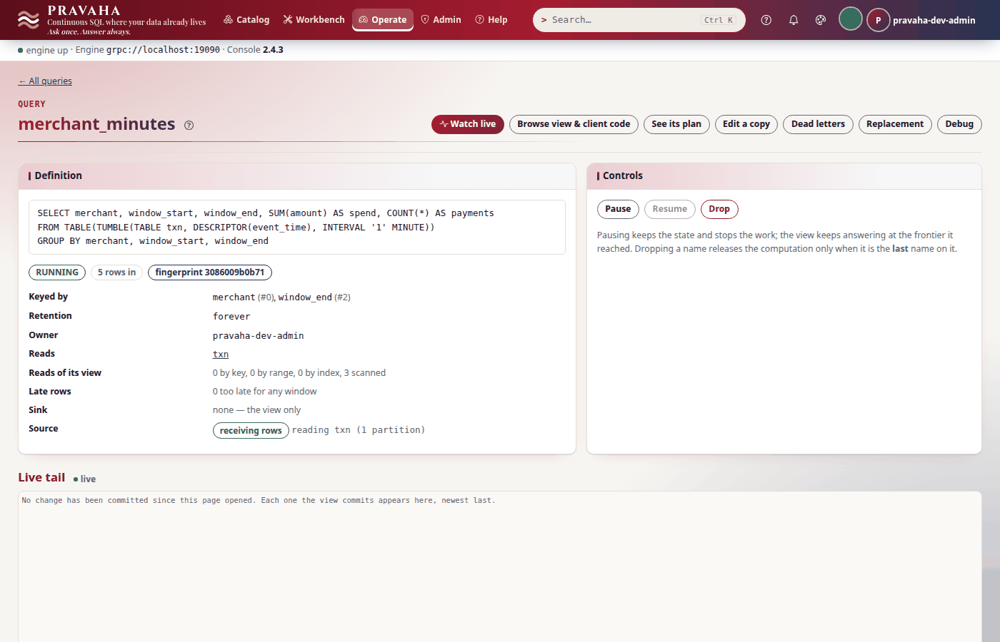
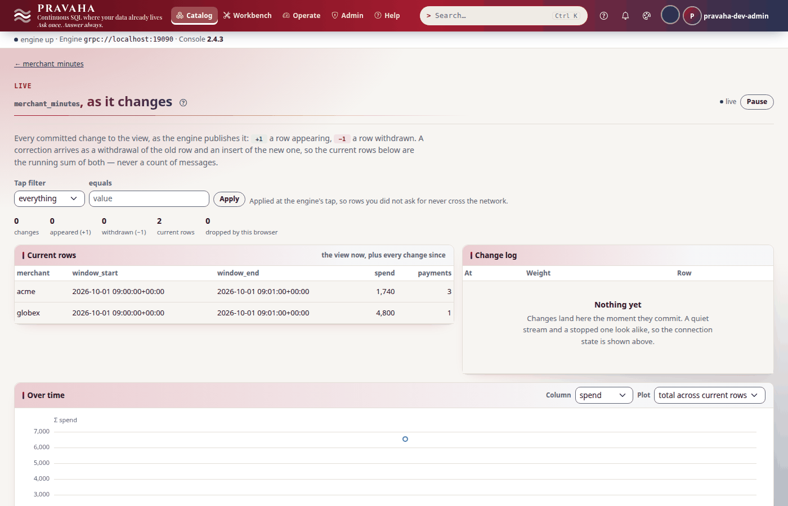

# Tutorial 12 · Embedding Pravaha

Copyright © 2026 Ashutosh Sinha \<ajsinha@gmail.com\>. All rights reserved.
**Proprietary and confidential** — see [`../../LICENSE`](../../LICENSE).

Not every maintained answer needs a server. A payments service that owns its own input can carry the
whole engine inside its JVM — the planner, the lanes, the views, the checkpoints — call it directly,
and open no port at all. In this tutorial you build two small Maven projects against the engine you
installed: a **plain Java program** with `pravaha-embedded` (no Spring), which declares a stream,
registers two continuous queries, pushes payments, closes a minute by advancing event time, follows a
view and reads it, and is refused exactly as a node would refuse it; the same engine **built from
configuration**, run four times so you can watch a restart keep its total — and a close before the
next checkpoint lose a payment; and a **Spring Boot service** with the starter, where a
`@PravahaListener` keeps a board up to date and `@PravahaTest` with `PravahaTester` tests it without a
single sleep. Last, the same SQL on a node, so you can see when to embed and when not to. Every output
below was printed by these projects and a real node running these steps.

**Time to complete:** about 30 minutes.

## Before you start

- [Tutorial 1](01-first-15-minutes.md) done, for the node at the end (step 6).
- Java 21 or later and Maven 3.9. The engine's artefacts in your local Maven repository: in a checkout,
  `./mvnw -q -DskipTests install` once (it puts `pravaha-embedded`, `pravaha-spring-boot-starter`,
  `pravaha-bom` and the rest into `~/.m2/repository`).
- The tutorial's two projects, in [data/t12/](data/t12/): `payments-embedded/` (a plain Java program)
  and `payments-spring/` (a Spring Boot service). Each `pom.xml` names the engine's version in one
  property, `pravaha.version`; set it to the version you installed (`./mvnw help:evaluate
  -Dexpression=project.version -q -DforceStdout` prints it).
- For step 6, a node with the same payments: `application.yaml`, `txn.csv` and `merchant_minutes.sql`.

```bash
cp -r docs/tutorials/data/t12/payments-embedded docs/tutorials/data/t12/payments-spring ~/work/
cd ~/work/payments-embedded
```

## What you will learn

- what `pravaha-embedded` is — the engine as a library, with no Spring and no server — and how a
  project depends on it (through `pravaha-bom`);
- the embedded lifecycle: **declare → start → register, push, read, subscribe → close**; pushing rows
  and advancing event time yourself; reading rows into records;
- that the embedded engine refuses what a node refuses, with the same `PRV` codes;
- the registry journal and checkpoints in a program, and what a close before a checkpoint costs;
- the Spring Boot starter: `pravaha.*` properties, `PravahaTemplate`, `@PravahaListener`;
- testing with `@PravahaTest` and `PravahaTester` — and why each test wants an engine of its own;
- when to embed, and when to run a node instead.

## Step 1 · A project with the engine in it

`payments-embedded/pom.xml` imports the engine's **bill of materials** and depends on one artefact:

<!-- file: data/t12/payments-embedded/pom.xml -->
```xml
  <dependencyManagement>
    <dependencies>
      <!-- The engine's bill of materials: every pravaha-* artefact, and the versions of the libraries
           they were built and tested with (Arrow, Jackson, Calcite ...), so Maven does not pick older
           ones from a dependency's dependency. -->
      <dependency>
        <groupId>com.ash.messaging</groupId>
        <artifactId>pravaha-bom</artifactId>
        <version>${pravaha.version}</version>
        <type>pom</type>
        <scope>import</scope>
      </dependency>
    </dependencies>
  </dependencyManagement>

  <dependencies>
    <!-- The whole engine as a library: planner, lanes, views, checkpoints. No Spring, no server. -->
    <dependency>
      <groupId>com.ash.messaging</groupId>
      <artifactId>pravaha-embedded</artifactId>
      <version>${pravaha.version}</version>
    </dependency>
```

The import is not decoration. Without it Maven resolves the engine's libraries from whichever
dependency's dependency it meets first — older Jackson, Guava and SnakeYAML than the engine was built
with — and an offline build fails to find them at all. What the one dependency brings:

<!-- capture: t12-tree -->
```text
$ mvn -q dependency:tree -Dincludes=com.ash.messaging -DoutputFile=tree.txt && cat tree.txt
com.example:payments-embedded:jar:<version>
\- com.ash.messaging:pravaha-embedded:jar:<version>:compile
   +- com.ash.messaging:pravaha-api:jar:<version>:compile
   +- com.ash.messaging:pravaha-common:jar:<version>:compile
   +- com.ash.messaging:pravaha-algebra:jar:<version>:compile
   +- com.ash.messaging:pravaha-connect:jar:<version>:compile
   +- com.ash.messaging:pravaha-security:jar:<version>:compile
   +- com.ash.messaging:pravaha-sql:jar:<version>:compile
   |  +- com.ash.messaging:pravaha-catalog:jar:<version>:compile
   |  \- com.ash.messaging:pravaha-runtime:jar:<version>:compile
   +- com.ash.messaging:pravaha-serving:jar:<version>:compile
   |  \- com.ash.messaging:pravaha-state:jar:<version>:compile
   +- com.ash.messaging:pravaha-registry:jar:<version>:compile
   |  \- com.ash.messaging:pravaha-backfill:jar:<version>:compile
   +- com.ash.messaging:pravaha-bindings:jar:<version>:compile
   \- com.ash.messaging:pravaha-plugin-filesystem:jar:<version>:compile
```
<!-- /capture -->

The SQL planner, the runtime with its lanes, the serving layer that answers reads, the registry that
owns registrations, checkpoints — and the `filesystem` source, so a stream can be bound to a file as on
a node. Not in the tree: `pravaha-server`, Flight, the HTTP API, the PostgreSQL gateway, users and
the catalogue. Nothing listens on a port, and nothing checks who is calling: **an embedded engine
trusts its caller completely**, so the host decides who may call it. There is no Spring either; the
build of `pravaha-embedded` fails if any reaches its classpath (ADR-019), so the engine can live in an
application on any Spring version, or none.

You should see `pravaha-embedded` and the modules under it, all at the version you installed.

## Step 2 · Declare, push, close a minute, read

`Payments.java` is a payments service with two maintained answers inside it: each merchant's spend per
minute, and the large payments. The engine's whole lifecycle is in its first sixty lines:

<!-- file: data/t12/payments-embedded/src/main/java/com/example/payments/Payments.java -->
```java
        try (PravahaEngine engine = PravahaEngine.createDefault()) {
            // 1. Declare, then start: every query is planned against the streams declared here.
            engine.declareStream("txn",
                    "txn_id:INT64,user_id:STRING,merchant:STRING,amount:INT64,event_time:TIMESTAMP",
                    "event_time");                  // the event-time column: windows over it can close
            engine.start();
            System.out.println("engine " + engine.state() + ", streams " + engine.streams().size());

            // 2. Register: CREATE CONTINUOUS QUERY through query(), or the registration call.
            engine.query("""
                    CREATE CONTINUOUS QUERY merchant_minutes
                        KEYED BY (merchant, window_end)
                    AS SELECT merchant, window_start, window_end, SUM(amount) AS spend, COUNT(*) AS payments
                       FROM TABLE(TUMBLE(TABLE txn, DESCRIPTOR(event_time), INTERVAL '1' MINUTE))
                       GROUP BY merchant, window_start, window_end""");
            engine.register("large_payments",
                    "SELECT txn_id, merchant, amount FROM txn WHERE amount >= 1000", "txn_id");
            System.out.println("registered " + new TreeSet<>(engine.queries()));

            // 3. Follow a view: every commit, as +1 and -1 changes, on the committing thread.
            Queue<String> seen = new ConcurrentLinkedQueue<>();
            engine.subscribe("merchant_minutes", changes -> changes.forEach(c ->
                    seen.add((c.isRetraction() ? "- " : "+ ") + c.as(Minute.class))));

            // 4. Push rows, in column order. Returns once every query reading txn has committed them.
            int reached = engine.push("txn",
                    new Object[] {1L, "ann", "acme", 400L, NINE.plusSeconds(5)},
                    new Object[] {2L, "bob", "acme", 1250L, NINE.plusSeconds(20)},
                    new Object[] {3L, "ann", "globex", 4800L, NINE.plusSeconds(40)},
                    new Object[] {4L, "cat", "acme", 90L, NINE.plusSeconds(55)});
            System.out.println("pushed 4 payments to " + reached + " computations");
            System.out.println("large payments now: " + engine.query(Large.class, "SELECT * FROM large_payments"));
            System.out.println("minutes published so far: "
                    + engine.query("SELECT COUNT(*) AS n FROM merchant_minutes").rows().get(0)[0]);

            // 5. Close 09:00 -- nothing earlier than 09:01:30 is still coming -- and a row of 09:01.
            engine.push("txn", new Object[] {5L, "dan", "globex", 700L, NINE.plusSeconds(75)});
            engine.advanceEventTime("txn", NINE.plusSeconds(90));
            await(seen, 2);
            System.out.println("the subscriber saw:");
            seen.stream().sorted().forEach(line -> System.out.println("  " + line));
```

The two statements are ordinary Pravaha SQL, planned exactly as a node plans them:

```sql
SELECT merchant, window_start, window_end, SUM(amount) AS spend, COUNT(*) AS payments
FROM TABLE(TUMBLE(TABLE txn, DESCRIPTOR(event_time), INTERVAL '1' MINUTE))
GROUP BY merchant, window_start, window_end
```

```sql
SELECT txn_id, merchant, amount FROM txn WHERE amount >= 1000
```

Run it (`exec:exec` starts the program in a JVM of its own, on the project's classpath):

<!-- capture: t12-run -->
```text
$ mvn -q compile exec:exec
engine RUNNING, streams 1
registered [large_payments, merchant_minutes]
pushed 4 payments to 2 computations
large payments now: [Large[txnId=2, merchant=acme, amount=1250], Large[txnId=3, merchant=globex, amount=4800]]
minutes published so far: 0
the subscriber saw:
  + Minute[merchant=acme, windowEnd=2026-10-01T09:01:00Z, spend=1740, payments=3]
  + Minute[merchant=globex, windowEnd=2026-10-01T09:01:00Z, spend=4800, payments=1]
acme 09:00: spend 1740 in 3 payments
refused: PRV-2050  GROUP BY user_id has no bound on its key space, so its state grows with the number of distinct keys and never shrinks.
refused: PRV-8102  a row pushed to 'txn' has a String in column 'amount' (INT64), which needs an integral Number
closed
```
<!-- /capture -->

Read it line by line:

- **`pushed 4 payments to 2 computations`** — `push` returns once every running query that reads `txn`
  has applied and committed the rows, so `large_payments` answers with the two big ones on the very
  next line. There is no "eventually" between a push and a read.
- **`minutes published so far: 0`** — the minute is still open. Over *pushed* rows the engine cannot
  know that no earlier payment is still coming; a bound source advances the watermark itself, but
  here **you** say it, with `advanceEventTime("txn", 09:01:30)`. Then the 09:00 minute is published:
  acme's three payments (400 + 1250 + 90 = 1740) and globex's one. Payment 5, at 09:01:15, is in the
  next minute, which is still open.
- **The subscriber** runs on the thread that committed; keep it short, or hand the work to an
  executor. `c.as(Minute.class)` reads the change into a record by column name, a `TIMESTAMP` into an
  `Instant`. (`c.values()` gives the same row as a map — with a `TIMESTAMP` as nanoseconds since 1970,
  not an `Instant`, whatever the [embedded engine topic](../../pravaha-console/content/topics/embedded-engine.md)'s
  sample output shows; EMBEDTS-1.)
- **The refusals are the node's own.** An unwindowed `GROUP BY user_id` would keep state for every user
  for ever:

<!-- sql: refused PRV-2050 -->
```sql
SELECT user_id, SUM(amount) AS total FROM txn GROUP BY user_id
```

  and a push with a string where a number belongs is refused whole, before any query sees any of it
  (`PRV-8102`): one bad row and nothing of the batch is delivered.

You should see the two large payments before the minute closes, `0` minutes published, then acme
`1740` in `3` payments and globex `4800`, and the two refusals.

## Step 3 · Surviving a restart

`createDefault()` is memory only — right for a test, wrong for a service. `Durable.java` builds the
engine from **configuration**, with the keys a node reads: a registry journal (registrations come back
at start) and a checkpoint directory (each query's state comes back), checkpointing every second:

<!-- file: data/t12/payments-embedded/src/main/java/com/example/payments/Durable.java -->
```java
        Configuration configuration = Configuration.builder()
                .set("pravaha.node.id", "payments-service")
                .set("pravaha.streams.txn.schema",
                        "txn_id:INT64,user_id:STRING,merchant:STRING,amount:INT64,event_time:TIMESTAMP")
                .set("pravaha.registry.journal", "state/registry.journal")
                .set("pravaha.checkpoint.directory", "state/checkpoints")
                .set("pravaha.checkpoint.interval", "1s")
                .build();
```

Each run registers `payments_total` if the journal did not bring it back, pushes one payment of 250,
waits for a checkpoint and closes. The query is a global aggregate — no `GROUP BY`, one row — so its
state cannot grow and needs no window:

```sql
SELECT COUNT(*) AS payments, SUM(amount) AS total FROM txn
```

<!-- capture: t12-durable-1 -->
```text
$ mvn -q exec:exec -Dmain=com.example.payments.Durable
registered payments_total
at start: no rows yet
after a payment of 250: 1 payments, 250 in all
checkpointed; closing
```
<!-- /capture -->

<!-- capture: t12-durable-2 -->
```text
$ mvn -q exec:exec -Dmain=com.example.payments.Durable
payments_total is back: the journal registered it again at start
at start: 1 payments, 250 in all
after a payment of 250: 2 payments, 500 in all
checkpointed; closing
```
<!-- /capture -->

The second run found the query in the journal and its total in the last checkpoint. Now close **before**
the next checkpoint:

<!-- capture: t12-durable-closed -->
```text
$ CLOSE_AT_ONCE=1 mvn -q exec:exec -Dmain=com.example.payments.Durable
payments_total is back: the journal registered it again at start
at start: 2 payments, 500 in all
after a payment of 250: 3 payments, 750 in all
closing before the next checkpoint
```
<!-- /capture -->

<!-- capture: t12-durable-4 -->
```text
$ mvn -q exec:exec -Dmain=com.example.payments.Durable
payments_total is back: the journal registered it again at start
at start: 2 payments, 500 in all
after a payment of 250: 3 payments, 750 in all
checkpointed; closing
```
<!-- /capture -->

The third run's payment is gone: it started at `2 payments, 500`. **The engine checkpoints every
`pravaha.checkpoint.interval`, not at `close()`.** On a node that costs nothing — its sources replay
from the checkpoint's offsets — but pushed rows have no source to replay them, so whatever was pushed
after the last checkpoint is lost on a restart, a clean one included (EMBEDCKPT-1). Until the engine
checkpoints at close, a service that pushes must either keep its own record of what it pushed since the
last checkpoint, or bind a [source](../../pravaha-console/content/topics/embedded-engine.md#every-call)
(`bindSource`) whose offsets replay. What is on disk:

<!-- capture: t12-state -->
```text
$ find state -type f | sort
state/checkpoints/payments_5ftotal/checkpoint-4.bin
state/checkpoints/payments_5ftotal/checkpoint-5.bin
state/checkpoints/payments_5ftotal/checkpoint-6.bin
state/registry.journal
```
<!-- /capture -->

Three checkpoints are kept (`pravaha.checkpoint.keep`), each query in a directory of its own. The
engine keeps `state/` readable by its owner only, and narrows it (with a warning) when it finds it
wider — a umask of `022` makes new directories `rwxr-xr-x`, which it then tightens.

You should see the total come back after a restart, and the payment pushed just before an early close
not come back.

## Step 4 · The Spring Boot starter

`payments-spring` is the same engine as a bean of a Spring Boot service. The starter
(`pravaha-spring-boot-starter`) builds and **starts** the engine from `pravaha.*` properties before any
bean of yours is created, closes it with the context, and gives you a `PravahaTemplate` and
`@PravahaListener`:

<!-- file: data/t12/payments-spring/src/main/resources/application.yaml -->
```yaml
pravaha:
  node:
    id: revenue-board
  streams:
    orders:
      schema: "order_id:INT64,customer:STRING,region:STRING,amount:INT64,event_time:TIMESTAMP"
      event-time: event_time
  queries:
    region_revenue:
      sql: >
        SELECT region, window_start, window_end, SUM(amount) AS revenue, COUNT(*) AS orders
        FROM TABLE(TUMBLE(TABLE orders, DESCRIPTOR(event_time), INTERVAL '1' MINUTE))
        GROUP BY region, window_start, window_end
      keys: [region, window_end]
```

The service pushes through the template and keeps a board from the view's changes:

<!-- file: data/t12/payments-spring/src/main/java/com/example/board/RevenueBoard.java -->
```java
    /** The intake path: one row per order, in the stream's column order. */
    public void recordOrder(long orderId, String customer, String region, long amount, Instant at) {
        pravaha.push("orders", new Object[] {orderId, customer, region, amount, at});
    }

    /** Every committed change of the view, off the engine's thread; a correction is -1 then +1. */
    @PravahaListener(query = "region_revenue")
    void onRevenue(RegionRevenue row, boolean retraction) {
        String key = row.region() + " " + row.windowEnd();
        if (retraction) {
            board.remove(key);
        } else {
            board.put(key, row.revenue());
        }
    }
```

The `boolean` is required for the record form: an update arrives as the old row withdrawn and the new
one added, in that order, and a listener that could not tell them apart would apply the stale row last.
`MinuteOfOrders`, a `CommandLineRunner`, records four orders, advances event time past 09:01, waits for
the listener and prints. Build the jar and run it:

<!-- capture: t12-package -->
```text
$ mvn -q package -DskipTests
```
<!-- /capture -->

<!-- capture: t12-jar -->
```text
$ java -jar target/revenue-board-0.1.0-SNAPSHOT.jar
4 orders recorded; the view has 0 rows
the listener's board:
  AMER 2026-10-01T09:01:00Z  300
  APAC 2026-10-01T09:01:00Z  800
  EMEA 2026-10-01T09:01:00Z  5700
the view: RegionRevenue[region=AMER, windowEnd=2026-10-01T09:01:00Z, revenue=300, orders=1]
the view: RegionRevenue[region=APAC, windowEnd=2026-10-01T09:01:00Z, revenue=800, orders=1]
the view: RegionRevenue[region=EMEA, windowEnd=2026-10-01T09:01:00Z, revenue=5700, orders=2]
```
<!-- /capture -->

Two things in the pom are worth copying. It imports `spring-boot-dependencies` **and** `pravaha-bom`,
for the reason step 1 gave. And it excludes `commons-logging` from the starter: Calcite's
`aggdesigner` brings it, Spring has its own (`spring-jcl`), and with both on the classpath every start
prints `Standard Commons Logging discovery in action with spring-jcl: please remove commons-logging.jar`
(SBCOMMONSLOG-1). What fails, and when: a listener naming a query that does not exist, or with a
signature it cannot be called with, **fails the start**, naming it; a query in `pravaha.queries` the
engine refuses fails the start with the engine's code (`PRV-2050`, `PRV-2071`, …); a listener that
throws is logged and stays subscribed; one more than `listener.max-pending` commits behind is detached
and logged, rather than handed a stream with a gap.

You should see the board with EMEA at `5700` (1200 + 4500, two orders), and the view saying the same.

## Step 5 · Testing it with `@PravahaTest`

`@PravahaTest` is a test slice: the engine from `application.yaml` (in memory — the slice clears the
journal and checkpoint settings), the beans that have a `@PravahaListener` method, and a
`PravahaTester` that waits for the engine **without sleeping** — a push is committed when it returns,
`awaitListeners` returns when every listener has been handed what is committed, and `awaitView` when
the view's answer satisfies a condition, woken by the view's commits rather than a timer:

<!-- file: data/t12/payments-spring/src/test/java/com/example/board/RevenueBoardTest.java -->
```java
@PravahaTest
@DirtiesContext(classMode = DirtiesContext.ClassMode.AFTER_EACH_TEST_METHOD)
class RevenueBoardTest {

    private static final Instant NINE = Instant.parse("2026-10-01T09:00:00Z");

    @Autowired
    PravahaTester pravaha;

    @Autowired
    RevenueBoard board;

    @Test
    void aClosedMinuteReachesTheListener() {
        pravaha.push("orders",
                new Object[] {1L, "ann-gmbh", "EMEA", 1200L, NINE.plusSeconds(5)},
                new Object[] {2L, "cafe-lyon", "EMEA", 4500L, NINE.plusSeconds(31)});
        pravaha.engine().advanceEventTime("orders", NINE.plusSeconds(70));
        pravaha.awaitListeners("region_revenue");
        assertThat(board.board()).containsEntry("EMEA 2026-10-01T09:01:00Z", 5700L);
    }
```

<!-- capture: t12-test -->
```text
$ mvn package 2>&1 | grep -E 'Tests run:|BUILD'
[INFO] Tests run: 2, Failures: 0, Errors: 0, Skipped: 0, Time elapsed: N s -- in com.example.board.RevenueBoardTest
[INFO] Tests run: 2, Failures: 0, Errors: 0, Skipped: 0
[INFO] BUILD SUCCESS
```
<!-- /capture -->

Two lessons this test learned the hard way, both worth knowing before you write your own:

- **`@DirtiesContext`.** Spring keeps one context — one engine — for every test that asks for the same
  one, and event time only goes forward. Without it the second test's `advanceEventTime` makes the
  first test's rows **late**, they are dropped, and the test fails (or worse, passes on stale state).
  A fresh engine per test costs a fraction of a second here.
- **No `@Bean` on the application class.** A slice starts from the `@SpringBootApplication` class, so
  its `@Bean` methods are part of every slice. The runner that records the demo's orders lives in a
  `@Component` of its own (`MinuteOfOrders`), which the slice leaves out because it has no listener;
  declared as a `@Bean` on `BoardApplication`, it ran inside the tests and pushed its own orders first.

You should see `Tests run: 2, Failures: 0` and `BUILD SUCCESS`.

## Step 6 · The same SQL on a node

The query is the same SQL whichever host runs it. Bind the same payments to a file on a node (the
`filesystem` source, as in [tutorial 1](01-first-15-minutes.md)) and register it from the CLI:

<!-- capture: t12-register -->
```text
$ pravaha register --name merchant_minutes --sql-file merchant_minutes.sql --keys 0,2
registered merchant_minutes  state=RUNNING  fingerprint=3086009b0b71
a query with the same fingerprint is the same computation, shared
```
<!-- /capture -->

<!-- capture: t12-query -->
```text
$ pravaha query --sql 'SELECT merchant, window_end, spend, payments FROM merchant_minutes'
merchant  window_end                 spend  payments
acme      2026-10-01 09:01:00+00:00  1740   3
globex    2026-10-01 09:01:00+00:00  4800   1
2 rows
```
<!-- /capture -->

The same totals as the program printed: here the source's watermark — the newest event time read, less
the stream's five seconds of out-of-orderness — closed 09:00 when payment 5 (09:01:15) was read; in the
program, `advanceEventTime` did. And the same refusal, from the node's planner:

<!-- capture: t12-refused -->
```text
$ pravaha validate --sql 'SELECT user_id, SUM(amount) AS total FROM txn GROUP BY user_id'
PRV-2050  GROUP BY user_id has no bound on its key space, so its state grows with the number of distinct keys and never shrinks. One row per key is fine at a thousand keys and fatal at a hundred million, and the failure arrives weeks after deployment.
  Bound it with a window -- GROUP BY TUMBLE(event_time, INTERVAL '1' MINUTE), user_id -- so state is released when each window closes.
Refusing now rather than exhausting memory later.
(exit 1)
```
<!-- /capture -->





What the node adds, and the embedded engine does not have: a network face (Flight, HTTP, the
PostgreSQL gateway) for other programs and people; users, sign-in, grants and the audit trail; sources
that replay after a crash; the console. What embedding adds: no second process, no network hop between
the service and its answer, and a push that returns only when the answer has it. The reference for both
is in the console's help:


| Embed it when | Run a node when |
|---|---|
| one service owns the input and is the only reader | other services, tools or people read the answer |
| the answer must be in the same process as the code that acts on it | readers need sign-in, grants, row filters, masks, an audit trail |
| a test needs a real engine, fast and in memory | input comes from Kafka, a database or files that must replay after a crash |
| the service already has its own deployment and lifecycle | you want the console, `pravaha top`, alerts and the rest of the operator's tools |

You should see acme `1740` from `3` payments and globex `4800`, as the program printed, and `PRV-2050`
for the unwindowed query.

## Next steps

- [Tutorial 13 · Writing a connector](13-writing-a-connector.md): a source of your own, which an
  embedded engine binds with `bindSource` exactly as a node binds it in configuration.
- [Tutorial 4 · Following a view](04-following-a-view.md): the same subscriptions, over the network,
  from Python, Java and `psql`.
- The reference: [the embedded engine](../../pravaha-console/content/topics/embedded-engine.md) (every
  call, the values a push accepts, closing windows, subscription buffers) and [the Spring Boot
  starter](../../pravaha-console/content/topics/spring-boot-starter.md) (every property, the
  template, the listener signatures).

## If something goes wrong

| Symptom | What it means | What to do |
|---|---|---|
| `Could not resolve dependencies ... jackson-annotations:jar:2.15.4` (or Guava, SnakeYAML) | the project does not import `pravaha-bom`, so Maven picked a dependency's older versions | import `pravaha-bom` in `dependencyManagement`, as step 1 |
| `Could not find artifact com.ash.messaging:pravaha-embedded` | the engine is not in your local Maven repository, or `pravaha.version` names another version | `./mvnw -q -DskipTests install` in a checkout; set `pravaha.version` to what it installed |
| a windowed view stays empty | event time was never advanced over pushed rows, or the stream was declared without its event-time column | `advanceEventTime(stream, instant)`; declare the column |
| `PRV-2050` | an unwindowed `GROUP BY` per key: its state would grow for ever | window it, or aggregate globally |
| `PRV-8102` | a pushed row has a value the column's type cannot take; the whole batch is refused | push the right Java type (`Long` for `INT64`, `Instant` for `TIMESTAMP`) |
| `PRV-8101` | a push to a stream that was never declared | `declareStream` before `start()` |
| `PRV-2070` / `PRV-2071` | a registration without a key, or a key the query does not produce | name key columns the query outputs |
| `PRV-8105` | some queries on the stream took the push and one did not | do not retry that push (it would count twice where it landed); fix the query that failed |
| the total is lower after a restart | rows pushed after the last checkpoint are not replayed (EMBEDCKPT-1) | a shorter `pravaha.checkpoint.interval`, or a replayable source |
| a `@PravahaTest` test fails when run with others | the tests share one engine, and another test's event time made these rows late | `@DirtiesContext(classMode = AFTER_EACH_TEST_METHOD)`, or give each test its own minutes |
| the start fails naming a listener | `@PravahaListener` names a query that does not exist, or has a signature it cannot be called with | register the query in `pravaha.queries`; use one of the four signatures |
