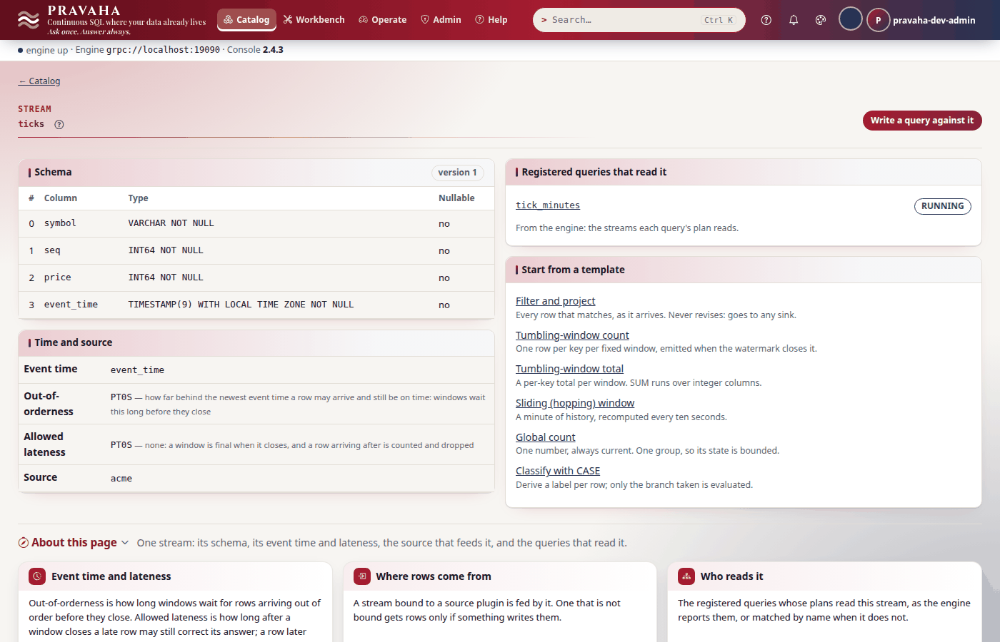
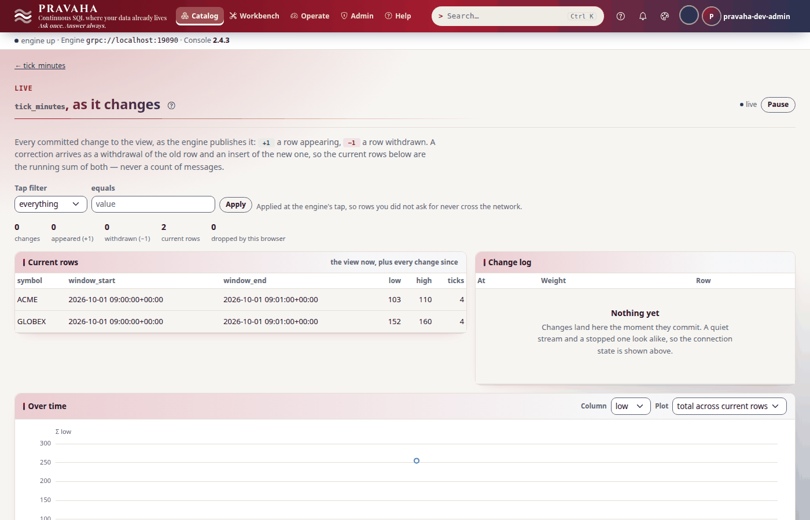
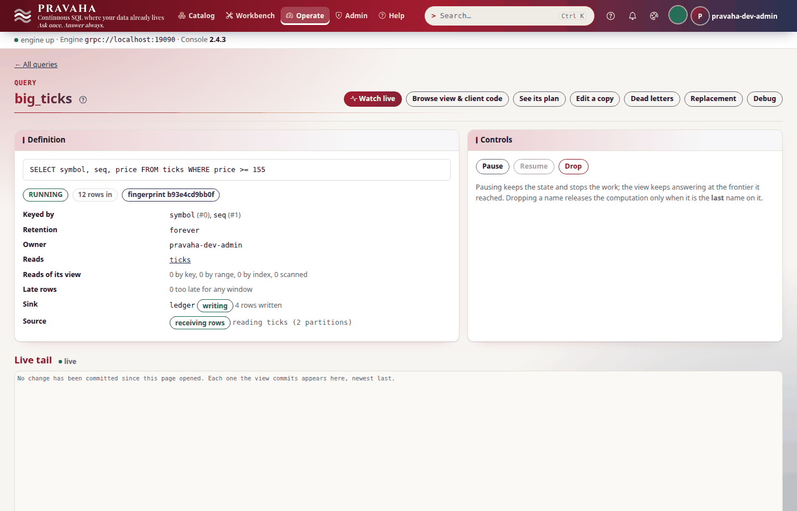

# Tutorial 13 · Writing a connector

Copyright © 2026 Ashutosh Sinha \<ajsinha@gmail.com\>. All rights reserved.
**Proprietary and confidential** — see [`../../LICENSE`](../../LICENSE).

Pravaha reads Kafka, files, PostgreSQL and MySQL change logs, Aerospike, Cassandra, Delta and Iceberg
because each of them is a **plugin**: a jar with a class that implements one small interface, found by
the node in `plugins/` at start. Your own system — an exchange's price feed, a device gateway, an
in-house queue — can be one too. In this tutorial you scaffold a source with `pravaha plugin new`,
build it and watch the **source TCK** (the ten conformance tests every shipped source runs) pass as
generated; replace the example with a source of your own — Acme Exchange's price ticks, one partition
per symbol, with offsets a restart resumes from — break the contract on purpose and watch the TCK catch
it; drop the jar into `plugins/`, bind it in the node's configuration and query it. Then, briefly, a
sink: scaffolded, its TCK, the jar beside the source's, and a query writing to it. Every output below
was printed by a real build and a real node running these steps.

**Time to complete:** about 30 minutes.

## Before you start

- [Tutorial 1](01-first-15-minutes.md) done.
- Java 21 or later and Maven 3.9. The engine's artefacts in your local Maven repository: in a checkout,
  `./mvnw -q -DskipTests install` once (it installs `pravaha-api` and `pravaha-testkit`, which a
  plugin builds against).
- `PRAVAHA_VERSION` set to that version. `pravaha plugin new` writes it into the project's `pom.xml`;
  without `--pravaha-version` it uses the CLI's own version, which in a checkout is the release number
  without `-SNAPSHOT` (`2.4.3` where the engine you built is `2.4.3-SNAPSHOT`), and the build then
  cannot find the engine (PLUGINVER-1).
- The tutorial's files, in [data/t13/](data/t13/): the source (`AcmeSourcePlugin.java`,
  `AcmeReader.java`), its TCK test (`AcmeSourceTckTest.java`), the node's `application.yaml`, the same
  with the sink bound (`application-with-ledger.yaml`) and `tick_minutes.sql`.

```bash
export PRAVAHA_VERSION=$(./mvnw help:evaluate -Dexpression=project.version -q -DforceStdout)
export PRAVAHA_HOME=$HOME/pravaha-t13 T=$PWD/docs/tutorials/data/t13
mkdir -p $PRAVAHA_HOME/conf $PRAVAHA_HOME/data $PRAVAHA_HOME/plugins ~/work
cp $T/application.yaml $PRAVAHA_HOME/conf/ && cp $T/tick_minutes.sql ~/work/
cd ~/work
```

## What you will learn

- what a source plugin is: `StreamSourcePlugin` (name, version, configure, capabilities, schemas,
  partitions) and `PartitionReader` (a non-blocking `poll`, a replayable `position`, `pause` and
  `resume`);
- how a node finds a plugin (`ServiceLoader`, `plugins/`, `-Dloader.path`) and binds it by name;
- what the source TCK checks, and what it looks like when a plugin breaks the contract;
- offsets, partitions and event time from the plugin's side;
- a sink plugin, its TCK, and a query writing to it;
- the error codes a plugin's mistakes become.

## Step 1 · Scaffold a source

<!-- capture: t13-new -->
```text
$ pravaha plugin new acme --kind source --pravaha-version "$PRAVAHA_VERSION"
created a Pravaha source plugin, acme in pravaha-plugin-acme/
  pom.xml                                                                                       pravaha-api <version> (provided) and pravaha-testkit (test); Java 21
  src/main/java/com/example/acme/AcmeSourcePlugin.java                                          the plugin: name, version, configure (validates), capabilities, schema, partitions, health
  src/main/java/com/example/acme/AcmeReader.java                                                the reader: non-blocking poll, replayable position, pause and resume
  src/test/java/com/example/acme/AcmeSourceTckTest.java                                         SourcePluginTck: the ten conformance tests every shipped source runs
  src/main/resources/META-INF/services/com.ash.messaging.pravaha.api.plugin.StreamSourcePlugin  ServiceLoader registration: how a node finds the plugin on its classpath
  README.md                                                                                     how to build it, and where the jar goes

choices made for you:
  - pravaha-api and pravaha-testkit <version>: as --pravaha-version said
  - pravaha-api at provided scope: the node carries it, and a second copy in plugins/ would clash
  - maven.compiler.release 21: production runs Java 21, which cannot load newer class files
  - the TCK wired in (SourcePluginTck), so a change that breaks the contract fails `mvn verify`

next:
  cd pravaha-plugin-acme
  mvn verify   # builds the jar and runs the TCK
  cp target/pravaha-plugin-acme-<version>-SNAPSHOT.jar $PRAVAHA_HOME/plugins/
```
<!-- /capture -->

`plugin new` asks no node. The project is complete as it stands:

<!-- capture: t13-files -->
```text
$ cd pravaha-plugin-acme && find . -type f | sort
./pom.xml
./README.md
./src/main/java/com/example/acme/AcmeReader.java
./src/main/java/com/example/acme/AcmeSourcePlugin.java
./src/main/resources/META-INF/services/com.ash.messaging.pravaha.api.plugin.StreamSourcePlugin
./src/test/java/com/example/acme/AcmeSourceTckTest.java
```
<!-- /capture -->

Three choices in it matter. **`pravaha-api` is `provided`**: the node already carries the plugin API,
and a second copy in `plugins/` would be a second class with the same name. **Java 21**: production
runs Java 21 (ADR-062), which cannot load a class compiled for 25. And the file under
`META-INF/services` names the plugin class: that is how the node's `ServiceLoader` finds it among the
jars in `plugins/` — forget it and the jar loads, and no plugin called `acme` exists. The generated
example — the numbers 1 to `rows`, each with its parity — passes its TCK already:

<!-- capture: t13-verify-generated -->
```text
$ mvn verify | grep -E 'Tests run:|FAILURE!|must|BUILD'
[INFO] Tests run: 10, Failures: 0, Errors: 0, Skipped: 0, Time elapsed: N s -- in com.example.acme.AcmeSourceTckTest
[INFO] Tests run: 10, Failures: 0, Errors: 0, Skipped: 0
[INFO] BUILD SUCCESS
```
<!-- /capture -->

You should see a project of six files and `Tests run: 10, Failures: 0`.

## Step 2 · Your source: Acme Exchange's ticks

Replace the example with the tutorial's source — the same two classes, doing something of their own:

<!-- capture: t13-copy -->
```text
$ cp $T/AcmeSourcePlugin.java $T/AcmeReader.java src/main/java/com/example/acme/ && cp $T/AcmeSourceTckTest.java src/test/java/com/example/acme/
```
<!-- /capture -->

`AcmeSourcePlugin` is what the node talks to. `configure` reads the binding's options and **checks
every one**: a bad setting must stop the node at start, naming itself, not fail at the first row:

<!-- file: data/t13/AcmeSourcePlugin.java -->
```java
    @Override
    public void configure(PluginContext context) {
        // Every setting is checked here, by name: a bad one must stop the node at start, not the first row.
        String stream = context.get("stream", context.instanceName());
        List<String> named = new ArrayList<>();
        for (String symbol : context.require("symbols").split(",")) {
            if (!symbol.isBlank()) {
                named.add(symbol.strip().toUpperCase(java.util.Locale.ROOT));
            }
        }
        if (named.isEmpty()) {
            throw new ConfigurationException(BAD_CONFIGURATION, "acme.symbols names no symbol; give one or more, comma-separated");
        }
```

`context.require("symbols")` refuses a missing option with `PRV-5001`, naming the key; the plugin's
own `BAD_CONFIGURATION` is a code in the range plugins own (5000–5999). The stream's columns come from
the plugin (`discoverSchemas`) — `symbol`, `seq`, `price`, `event_time` — and its **partitions** are
the unit of parallelism and of offsets — here one per symbol:

<!-- file: data/t13/AcmeSourcePlugin.java -->
```java
    @Override
    public List<SourcePartition> partitions(String streamName) {
        // One partition per symbol: the engine reads them in parallel and keeps an offset for each.
        List<SourcePartition> partitions = new ArrayList<>();
        for (int i = 0; i < symbols.size(); i++) {
            partitions.add(SourcePartition.of(streamName, i));
        }
        return partitions;
    }

    @Override
    public PartitionReader createReader(SourcePartition partition, SourceOffset resumeFrom) {
        // null is "from the configured position" (the first tick); BEGINNING is "".
        long next = resumeFrom == null || resumeFrom.isBeginning() ? 1 : Long.parseLong(resumeFrom.token());
        return new AcmeReader(symbols.get(partition.index()), partition.index(), next, ticks, start, stepSeconds);
    }
```

`AcmeReader` reads one partition. `poll` writes rows straight into the lane's inbox — no objects per
row — and **never waits**: when there is nothing more it answers 0 and the engine decides how to wait.
Each row carries its weight (+1, an insert), its event time (for windows) and a sequence:

<!-- file: data/t13/AcmeReader.java -->
```java
    @Override
    public int poll(RecordSink sink, int maxRecords) {
        if (paused) {
            return 0;                                 // flow control: the engine asked for nothing
        }
        int produced = 0;
        while (produced < maxRecords && next <= last) {
            Instant at = start.plusSeconds((next - 1) * stepSeconds);
            long nanos = at.getEpochSecond() * 1_000_000_000L + at.getNano();
            RowWriter row = sink.beginRow();          // a cell in the lane's inbox
            row.setString(0, symbol);
            row.setLong(1, next);
            row.setLong(2, price(next));
            row.setLong(3, nanos);                    // a TIMESTAMP is nanoseconds since 1970
            row.weight(1L)                            // +1: an insert
                    .eventTimestampNanos(nanos)       // the row's event time, for windows
                    .sequence(next)
                    .commit();
            next++;
            produced++;
        }
        return produced;                              // 0 means "not now", never "never"
    }
```

and `position()` returns the next tick's number. That token is what a checkpoint stores, per partition,
and what `createReader` is handed after a restart: a source whose offsets replay is what lets the
engine recover without losing a row.

You should see the two classes in place of the example's.

## Step 3 · The TCK, and a contract broken on purpose

The TCK test extends `SourcePluginTck` and gives it a fixture — here one symbol and five ticks:

<!-- file: data/t13/AcmeSourceTckTest.java -->
```java
    @Override
    protected StreamSourcePlugin createPlugin() {
        AcmeSourcePlugin plugin = new AcmeSourcePlugin();
        plugin.configure(new Context("ticks", Map.of("symbols", "ACME", "ticks", "5")));
        plugin.open();
        return plugin;
    }
```

One symbol, not two, for a reason: the TCK's replay test resumes **partition 0** from an offset and
expects the rest of the **whole** fixture from it, so with two symbols it counts the other symbol's
ticks as lost and fails a source that loses nothing (TCKPARTS-1). Before the passing run, see what a
real mistake looks like. A reader that ignores `pause` turns the engine's flow control into an
out-of-memory error further down the pipeline; make that mistake:

<!-- capture: t13-break -->
```text
$ sed -i 's/if (paused) {/if (false \&\& paused) {/' src/main/java/com/example/acme/AcmeReader.java && grep -n 'paused) {' src/main/java/com/example/acme/AcmeReader.java
40:        if (false && paused) {
```
<!-- /capture -->

<!-- capture: t13-verify-broken -->
```text
$ mvn verify | grep -E 'Tests run:|FAILURE!|must|BUILD'
[ERROR] Tests run: 10, Failures: 1, Errors: 0, Skipped: 0, Time elapsed: N s <<< FAILURE! -- in com.example.acme.AcmeSourceTckTest
[ERROR] com.example.acme.AcmeSourceTckTest.pauseStopsProductionAndResumeRestartsIt -- Time elapsed: N s <<< FAILURE!
[a paused reader must produce nothing]
[ERROR]   AcmeSourceTckTest>SourcePluginTck.pauseStopsProductionAndResumeRestartsIt:185 [a paused reader must produce nothing]
[ERROR] Tests run: 10, Failures: 1, Errors: 0, Skipped: 0
[INFO] BUILD FAILURE
```
<!-- /capture -->

Put `AcmeReader.java` back (`cp $T/AcmeReader.java src/main/java/com/example/acme/`) and build again:

<!-- capture: t13-verify -->
```text
$ mvn verify | grep -E 'Tests run:|FAILURE!|must|BUILD'
[INFO] Tests run: 10, Failures: 0, Errors: 0, Skipped: 0, Time elapsed: N s -- in com.example.acme.AcmeSourceTckTest
[INFO] Tests run: 10, Failures: 0, Errors: 0, Skipped: 0
[INFO] BUILD SUCCESS
```
<!-- /capture -->

| The TCK checks | Because |
|---|---|
| a name and a version; at least one schema; at least one partition, indices unique | the node binds by name and keeps an offset per partition index |
| every fixture record read exactly once | the baseline |
| `poll` on an exhausted reader returns 0, at once | a reader that blocks takes the wait decision away from the engine |
| `pause` produces nothing; `resume` produces again | flow control |
| resuming from `position()` loses nothing (an exactly-once source: no duplicates either) | recovery rests entirely on it |
| capabilities consistent (no exactly-once without replayable offsets) | the engine plans recovery and sharing from them |
| `close` twice is fine; health is reported | the engine and the TCK may close twice |

You should see `pauseStopsProductionAndResumeRestartsIt` fail with `a paused reader must produce
nothing`, then all ten pass.

## Step 4 · Into `plugins/`, bound, and read

<!-- capture: t13-install -->
```text
$ cp target/pravaha-plugin-acme-0.1.0-SNAPSHOT.jar "$PRAVAHA_HOME/plugins/" && ls "$PRAVAHA_HOME/plugins"
pravaha-plugin-acme-<version>-SNAPSHOT.jar
```
<!-- /capture -->

The node's configuration binds the stream `ticks` to the plugin by the name `name()` answers, with the
options `configure` reads:

<!-- file: data/t13/application.yaml -->
```yaml
pravaha:
  streams:
    ticks:
      schema: "symbol:STRING,seq:INT64,price:INT64,event_time:TIMESTAMP"
      event-time: event_time
      out-of-orderness: 0s
  sources:
    ticks:
      plugin: acme                   # what AcmeSourcePlugin.name() answers
      options:                       # what AcmeSourcePlugin.configure() reads, and checks
        symbols: ACME,GLOBEX         # one partition each
        ticks: "6"                   # per symbol
        start: "2026-10-01T09:00:00Z"
        step-seconds: "15"
```

Start the node from a second terminal (`bin/pravaha-server --spring.profiles.active=dev,users &`, which puts `plugins/` on the
class path with `-Dloader.path`) and sign in as in tutorial 1. The plugin is loaded, compatible and
bound (back in `~/work`):

<!-- capture: t13-plugins -->
```text
$ pravaha plugins
NAME              VERSION  KINDS        COMPATIBLE  LOADED  HEALTH   BINDINGS
acme              <version>    source       yes         yes     UNKNOWN  source:ticks
```
<!-- /capture -->

<!-- capture: t13-streams -->
```text
$ pravaha streams list
NAME   VERSION  EVENT TIME  LATENESS  SOURCE  FIELDS
ticks  1        event_time  PT0S      acme    symbol VARCHAR NOT NULL, seq INT64 NOT NULL, price INT64 NOT NULL, event_time TIMESTAMP(9) WITH LOCAL TIME ZONE NOT NULL
```
<!-- /capture -->


A minute's low, high and number of ticks per symbol:

```sql
SELECT symbol, window_start, window_end, MIN(price) AS low, MAX(price) AS high, COUNT(*) AS ticks
FROM TABLE(TUMBLE(TABLE ticks, DESCRIPTOR(event_time), INTERVAL '1' MINUTE))
GROUP BY symbol, window_start, window_end
```

<!-- capture: t13-register -->
```text
$ pravaha register --name tick_minutes --sql-file tick_minutes.sql --keys 0,2
registered tick_minutes  state=RUNNING  fingerprint=d93ce5af5253
a query with the same fingerprint is the same computation, shared
```
<!-- /capture -->

<!-- capture: t13-query -->
```text
$ pravaha query --sql 'SELECT symbol, window_end, low, high, ticks FROM tick_minutes'
symbol  window_end                 low  high  ticks
ACME    2026-10-01 09:01:00+00:00  103  110   4
GLOBEX  2026-10-01 09:01:00+00:00  152  160   4
2 rows
```
<!-- /capture -->

Ticks 1 to 4 of each symbol (09:00:00 to 09:00:45) are in the 09:00 minute; tick 5, at 09:01:00, moved
the watermark past its end (the stream allows no out-of-orderness), so it closed. Ticks 5 and 6 are in
09:01, which closes when a later tick comes — and this source has no more.





You should see `acme` loaded and bound to `source:ticks`, and ACME `103`–`110`, GLOBEX `152`–`160`,
four ticks each.

## Step 5 · A sink, briefly

A sink is the same shape the other way round: `StreamSinkPlugin` takes batches of rows and says what it
can do with them — append only, or upsert by key, retractions or not, exactly once or at least once.

<!-- capture: t13-new-sink -->
```text
$ pravaha plugin new acme-ledger --kind sink --pravaha-version "$PRAVAHA_VERSION"
created a Pravaha sink plugin, acme-ledger in pravaha-plugin-acme-ledger/
  pom.xml                                                                                     pravaha-api <version> (provided) and pravaha-testkit (test); Java 21
  src/main/java/com/example/acmeledger/AcmeLedgerSinkPlugin.java                              the plugin: appends rows to a file (option path); append-only, at-least-once
  src/test/java/com/example/acmeledger/AcmeLedgerSinkTckTest.java                             SinkPluginTck: the cases for what the sink declares; the rest skip
  src/main/resources/META-INF/services/com.ash.messaging.pravaha.api.plugin.StreamSinkPlugin  ServiceLoader registration: how a node finds the plugin on its classpath
  README.md                                                                                   how to build it, and where the jar goes

choices made for you:
  - pravaha-api and pravaha-testkit <version>: as --pravaha-version said
  - pravaha-api at provided scope: the node carries it, and a second copy in plugins/ would clash
  - maven.compiler.release 21: production runs Java 21, which cannot load newer class files
  - the TCK wired in (SinkPluginTck), so a change that breaks the contract fails `mvn verify`

next:
  cd pravaha-plugin-acme-ledger
  mvn verify   # builds the jar and runs the TCK
  cp target/pravaha-plugin-acme-ledger-<version>-SNAPSHOT.jar $PRAVAHA_HOME/plugins/
```
<!-- /capture -->

The generated sink appends each row to a file, its columns joined by `|`, and declares itself
append-only and at-least-once (`SinkCapabilities.appendOnly()`). The sink TCK runs the cases for what a
sink declares and skips the rest — upserts, retractions and exactly-once are not this sink's claims:

<!-- capture: t13-verify-sink -->
```text
$ mvn verify | grep -E 'Tests run:|FAILURE!|must|BUILD'
[WARNING] Tests run: 10, Failures: 0, Errors: 0, Skipped: 6, Time elapsed: N s -- in com.example.acmeledger.AcmeLedgerSinkTckTest
[INFO] Tests run: 10, Failures: 0, Errors: 0, Skipped: 6
[INFO] BUILD SUCCESS
```
<!-- /capture -->

Drop the jar beside the source's, bind it, and restart the node (plugins are found at start):

<!-- capture: t13-install-sink -->
```text
$ cp target/pravaha-plugin-acme-ledger-0.1.0-SNAPSHOT.jar "$PRAVAHA_HOME/plugins/" && ls "$PRAVAHA_HOME/plugins"
pravaha-plugin-acme-<version>-SNAPSHOT.jar
pravaha-plugin-acme-ledger-<version>-SNAPSHOT.jar
```
<!-- /capture -->

<!-- file: data/t13/application-with-ledger.yaml -->
```yaml
  sinks:
    ledger:
      plugin: acme-ledger            # what AcmeLedgerSinkPlugin.name() answers
      options:
        path: data/outgoing/ledger.txt
```

(`cp $T/application-with-ledger.yaml $PRAVAHA_HOME/conf/application.yaml`, and `mkdir -p
$PRAVAHA_HOME/data/outgoing`: the sink opens its file at start and does not make the directory.)

<!-- capture: t13-sinks -->
```text
$ pravaha sinks
NAME    PLUGIN       EMIT    RETRACTIONS  GUARANTEE      WRITERS  PROBLEM
ledger  acme-ledger  APPEND  no           AT_LEAST_ONCE  -        -
```
<!-- /capture -->

An append-only sink takes only a query whose rows are never withdrawn — a filter, not an aggregate
(an aggregate's corrections would need retractions: `PRV-2041`):

```sql
SELECT symbol, seq, price FROM ticks WHERE price >= 155
```

<!-- capture: t13-register-sink -->
```text
$ pravaha register --name big_ticks --sql 'SELECT symbol, seq, price FROM ticks WHERE price >= 155' --keys 0,1 --sink ledger
registered big_ticks  state=RUNNING  fingerprint=b93e4cd9bb0f  sink=ledger
a query with the same fingerprint is the same computation, shared
```
<!-- /capture -->

<!-- capture: t13-ledger -->
```text
$ sort "$PRAVAHA_HOME/data/outgoing/ledger.txt"
GLOBEX|1|160
GLOBEX|2|156
GLOBEX|4|159
GLOBEX|5|155
```
<!-- /capture -->

The new query read the ticks from the beginning — a source with replayable offsets can give a query
that joins late what it missed — and wrote the four GLOBEX ticks at 155 or more.



You should see `ledger` with plugin `acme-ledger`, `APPEND`, `AT_LEAST_ONCE`, and four lines in the file.

## Next steps

- [Tutorial 9 · Exactly-once sinks](09-exactly-once-sinks.md): what a transactional sink adds, and
  what at-least-once costs after a crash.
- [Tutorial 12 · Embedding Pravaha](12-embedding-pravaha.md): an embedded engine binds your plugin with
  `bindSource("ticks", "acme", options)` when its jar is on the class path.
- The reference: [CONNECTORS.md](../guides/CONNECTORS.md) (every shipped plugin and its options) and
  [the connector guide](../development/guides/CONNECTOR_DEVELOPMENT.md) (the whole contract, lookups,
  pushdown, TLS, health and the TCKs).

## If something goes wrong

| Symptom | What it means | What to do |
|---|---|---|
| `Could not find artifact com.ash.messaging:pravaha-api:jar:2.4.3` | the project names a version that is not in your Maven repository; in a checkout the CLI's own version lacks `-SNAPSHOT` (PLUGINVER-1) | `plugin new ... --pravaha-version "$PRAVAHA_VERSION"`, or set `pravaha.version` in the pom |
| the node will not start: no plugin `acme` | the jar is not in `plugins/`, the node was not started with `-Dloader.path=plugins` (`bin/pravaha-server` does it), or `META-INF/services` does not name the class | check all three; `unzip -l` the jar for the services file |
| `PRV-5001` at start | a binding lacks an option `configure` requires; the message names the key | add it under `options:` |
| `PRV-5990` (the plugin's own) at start | `configure` refused a value | the message says which and why |
| `pravaha plugins` says `COMPATIBLE no` | the plugin was built against a plugin API this node does not speak | rebuild against the node's version |
| `UnsupportedClassVersionError` | the jar was compiled for a newer Java than the node runs | keep `maven.compiler.release` at 21 |
| the TCK's `replayableOffsetsActuallyReplay` fails for a multi-partition fixture | the TCK resumes partition 0 and expects the rest of the whole fixture (TCKPARTS-1) | a one-partition fixture |
| `PRV-2041` registering with `--sink` | the query's rows can be withdrawn, and the sink appends only | a filter or projection, or a sink that upserts and retracts |
| the sink fails to open | its directory does not exist | `mkdir -p` it before the start |
