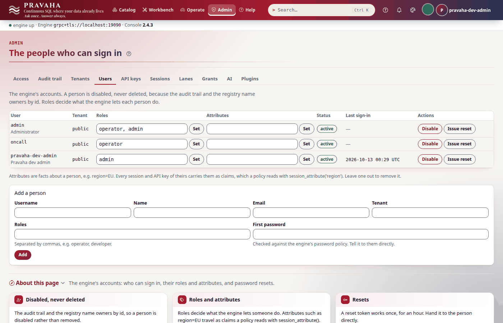
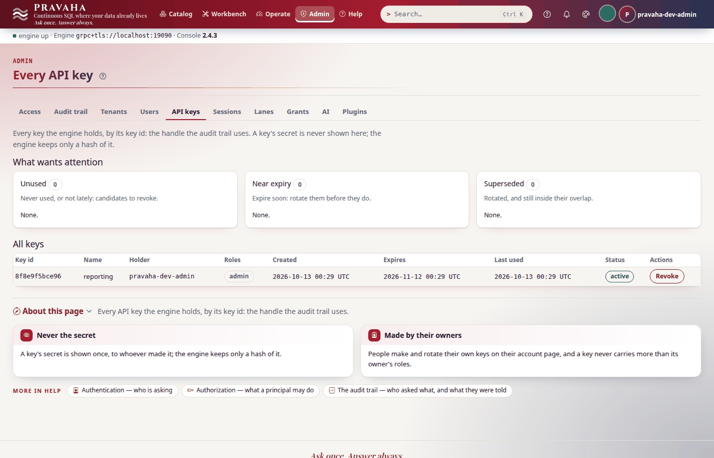

# Tutorial 14 · Running in production

Copyright © 2026 Ashutosh Sinha \<ajsinha@gmail.com\>. All rights reserved.
**Proprietary and confidential** — see [`../../LICENSE`](../../LICENSE).

The node you started in tutorial 1 was right for a laptop: plaintext on loopback, a development
account with a published password, checkpoints once a minute. Production asks different questions —
who can read the traffic, who can sign in and how, what survives a restart, what a backup holds, how
the node is packaged and how it is scheduled. In this tutorial you lay out a **`PRAVAHA_HOME`**, make a
CA and put **Flight and the PostgreSQL gateway on TLS** — and watch the untrusted client and the
plaintext one refused; add **people and an API key** beside the captive development account; let the
node **checkpoint**, take a **backup** with it stopped and **restart** it with its answer intact; run
**`pravaha doctor`** against it; then run the engine's **Docker image** on the same kind of home outside
the dev profile — the first administrator's password from a file, a captive service account, a thread
dump by `SIGQUIT` — and render the **Helm chart** with production values. Every output below was printed
by a real node, a real container and a real `helm` running these steps.

**Time to complete:** about 35 minutes.

## Before you start

- [Tutorial 1](01-first-15-minutes.md) done; [tutorial 4](04-following-a-view.md) for API keys and
  `psql`.
- `openssl`, the `psql` client, Docker (as a member of the `docker` group), and `helm` 3 for the last
  step (no cluster is needed: `helm template` renders without one).
- The tutorial's files, in [data/t14/](data/t14/): `application.yaml` (the node), `orders.csv`,
  `region_revenue.sql`, `make-certs.sh` (a test CA and a server certificate), `docker/application.yaml`
  (the container's configuration) and `values-prod.yaml` (the chart's).

```bash
export PRAVAHA_HOME=$HOME/pravaha-t14 T=$PWD/docs/tutorials/data/t14
mkdir -p $PRAVAHA_HOME/conf $PRAVAHA_HOME/data/incoming
cp $T/application.yaml $PRAVAHA_HOME/conf/
cp $T/orders.csv $PRAVAHA_HOME/data/incoming/
```

## What you will learn

- the layout of a `PRAVAHA_HOME` and what `bin/pravaha-server` does with it;
- TLS on Flight and on the PostgreSQL gateway: making the certificates, checking the wire, and the
  refusals for an untrusted CA and for plaintext;
- the three kinds of identity — captive accounts, people, API keys — and which is for what;
- checkpoints, what a backup must hold, and a restart that keeps the answer;
- `pravaha doctor` as the first thing to run against a node;
- the Docker image, its read-only filesystem and its mounts, outside the dev profile; a thread dump
  without a JDK;
- the Helm chart: what it renders, and the values a production node sets.

## Step 1 · A home, and certificates for it

A **home** is one directory with everything a node owns. `bin/pravaha-server` runs from it: it reads
`conf/application.yaml` over the shipped defaults, keeps its registry journal, checkpoints and identity
store under `data/`, writes `logs/pravaha-server.log`, loads `plugins/`, and uses `tmp/` as the JVM's
temporary directory. Make a test CA and a server certificate in `conf/tls`:

<!-- capture: t14-certs -->
```text
$ bash make-certs.sh "$PRAVAHA_HOME/conf/tls"
ca-key.pem
ca.pem
server-key.pem
server.pem
```
<!-- /capture -->

<!-- capture: t14-cert -->
```text
$ openssl x509 -in "$PRAVAHA_HOME/conf/tls/server.pem" -noout -subject -issuer -ext subjectAltName
subject=CN=localhost
issuer=CN=pravaha-tutorial-ca
X509v3 Subject Alternative Name:
    DNS:localhost, IP Address:127.0.0.1
```
<!-- /capture -->

The **subjectAltName** is the part people leave out: a certificate without one fails hostname
verification whatever its CN says. The script also states the CA's key usage — strict verifiers,
`pravaha doctor`'s Python among them, refuse a CA certificate without it, while OpenSSL and gRPC accept
one; the recipe in the [TLS guide](../guides/CONNECTOR_TLS.md#6-generating-material-for-a-test-environment)
does not state it, so `doctor` reports that recipe's CA as untrusted (TLSRECIPE-1). Keys must be
PKCS#8 (`BEGIN PRIVATE KEY`), which is what `openssl` writes now. **In production the CA's key is not on
the node** — the script leaves `ca-key.pem` here only because this is a test CA.

The node's configuration turns TLS on for both doors:

<!-- file: data/t14/application.yaml -->
```yaml
  flight:
    tls:
      certificate: conf/tls/server.pem
      key: conf/tls/server-key.pem
  # The PostgreSQL gateway on the same certificate; a client that does not ask for TLS is refused.
  pgwire:
    enabled: true
    tls:
      certificate: conf/tls/server.pem
      key: conf/tls/server-key.pem
```

Start it (`bin/pravaha-server --spring.profiles.active=dev,users &`) and look at what it made, and what it
says it is listening on — read these lines after every configuration change, because they come from the
values the node bound, not from the file:

<!-- capture: t14-home -->
```text
$ cd "$PRAVAHA_HOME" && ls -d conf conf/tls data data/* logs
conf
conf/tls
data
data/checkpoints
data/identity
data/incoming
logs
```
<!-- /capture -->

<!-- capture: t14-started -->
```text
$ grep -oE '(Flight SQL listening on|PostgreSQL wire protocol listening on) [^(]*.*' "$PRAVAHA_HOME/logs/pravaha-server.log"
Flight SQL listening on 127.0.0.1:<port> (pravaha.flight.host, pravaha.flight.port)
PostgreSQL wire protocol listening on 127.0.0.1:<port> over TLS
```
<!-- /capture -->

You should see `ca.pem`, `server.pem` and their keys, a certificate for `localhost` and `127.0.0.1`
issued by `pravaha-tutorial-ca`, and the gateway `listening ... over TLS`.

## Step 2 · TLS on the wire

Do not trust a configuration file that says TLS is on: check the wire.

<!-- capture: t14-openssl -->
```text
$ openssl s_client -connect localhost:19090 -CAfile "$PRAVAHA_HOME/conf/tls/ca.pem" -servername localhost </dev/null 2>/dev/null | grep -E '^(subject|issuer)=|Verify return code'
subject=CN=localhost
issuer=CN=pravaha-tutorial-ca
Verify return code: 0 (ok)
```
<!-- /capture -->

The CLI speaks `grpc+tls://` and trusts the CA you give it (`--tls-ca`, or the environment):

```bash
export PRAVAHA_URL=grpc+tls://localhost:19090 PRAVAHA_TLS_CA=$PRAVAHA_HOME/conf/tls/ca.pem
export PRAVAHA_TOKEN=$(pravaha login --user pravaha-dev-admin)
cp $T/region_revenue.sql . && pravaha register --name region_revenue --sql-file region_revenue.sql --keys 0,2
```

```sql
SELECT region, window_start, window_end, SUM(amount) AS revenue, COUNT(*) AS orders
FROM TABLE(TUMBLE(TABLE orders, DESCRIPTOR(event_time), INTERVAL '1' MINUTE))
GROUP BY region, window_start, window_end
```

<!-- capture: t14-register -->
```text
$ pravaha register --name region_revenue --sql-file region_revenue.sql --keys 0,2
registered region_revenue  state=RUNNING  fingerprint=0dfc3744c867
a query with the same fingerprint is the same computation, shared
```
<!-- /capture -->

<!-- capture: t14-query -->
```text
$ pravaha query --sql 'SELECT region, window_end, revenue, orders FROM region_revenue'
region  window_end                 revenue  orders
EMEA    2026-10-01 09:01:00+00:00  5700     2
AMER    2026-10-01 09:01:00+00:00  300      1
APAC    2026-10-01 09:01:00+00:00  800      1
3 rows
```
<!-- /capture -->

Now the two clients that must fail. One that does not trust the CA:

<!-- capture: t14-no-ca -->
```text
$ PRAVAHA_TLS_CA= pravaha query --sql 'SELECT region, window_end, revenue, orders FROM region_revenue'
PRV-1040  failed to connect to all addresses; last error: UNKNOWN: ipv4:localhost:19090: Ssl handshake failed (TSI_PROTOCOL_FAILURE): SSL_ERROR_SSL: error:0A000086:SSL routines::certificate verify failed: unable to get local issuer certificate (talking to grpc+tls://localhost:19090 -- pass --url if that is not the node you meant)
(exit 3)
```
<!-- /capture -->

(gRPC's own library also prints two lines of its native log to standard error — a timestamp and a
thread id — before the CLI's message; they are left out above.) And one that does not ask for TLS at
all — the node does not fall back to plaintext:

<!-- capture: t14-plaintext -->
```text
$ pravaha --url grpc://localhost:19090 query --sql 'SELECT region, window_end, revenue, orders FROM region_revenue'
PRV-1040  failed to connect to all addresses; last error: UNAVAILABLE: ipv4:localhost:19090: Socket closed (talking to grpc://localhost:19090 -- pass --url if that is not the node you meant)
(exit 3)
```
<!-- /capture -->

You should see `Verify return code: 0 (ok)`, the three regions, and `PRV-1040` twice: `certificate
verify failed` for the untrusted client and `Socket closed` for the plaintext one.

## Step 3 · People, captive accounts and API keys

Three kinds of identity, for three kinds of caller:

| Kind | Made by | For | Changed at runtime? |
|---|---|---|---|
| **captive** | `pravaha.identity.captive-users` in the configuration; ensured at every start | a service account the deployment owns (the ingest job), and the `users` profile's development account | no — `PRV-7023`; change the configuration |
| **person** | `pravaha user create`, Admin · Users; the first administrator from `bootstrap-password-file` | people: a password, sessions, password expiry | yes: roles, disable, reset |
| **API key** | `pravaha key create`, Admin · API keys | a program acting as its holder — a BI tool, a dashboard, a scraper | revoke, rotate (with an overlap) |

<!-- capture: t14-user -->
```text
$ printf '%s\n' 'Tutorial-oncall-2026' | pravaha user create oncall --roles operator --password-stdin
created oncall
```
<!-- /capture -->

<!-- capture: t14-users -->
```text
$ pravaha user list
USERNAME           ROLES           STATUS  TENANT  LAST LOGIN
admin              admin,operator  active  public  -
pravaha-dev-admin  admin           active  public  <time>
oncall             operator        active  public  -
```
<!-- /capture -->

`pravaha-dev-admin` is the `users` profile's captive account — published password, development only;
step 6 runs a node without it. A BI tool gets a key, not your session (sessions end within hours); the
key is the PostgreSQL password, and the gateway takes nothing but TLS:

<!-- capture: t14-key -->
```text
$ pravaha key create reporting --days 30
key <id>, expires <time>. Shown once:
<key>
```
<!-- /capture -->

<!-- capture: t14-psql -->
```text
$ PGPASSWORD="$KEY" psql "host=localhost port=5433 dbname=pravaha user=reporting sslmode=verify-full sslrootcert=$PRAVAHA_HOME/conf/tls/ca.pem" -c 'SELECT region, window_end, revenue, orders FROM region_revenue'
NOTICE:  connected as 'pravaha-dev-admin', not 'reporting': the credential determines the principal, not the user name in the startup packet
 region |       window_end       | revenue | orders
--------+------------------------+---------+--------
 EMEA   | 2026-10-01 09:01:00+00 |    5700 |      2
 AMER   | 2026-10-01 09:01:00+00 |     300 |      1
 APAC   | 2026-10-01 09:01:00+00 |     800 |      1
(3 rows)
```
<!-- /capture -->

<!-- capture: t14-psql-plain -->
```text
$ PGPASSWORD="$KEY" psql "host=localhost port=5433 dbname=pravaha user=reporting sslmode=disable" -c 'SELECT region, window_end, revenue, orders FROM region_revenue'
psql: error: connection to server at "localhost" (127.0.0.1), port 5433 failed: FATAL:  PRV-6221  this gateway requires TLS and the client did not ask for it: connect with sslmode=verify-full (or require); the credential is never asked for in the clear. pravaha.pgwire.tls.allow-plaintext=true accepts plaintext clients as well.
DETAIL:  PGWIRE_TLS_REQUIRED
(exit 2)
```
<!-- /capture -->

The `NOTICE` is the gateway being honest: **the credential decides who you are**, not the user name in
the connection string. The plaintext client is refused before any password is asked for.





You should see `oncall` beside `admin` and `pravaha-dev-admin`, the three regions through `psql` with
`sslmode=verify-full`, and `FATAL: PRV-6221` for `sslmode=disable`.

## Step 4 · Checkpoints, a backup and a restart

This node checkpoints every query every five seconds (the default is a minute), under `data/checkpoints`:

<!-- file: data/t14/application.yaml -->
```yaml
  checkpoint:
    interval: 5s
```

<!-- capture: t14-checkpoints -->
```text
$ pravaha debug checkpoints --name region_revenue | head -n 1
N
```
<!-- /capture -->

**What a backup holds:** `data/` (the registry journal, the identity store, the checkpoints — the
engine's state) and `conf/` (and `secrets/`, where a home has one); `logs/` if you want them, `tmp/`
never. Copy them **with the node stopped**: a checkpoint being written is not a checkpoint. Stop the node
(`kill` it — `SIGTERM`, a clean stop), and while it is down:

<!-- capture: t14-backup -->
```text
$ cd "$PRAVAHA_HOME" && tar czf pravaha-backup.tgz conf data && tar tzf pravaha-backup.tgz | grep -v '/$'
conf/application.yaml
conf/tls/ca-key.pem
conf/tls/ca.pem
conf/tls/server-key.pem
conf/tls/server.pem
data/checkpoints/region_5frevenue/checkpoint-N.bin
data/identity/identity.journal
data/incoming/orders.csv
data/registry.journal
```
<!-- /capture -->

(The listing above shows one `checkpoint-N.bin` for every checkpoint kept; `keep` is three by default.)
Start the node again. The journal registers `region_revenue` again; its state comes back from the
newest complete checkpoint — each one ends with a checksum and is skipped if it does not match
(`PRV-4094`) — and the source resumes at the offsets that checkpoint recorded:

<!-- capture: t14-after -->
```text
$ pravaha query --sql 'SELECT region, window_end, revenue, orders FROM region_revenue'
region  window_end                 revenue  orders
EMEA    2026-10-01 09:01:00+00:00  5700     2
AMER    2026-10-01 09:01:00+00:00  300      1
APAC    2026-10-01 09:01:00+00:00  800      1
3 rows
```
<!-- /capture -->

**A clean stop does not take a last checkpoint.** A node's sources replay from the newest checkpoint's
offsets, so nothing is lost — what was read after it is read again. (For the embedded engine, whose rows
are pushed and cannot be replayed, that costs rows: [tutorial 12](12-embedding-pravaha.md#step-3--surviving-a-restart).)

You should see a checkpoint id, the backup's files — `conf/`, the journals, the checkpoint — and the same
three regions after the restart.

## Step 5 · `pravaha doctor`

The first thing to run against any node, from any machine: it checks this machine (Python, `pyarrow`,
Java, the saved token) and then the node — TLS, HTTP, the versions, Flight, who you are — and exits 1 on
any red.

<!-- capture: t14-doctor -->
```text
$ pravaha doctor
GREEN    python        Python 3.x (python); needs >=3.9
GREEN    cli           pravaha <version> (sdk/python/pravaha)
GREEN    pyarrow       pyarrow <version>, with Flight
GREEN    java          JAVA_HOME=$JAVA_HOME: Java 21
GREEN    token file    ~/.config/pravaha/token: none saved (pravaha login --save writes it); token from PRAVAHA_TOKEN
GREEN    context       none in use: flags, environment and defaults decide
GREEN    tls flight    localhost:19090: trusted, names 127.0.0.1; expires <date>
GREEN    http          http://localhost:18080 answered in N ms: health UP
GREEN    version       cli <version>, node <version>
GREEN    flight        grpc+tls://localhost:19090 answered in N ms: 1 continuous query you may see
GREEN    auth          pravaha-dev-admin (tenant public), via session, roles admin
YELLOW   token expiry  expires <time> (in N h)
                       fix: pravaha login --user <name> --save   before it does
doctor: 0 red, 1 yellow
```
<!-- /capture -->

`tls flight` says whether the certificate is trusted, the name it is valid for and when it expires —
the line to watch before it does. `token expiry` is yellow because a session ends within hours; a
script should use an API key. The console reaches a TLS engine too — the pictures here are of one — but
it has no setting of its own for a private CA: it trusts one through gRPC's
`GRPC_DEFAULT_SSL_ROOTS_FILE_PATH` environment variable, set to the CA's file before it starts
(CONSOLETLS-1). On Operations, after the restart, `region_revenue` has its three rows and a checkpoint
seconds old, and the note *no watermark yet*: the source resumed past every row it had read, so since
the start it has seen no row with an event time to measure one from.


You should see `GREEN` for `tls flight` (`trusted, names 127.0.0.1`), `http`, `flight` and `auth`, and
`doctor: 0 red`.

## Step 6 · The Docker image, outside the dev profile

The image (`deploy/docker/Dockerfile`) is a Java 21 JRE with the engine at `/opt/pravaha`, running as
uid 10001, with a health check built in. Build it from a checkout (a release publishes it):

<!-- capture: t14-build -->
```text
$ deploy/docker/build.sh --tag pravaha/pravaha-server:tutorial-14 | tail -n 3
  size  N bytes
  user  10001:10001
  entry [/__cacert_entrypoint.sh bin/pravaha-server]
```
<!-- /capture -->

The container gets a home of its own — mounted, not the image's: `conf/` and `secrets/` read-only,
`data/`, `logs/` and `tmp/` writable, and everything else read-only (`--read-only`, with a `tmpfs` at
`/tmp` for the JVM's attach socket). Its configuration leaves the dev profile behind:

<!-- file: data/t14/docker/application.yaml -->
```yaml
  identity:
    enabled: true
    # The first administrator, admin, gets this file's password when the store is empty. Without it,
    # outside the dev profile, the node refuses to start (PRV-7019) until the published one is changed.
    bootstrap-password-file: secrets/initial-admin-password
    # A service account the configuration owns: created at every start, its roles and password put
    # back if anyone changed them; nobody can disable or re-role it at runtime (PRV-7023).
    captive-users:
      - username: ingest
        display-name: The ingest job
        roles: [operator]
        password-file: secrets/ingest-password
```

<!-- capture: t14-docker-home -->
```text
$ find docker -type f | sort
docker/conf/application.yaml
docker/conf/tls/server-key.pem
docker/conf/tls/server.pem
docker/data/incoming/orders.csv
docker/secrets/ingest-password
docker/secrets/initial-admin-password
```
<!-- /capture -->

```bash
docker run -d --name pravaha-node -p 127.0.0.1:28080:18080 -e SPRING_PROFILES_ACTIVE=users \
  --user "$(id -u):$(id -g)" --read-only --tmpfs /tmp:rw,mode=1777 \
  -v "$PWD/docker/conf:/opt/pravaha/conf:ro" -v "$PWD/docker/secrets:/opt/pravaha/secrets:ro" \
  -v "$PWD/docker/data:/opt/pravaha/data" -v "$PWD/docker/logs:/opt/pravaha/logs" \
  -v "$PWD/docker/tmp:/opt/pravaha/tmp" pravaha/pravaha-server:tutorial-14
```

<!-- capture: t14-docker-ps -->
```text
$ docker ps --filter name=pravaha-node --format '{{.Names}}  {{.Image}}  {{.Ports}}'
pravaha-node  pravaha/pravaha-server:tutorial-14  19090/tcp, 127.0.0.1:28080->18080/tcp
```
<!-- /capture -->

<!-- capture: t14-docker-ready -->
```text
$ curl -s http://localhost:28080/actuator/health/readiness
{"status":"UP"}
```
<!-- /capture -->

<!-- capture: t14-docker-logs -->
```text
$ docker logs pravaha-node 2>&1 | grep -oE '(security|identity): .*|(Flight SQL|PostgreSQL wire protocol) listening on .*'
security: authentication=token, policy=authenticated, administer=ownership, audit=file, flight transport=TLS
identity: users, API keys and sessions kept in /opt/pravaha/data/identity/identity.journal (environment dev, sign-in by password, forced password change off)
identity: captive users [ingest] ensured from pravaha.identity.captive-users; they cannot be disabled, re-roled or re-passworded at runtime
Flight SQL listening on 0.0.0.0:19090 (pravaha.flight.host, pravaha.flight.port)
PostgreSQL wire protocol listening on 0.0.0.0:5432 over TLS
```
<!-- /capture -->

(The identity line's `environment dev` is `pravaha.identity.environment`'s default, a label in key ids
and audit rows, not the dev profile; name it — `prod` — in your own configuration.) Sign in as the first
administrator, with the password from the file:

<!-- capture: t14-docker-login -->
```text
$ ADMIN=$(pravaha --http http://localhost:28080 login --user admin)
signed in as admin; pass this as --token or PRAVAHA_TOKEN, or sign in with --save
```
<!-- /capture -->

<!-- capture: t14-docker-whoami -->
```text
$ PRAVAHA_TOKEN=$ADMIN pravaha --http http://localhost:28080 whoami
user              admin
principal         admin
tenant            public
roles             admin,operator
via               session
name              Administrator
email             -
password expires  <time>
token from        env
```
<!-- /capture -->

<!-- capture: t14-docker-users -->
```text
$ PRAVAHA_TOKEN=$ADMIN pravaha --http http://localhost:28080 user list
USERNAME  ROLES           STATUS  TENANT  LAST LOGIN
admin     admin,operator  active  public  <time>
ingest    operator        active  public  -
```
<!-- /capture -->

No `pravaha-dev-admin` here: outside the dev profile there is no account with a published password.
And a stall in a container is diagnosed without a JDK in the image — the JVM answers `SIGQUIT` with a
full thread dump on its standard output, which is the container's log, and keeps running:

<!-- capture: t14-docker-dump -->
```text
$ docker kill --signal=QUIT pravaha-node && docker logs pravaha-node 2>&1 | grep -m1 -A1 '^Full thread dump'
Full thread dump OpenJDK 64-Bit Server VM (<version>):
```
<!-- /capture -->

(With `jcmd` instead: a JDK sidecar in the container's PID namespace, as the node's user and group —
[RUNNING_IN_DOCKER.md](../operations/RUNNING_IN_DOCKER.md#diagnosing-a-stall-thread-dumps), and
[tutorial 15](15-operating-at-scale.md) for reading one.) The compose file,
`deploy/docker/compose/docker-compose.yml`, runs this same image with the console, Kafka and — behind
profiles — databases, Prometheus and Grafana, every port on `127.0.0.1` and every file in one
`pravaha-home`; [RUNNING_IN_DOCKER.md](../operations/RUNNING_IN_DOCKER.md) is its manual.

You should see the container `healthy` on `127.0.0.1:28080`, `flight transport=TLS`, the captive `ingest`
ensured, `admin` signed in with the file's password, and `Full thread dump`.

## Step 7 · The Helm chart

`deploy/helm/pravaha` runs one node as a StatefulSet with a persistent volume, its configuration in a
ConfigMap, TLS from a Secret, and — when you switch them on — a PodDisruptionBudget, the Prometheus
Operator's ServiceMonitor and the shipped alert rules as a PrometheusRule:

<!-- file: data/t14/values-prod.yaml -->
```yaml
image:
  tag: "2.4.2"
tls:
  enabled: true
  existingSecret: pravaha-tls          # kubectl create secret tls pravaha-tls --cert=server.pem --key=server-key.pem
```

<!-- capture: t14-helm -->
```text
$ helm template prod deploy/helm/pravaha -f values-prod.yaml | grep -E '^kind:' | sort | uniq -c
      1 kind: ConfigMap
      1 kind: Pod
      1 kind: PodDisruptionBudget
      1 kind: PrometheusRule
      2 kind: Service
      1 kind: ServiceAccount
      1 kind: ServiceMonitor
      1 kind: StatefulSet
```
<!-- /capture -->

<!-- capture: t14-helm-tls -->
```text
$ helm template prod deploy/helm/pravaha -f values-prod.yaml | grep -E 'certificate:|key: /opt|secretName:|image:'
          certificate: /opt/pravaha/secrets/tls/tls.crt
          key: /opt/pravaha/secrets/tls/tls.key
          image: "pravaha/pravaha-server:<version>"
            secretName: pravaha-tls
      image: "pravaha/pravaha-server:<version>"
```
<!-- /capture -->

The `Pod` is the chart's test (`helm test`: it probes HTTP and Flight); the two `Service`s are the
node's and a headless one for the StatefulSet. `terminationGracePeriodSeconds` is 60, not Kubernetes'
30, so a stopping node can finish its sinks' commit; with one replica, the PodDisruptionBudget uses
`maxUnavailable: 1` — `minAvailable: 1` would block every drain. The chart's own values file says what
every value does; [DEPLOYMENT.md](../operations/DEPLOYMENT.md) is the reference.

You should see a StatefulSet, two Services, a ConfigMap, a ServiceAccount, a PodDisruptionBudget, a
ServiceMonitor, a PrometheusRule and the test Pod, and the certificate mounted from `pravaha-tls`.

## Next steps

- [Tutorial 15 · Operating at scale](15-operating-at-scale.md): lanes, the metrics Prometheus scrapes,
  `pravaha top` and thread dumps.
- [Tutorial 11 · Governance](11-governance.md): grants, row filters and masks for the people you just
  created.
- The reference: [DEPLOYMENT.md](../operations/DEPLOYMENT.md), [RUNNING_IN_DOCKER.md](../operations/RUNNING_IN_DOCKER.md),
  [SECURITY.md](../operations/SECURITY.md) and the [TLS guide](../guides/CONNECTOR_TLS.md).

## If something goes wrong

| Symptom | What it means | What to do |
|---|---|---|
| `PRV-1040 ... certificate verify failed` | the client does not trust the CA that signed the node's certificate | `--tls-ca` / `PRAVAHA_TLS_CA` the CA; for `psql`, `sslrootcert=` |
| `PRV-1040 ... Socket closed` | a plaintext `grpc://` client against a TLS node | `grpc+tls://` |
| the node refuses to start naming the other half of a TLS pair | a certificate without its key, or a key without its certificate | set both, or neither |
| a key is refused as PKCS#1 | `BEGIN RSA PRIVATE KEY` | `openssl pkcs8 -topk8 -nocrypt -in old.pem -out new.pem` |
| `doctor` says `CA cert does not include key usage extension` | Python's strict verification refuses a CA without key usage (TLSRECIPE-1) | make the CA as `make-certs.sh` does |
| `FATAL: PRV-6221` from `psql` | the gateway requires TLS and the client did not ask | `sslmode=verify-full` and `sslrootcert=` |
| `PRV-7019` at start | outside the dev profile, the store is empty and no first password is given | `pravaha.identity.bootstrap-password-file` |
| `PRV-7022` at start | a captive user's entry cannot be honoured (no password source, a bad name) | the message names the entry |
| `PRV-7023` | a captive user cannot be changed at runtime | change the configuration and restart |
| `PRV-4094` in the log | a checkpoint failed its checksum and was skipped for the one before it | none needed; find what truncated it |
| the container exits at once | its configuration was refused | `docker logs <node>`: the reason is the last lines |
