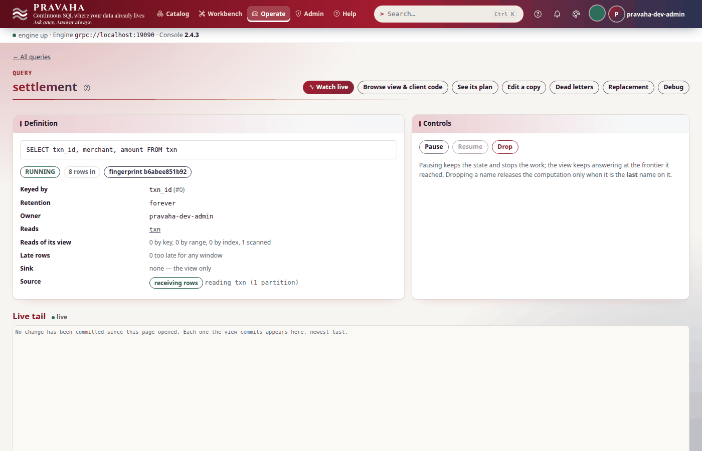

# Tutorial 15 · Operating at scale

Copyright © 2026 Ashutosh Sinha \<ajsinha@gmail.com\>. All rights reserved.
**Proprietary and confidential** — see [`../../LICENSE`](../../LICENSE).

A node with five queries and a node with five thousand run the same engine; what changes is where each
query runs, what it costs to keep, and how you find the one that is in trouble. Every registered query
runs on a **lane** — an inbox, an arena and a place on the shared runner — and past a threshold a node
**shares** lanes between queries to keep its memory flat. In this tutorial you watch five queries
placed (lanes of their own first, then a shared lane, and one that asks to stay alone), drop two and
**rebalance** by hand, read the **lane and read-admission metrics** and `pravaha top`, have
**Prometheus** scrape the node with an API key of its own and load the shipped alert rules, meet the
**Grafana** dashboards, and take a **thread dump**. Every output below was printed by a real node and a
real Prometheus running these steps.

**Time to complete:** about 30 minutes.

## Before you start

- [Tutorial 1](01-first-15-minutes.md) done; [tutorial 6](06-investigating-an-incident.md) introduces
  `top` and the metrics, [tutorial 14](14-running-in-production.md) API keys.
- Docker, for Prometheus (`prom/prometheus`); a JDK's `jcmd` for the thread dump.
- The tutorial's files, in [data/t15/](data/t15/): `application.yaml` (the stream, the lanes, read
  admission), `txn.csv` (eight payments) and `prometheus.yml`.

```bash
export PRAVAHA_HOME=$HOME/pravaha-t15
mkdir -p $PRAVAHA_HOME/conf $PRAVAHA_HOME/data/incoming
cp docs/tutorials/data/t15/application.yaml $PRAVAHA_HOME/conf/
cp docs/tutorials/data/t15/txn.csv $PRAVAHA_HOME/data/incoming/
bin/pravaha-server --spring.profiles.active=dev,users &
export PRAVAHA_TOKEN=$(pravaha login --user pravaha-dev-admin) PRAVAHA_INSECURE_TOKEN=true
```

## What you will learn

- what a lane costs, and the settings that size it;
- how a node places a registration — a lane of its own, a shared lane, or `lane = 'dedicated'` — and
  that nothing running is ever moved by itself;
- `pravaha lanes`, and an administrator's rebalance: the plan first, then the move;
- the metrics that say how the lanes and the read path are doing, and `pravaha top`;
- Prometheus scraping a node that requires sign-in, the shipped rules, and the Grafana dashboards;
- a thread dump: taking one, and what the engine's threads are.

## Step 1 · Five queries, and where they run

This node is sized small and shares early, so five queries are enough to see every kind of placement:

<!-- file: data/t15/application.yaml -->
```yaml
  lane:
    # A smaller inbox than the default 2048 x 512 B: 64 KiB a lane rather than 1 MiB.
    inbox:
      cells: 256
      cell-bytes: 256
    multiplex:
      enabled: auto                  # the default: lanes of their own first, then shared lanes
      auto-from: 3                   # small here to see sharing with five queries; 64 by default
      lanes: 2                       # shared lanes; 0 = one per processor
      max-queries-per-lane: 300
```

A lane of its own costs its inbox (`cells × cell-bytes`) and gives the query a fate of its own; a shared
lane's inbox serves every query on it, and a query that fails takes its lane — and its neighbours — with
it. So under `auto` the first `auto-from` queries each own a lane and later registrations share. Four
ordinary registrations, and one that asks for a lane of its own whatever the node's mode:

<!-- capture: t15-register-big -->
```text
$ pravaha register --name big_txn --sql 'SELECT txn_id, user_id, amount FROM txn WHERE amount >= 1000' --keys 0
registered big_txn  state=RUNNING  fingerprint=9c0d66b71672
a query with the same fingerprint is the same computation, shared
```
<!-- /capture -->

<!-- capture: t15-register-users -->
```text
$ pravaha register --name user_minutes --sql "SELECT user_id, window_start, window_end, SUM(amount) AS spend FROM TABLE(TUMBLE(TABLE txn, DESCRIPTOR(event_time), INTERVAL '1' MINUTE)) GROUP BY user_id, window_start, window_end" --keys 0,2
registered user_minutes  state=RUNNING  fingerprint=951ae1cafe05
a query with the same fingerprint is the same computation, shared
```
<!-- /capture -->

<!-- capture: t15-register-merchants -->
```text
$ pravaha register --name merchant_minutes --sql "SELECT merchant, window_start, window_end, SUM(amount) AS spend FROM TABLE(TUMBLE(TABLE txn, DESCRIPTOR(event_time), INTERVAL '1' MINUTE)) GROUP BY merchant, window_start, window_end" --keys 0,2
registered merchant_minutes  state=RUNNING  fingerprint=23786da16b25
a query with the same fingerprint is the same computation, shared
```
<!-- /capture -->

<!-- capture: t15-register-small -->
```text
$ pravaha register --name small_txn --sql 'SELECT txn_id, user_id, amount FROM txn WHERE amount < 100' --keys 0
registered small_txn  state=RUNNING  fingerprint=126778e15fbc
a query with the same fingerprint is the same computation, shared
```
<!-- /capture -->

```text
CREATE CONTINUOUS QUERY settlement
    KEYED BY (txn_id)
    WITH (lane = 'dedicated')
AS SELECT txn_id, merchant, amount FROM txn
```

<!-- capture: t15-register-dedicated -->
```text
$ pravaha query --sql "CREATE CONTINUOUS QUERY settlement KEYED BY (txn_id) WITH (lane = 'dedicated') AS SELECT txn_id, merchant, amount FROM txn"
name        state    fingerprint   sink
settlement  RUNNING  b6abee851b92  NULL
1 row
```
<!-- /capture -->

<!-- capture: t15-lanes -->
```text
$ pravaha lanes list
mode auto, a lane each until 3, at most 300 per shared lane; 5 hosted, 4 on lanes of their own (1 dedicated)
NAME              STATE    LANE       SHARED LANE
big_txn           RUNNING  own        -
user_minutes      RUNNING  own        -
merchant_minutes  RUNNING  own        -
small_txn         RUNNING  shared     0
settlement        RUNNING  dedicated  -
```
<!-- /capture -->

The first three own a lane each; `small_txn`, the fourth, is on shared lane 0; `settlement` asked for a
lane of its own and has one — use `lane = 'dedicated'` for the few queries whose isolation matters more
than the inbox: the settlement feed, the one a pager is attached to. A dedicated query counts towards
`auto-from`.


You should see `5 hosted, 4 on lanes of their own (1 dedicated)` and `small_txn` on shared lane `0`.

## Step 2 · Drop two, and rebalance

Dropping queries frees room under `auto-from`, but **nothing running moves by itself** — the room is
used by new registrations. Drop the two that nobody reads any more:

<!-- capture: t15-drop -->
```text
$ pravaha drop --name big_txn --yes
dropped big_txn
```
<!-- /capture -->

<!-- capture: t15-drop-users -->
```text
$ pravaha drop --name user_minutes --yes
dropped user_minutes
```
<!-- /capture -->

A rebalance moves shared queries, oldest first, onto lanes of their own while there is room. Without
`--yes` it is a plan:

<!-- capture: t15-rebalance-dry -->
```text
$ pravaha lanes rebalance
mode auto, room for 1 more on lanes of their own
NAME       FROM SHARED LANE  STATUS   DETAIL
small_txn  0                 planned  -
a plan only: nothing was moved. Run `pravaha lanes rebalance --yes` to move these, one at a time
```
<!-- /capture -->

<!-- capture: t15-rebalance -->
```text
$ pravaha lanes rebalance --yes
mode auto, room for 1 more on lanes of their own; running
NAME       FROM SHARED LANE  STATUS   DETAIL
small_txn  0                 waiting  -
```
<!-- /capture -->

<!-- capture: t15-rebalance-status -->
```text
$ pravaha lanes rebalance status
mode auto, room for 1 more on lanes of their own
NAME       FROM SHARED LANE  STATUS  DETAIL
small_txn  0                 moved   -
```
<!-- /capture -->

<!-- capture: t15-lanes-after -->
```text
$ pravaha lanes list
mode auto, a lane each until 3, at most 300 per shared lane; 3 hosted, 3 on lanes of their own (1 dedicated)
NAME              STATE    LANE       SHARED LANE
merchant_minutes  RUNNING  own        -
small_txn         RUNNING  own        -
settlement        RUNNING  dedicated  -
```
<!-- /capture -->

Each move is a blue/green replacement with the SQL unchanged: the new version starts on its own lane,
is backfilled, and takes the name at a cutover at an exact input position — no reader loses or
double-counts a row. One at a time, so a node is never moving everything at once. (A restart also
re-places every query, in the order they were first registered.)




You should see `small_txn  0  planned`, then `moved`, and `3 on lanes of their own`.

## Step 3 · The metrics, and `pravaha top`

The node publishes its lanes and its read path as Prometheus metrics on `/actuator/prometheus`
(`pravaha metrics` prints them):

<!-- capture: t15-metrics -->
```text
$ pravaha metrics | grep -E '^pravaha_(lane_(shared|own)|read_)'
pravaha_lane_own_queries{application="pravaha",node="pravaha-node-01"} 3.0
pravaha_lane_shared_bytes{application="pravaha",node="pravaha-node-01"} 65536.0
pravaha_lane_shared_queries{application="pravaha",lane="0",node="pravaha-node-01"} 0.0
pravaha_lane_shared_queries{application="pravaha",lane="1",node="pravaha-node-01"} 0.0
pravaha_read_in_flight{application="pravaha",node="pravaha-node-01"} 0.0
pravaha_read_refused_total{application="pravaha",node="pravaha-node-01",reason="queue_timed_out"} 0.0
pravaha_read_refused_total{application="pravaha",node="pravaha-node-01",reason="rejected"} 0.0
pravaha_read_refused_total{application="pravaha",node="pravaha-node-01",reason="tenant_share"} 0.0
```
<!-- /capture -->

| Metric | Says |
|---|---|
| `pravaha_lane_own_queries` | queries on lanes of their own, dedicated included |
| `pravaha_lane_shared_queries{lane}` | queries on each shared lane |
| `pravaha_lane_shared_bytes` | the shared lanes' inboxes, held once however many queries they carry |
| `pravaha_lane_blocked_fraction{lane}`, `pravaha_lane_inbox_depth{lane}` | a shared lane's own backpressure |
| `pravaha_read_in_flight` | reads running now, across Flight and the PostgreSQL gateway |
| `pravaha_read_refused_total{reason}` | reads refused by admission: `rejected` (`PRV-4026`), `queue_timed_out` (`PRV-4027`), `tenant_share` (`PRV-4028`) |

The read path is guarded by **read admission**, so a burst of reads queues or is refused rather than
starving the lanes:

<!-- file: data/t15/application.yaml -->
```yaml
  serving:
    read:
      max-concurrent: 8              # reads at once across Flight and the PostgreSQL gateway (PRV-4026 past it)
      max-queued: 16                 # reads that may wait for a permit
      queue-timeout: 2s              # how long one waits before PRV-4027
      tenant-share: 1.0              # one tenant's share of max-concurrent (PRV-4028)
      deadline: 30s                  # how long one read may run (PRV-4029)
```

Unset (`max-concurrent: 0`, the default) every read is admitted. A refused read is never half-answered:
the client gets the code and may retry. `pravaha top` is the same picture per query, live (here one
frame):

<!-- capture: t15-top -->
```text
$ pravaha top --once --interval 1
pravaha top  http://localhost:18080  3 queries  sorted by name
NAME              STATE    LANE       ROWS IN  ROWS/S  WM DELAY  STATE ROWS  STATE BYTES  VIEW ROWS  SUBS
merchant_minutes  RUNNING  own        8        0.0     Nd        1/2000000   -            5          0
settlement        RUNNING  dedicated  8        0.0     Nd        0           -            8          0
small_txn         RUNNING  own        8        0.0     Nd        0           -            2          0
```
<!-- /capture -->

`WM DELAY` is how far each query's watermark is behind the wall clock — days here, because the sample
payments are of 2026-10-01; on a live feed it is seconds, and a growing one means the data is late or
its source has stopped. **Operate → Operations** says the same, and lists what needs attention:


(The Checkpoint column says `not checkpointing` for these queries: a home checkpoints every query
into `data/checkpoints` once a minute, and none has taken its first yet. The words are wrong for that —
"no checkpoint yet" is what is true — OPSCKPT-1.)

You should see `pravaha_lane_own_queries ... 3.0` and the three queries in `top`, each `8` rows in.

## Step 4 · Prometheus, with a key of its own

When sign-in is on, `/actuator/prometheus` asks who is asking. Give the scraper a **service account**
with only the `reader` role, and an API key for it — an administrator issues keys for service accounts:

<!-- capture: t15-scraper -->
```text
$ printf '%s\n' 'Scraper-only-2026' | pravaha user create metrics-reader --roles reader --service --password-stdin
created metrics-reader
```
<!-- /capture -->

<!-- capture: t15-key -->
```text
$ pravaha key create prometheus --for metrics-reader --days 90
key <id>, expires <time>. Shown once:
<key>
```
<!-- /capture -->

The key goes into a file Prometheus reads, never into its configuration:

<!-- file: data/t15/prometheus.yml -->
```yaml
scrape_configs:
  - job_name: pravaha
    metrics_path: /actuator/prometheus
    authorization:
      type: Bearer
      credentials_file: /etc/prometheus/pravaha.token
    static_configs:
      - targets: ["localhost:18080"]
```

```bash
pravaha key create prometheus --for metrics-reader --days 90 | tail -n 1 > prometheus.token
docker run -d --name pravaha-prometheus --network host --user "$(id -u):$(id -g)" \
  -v "$PWD/prometheus.yml:/etc/prometheus/prometheus.yml:ro" -v "$PWD/prometheus.token:/etc/prometheus/pravaha.token:ro" \
  -v "$PWD/deploy/observability/prometheus:/etc/prometheus/rules:ro" \
  prom/prometheus:v2.53.2 --config.file=/etc/prometheus/prometheus.yml --web.listen-address=127.0.0.1:9090
```

(`--network host` because the node listens on `127.0.0.1` only.) Ask Prometheus:

<!-- capture: t15-prom-up -->
```text
$ curl -s 'localhost:9090/api/v1/query?query=up' | python3 -c "import json, sys; [print(r['metric']['__name__'], r['metric'].get('lane', '-'), r['value'][1]) for r in json.load(sys.stdin)['data']['result']]"
up - 1
```
<!-- /capture -->

<!-- capture: t15-prom-lanes -->
```text
$ curl -s 'localhost:9090/api/v1/query?query=pravaha_lane_shared_queries' | python3 -c "import json, sys; [print(r['metric']['__name__'], r['metric'].get('lane', '-'), r['value'][1]) for r in json.load(sys.stdin)['data']['result']]"
pravaha_lane_shared_queries 0 0
pravaha_lane_shared_queries 1 0
```
<!-- /capture -->

And the alert rules that ship with the engine
(`deploy/observability/prometheus/pravaha-rules.yaml`: a stalled watermark, state near its ceiling,
checkpoints failing, sinks behind, notification delivery, catalogue denials, the console's assistant):

<!-- capture: t15-prom-rules -->
```text
$ curl -s 'localhost:9090/api/v1/rules' | python3 -c "import json, sys; [print(g['name'], len(g['rules'])) for g in json.load(sys.stdin)['data']['groups']]"
pravaha 10
pravaha-alerts-catalog 4
pravaha-console 1
```
<!-- /capture -->

The Grafana dashboards are in `deploy/observability/grafana/`, ready to import (the compose stack's
`observability` profile provisions them, with this Prometheus as their data source):

<!-- capture: t15-dashboards -->
```text
$ for f in deploy/observability/grafana/*.json; do python3 -c "import json, sys; d = json.load(open(sys.argv[1])); print(sys.argv[1].split('/')[-1], '--', d['title'], '--', len(d.get('panels', [])), 'panels')" $f; done
pravaha-alerts-catalogue.json -- Pravaha · Alerts and catalogue -- 18 panels
pravaha-assistant.json -- Pravaha · Assistant -- 12 panels
pravaha-node-overview.json -- Pravaha · Node overview -- 24 panels
pravaha-query-drilldown.json -- Pravaha · Query drill-down -- 23 panels
```
<!-- /capture -->

*Node overview* is the first one to open: lanes, reads, heap, checkpoints, the slowest queries; *Query
drill-down* takes one query by name.

You should see `up - 1`, a series for each shared lane, and the three rule groups.

## Step 5 · A thread dump

When a node stops answering — health times out, the metrics stop moving, a watermark freezes — a thread
dump says what every thread is waiting on. Take two or three a few seconds apart: a thread in the same
place in all of them is the stall. With a JDK on the machine, `jcmd`; `-l` adds the locks each thread
holds (most of the engine's are `ReentrantLock`s, whose owners a plain dump does not name):

<!-- capture: t15-threads -->
```text
$ jcmd $(pgrep -f pravaha-server) Thread.print -l > threads.txt && grep -m1 '^Full thread dump' threads.txt && grep -oE '^"[A-Za-z]+[-A-Za-z]*' threads.txt | sed 's/-$//' | sort | uniq -c | sort -k2 | grep -E 'pravaha|lane|flight|Reference|main'
Full thread dump OpenJDK 64-Bit Server VM (<version>):
      N "pravaha-alerts
      N "pravaha-clock
      N "pravaha-lane-runner
      N "pravaha-metrics
      N "pravaha-replacements
      N "pravaha-state-owner
      N "Reference
```
<!-- /capture -->

| Threads | Are |
|---|---|
| `pravaha-lane-runner` | the shared pool of platform threads that drives every lane — a lane is not a thread |
| `pravaha-clock` | the one timer thread; each firing (a watermark tick, an idleness check) is handed to a virtual thread |
| `pravaha-state-owner` | renews the lease on the node's claim to its checkpoint and journal directories, so two nodes cannot share one |
| `pravaha-metrics`, `pravaha-alerts`, `pravaha-replacements` | reconciling the per-query meters, evaluating alerts, running blue/green replacements |

Much of the rest — Flight calls, ticks, waits — runs on virtual threads, which a dump made this way does
not list; `jcmd <pid> Thread.dump_to_file -format=json threads.json` writes those too. A node in a
container has no JDK: `SIGQUIT` prints the same dump to the container's log, or a JDK sidecar runs `jcmd`
in its process namespace ([tutorial 14](14-running-in-production.md#step-6--the-docker-image-outside-the-dev-profile),
[RUNNING_IN_DOCKER.md](../operations/RUNNING_IN_DOCKER.md#diagnosing-a-stall-thread-dumps)).

You should see `Full thread dump` and the engine's named threads.

## Next steps

- [Tutorial 6 · Investigating an incident](06-investigating-an-incident.md): from a metric to the query,
  the dead letter and the checkpoint it came from.
- [Tutorial 14 · Running in production](14-running-in-production.md): TLS, people, backups, the image and
  the chart.
- The reference: [lanes](../../pravaha-console/content/topics/lanes.md) (sizing, sharing, dedicated
  queries, rebalancing), [observability](../../pravaha-console/content/topics/observability.md) and
  [OPERATIONS.md](../operations/OPERATIONS.md).

## If something goes wrong

| Symptom | What it means | What to do |
|---|---|---|
| `nothing to move` from a rebalance | no shared query, or no room under `auto-from` (a dedicated query counts) | drop queries, or raise `auto-from` and restart |
| `PRV-8017` | `lane` is neither `'dedicated'` nor `'shared'`, or a dedicated registration joined a computation already on a shared lane | `lane = 'shared'`, or move the running one first with a replacement |
| `PRV-4026` / `PRV-4027` / `PRV-4028` | a read refused by admission: too many at once, queued too long, one tenant over its share | retry; raise `max-concurrent` or `max-queued`; look at `pravaha_read_refused_total` |
| `PRV-4029` | a read ran past `pravaha.serving.read.deadline` | a narrower read, or a longer deadline |
| `PRV-3001` | an operator's output batch did not fit the lane's arena | raise `pravaha.lane.arena.slab-bytes` |
| `PRV-8104` at start | a `pravaha.lane.*` value cannot be used | the message names the setting |
| Prometheus target `down`, `401` | the scrape has no credential, or a revoked one | a key for a service account, in `credentials_file` |
| `PRV-7002` issuing the key | keys for a person are issued by that person; an administrator issues them for service accounts | `pravaha user create ... --service` |
| `jcmd`: `Unable to open socket file` | the JVM's attach socket is not reachable: another user, or a read-only `/tmp` | run as the node's user; give the node a writable `/tmp` |
